<!-- slide template="[[assets/fieldnote-academic/templates/fieldnote-title-footer]]" -->
<!-- .slide: class="title-slide" -->

# Colliders in medical entomology

How selective sampling due to bed-net use can create an apparent effect of an environmental covariable

A fictional field study with simulated data <!-- element class="subtitle" -->

**Carlo Costantini • 24 Sept. 2026** <!-- element class="byline" -->

  <!-- element class="title-decoration" -->

 [![[assets/licensing/cc-by.svg|118]]](https://creativecommons.org/licenses/by/4.0/) <!-- element class="corner-logo" -->

::: footer
[](https://mivegec.fr/) [](https://www.ird.fr/) [](https://www.cnrs.fr/) [](https://www.umontpellier.fr/)
:::

note:
This tutorial separates the ecological process from the observation process. The source scenario is `source/colliders_medical_entomology.md`.

The assumed absence of a temperature effect is a teaching device, not a conclusion about real mosquito ecology or climate change.

---

## About this presentation

> [!warning] _Nota Bene_
> - The study, results, and institutional responses in the cartoons are fictional.
> - The illustrations do not depict actual policies or actions by the named institutions.

note:
Introduce this framing before the cartoons. The final disclaimer returns to and expands these limits.

---

<!-- slide template="[[assets/fieldnote-academic/templates/fieldnote-figure-focus]]" -->

::: title
## The research question
:::

::: figure

:::

::: interpretation
Does higher air temperature increase the number of mosquitoes attacking a host?
:::

note:
Against a background of concern about climate change and mosquito-borne diseases, researchers investigate nightly temperature and mosquito pressure.

Here, mosquito pressure means the number of mosquitoes attempting to bite a host, not the number of successful bites.

---

<!-- slide template="[[assets/fieldnote-academic/templates/fieldnote-figure-focus]]" -->

::: title
## The study objective
:::

::: figure

:::

::: interpretation
The researchers aim to estimate the causal effect of nightly temperature on mosquito pressure.
:::

::: source
Pressure = per host abundance of attacking mosquitoes attempting to bite, not the number of successful bites.
:::

note:
Their intended question concerns an ecological effect. A regression of available counts on temperature will not automatically answer that question. **Potential implications for transmission motivate the study but are not measured directly.**

---

<!-- .slide: class="dag-slide" -->

## The researchers’ hypothesis

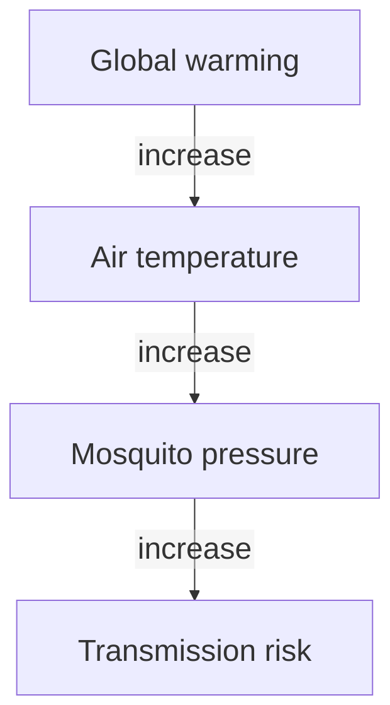

This is the proposed causal pathway, not an established result.

note:
Mosquito pressure, trapped mosquito counts, and transmission risk are distinct quantities. **This simplified hypothesis omits other determinants of transmission.** The simulation below concerns pressure and recorded counts; it does not simulate infections.

---

<!-- slide template="[[assets/fieldnote-academic/templates/fieldnote-figure-focus]]" -->

::: title
## Bed nets as sampling devices
:::

::: figure

:::

::: interpretation
Worn, non-impregnated nets trap some mosquitoes. The researchers assume these counts reflect mosquito pressure.

> [!danger]
> Implications for transmission motivate the study but are not measured directly.

:::

::: source
The scientists could not afford *active* sampling devices due to research grant budgetary constraints.
:::

note:
The researchers choose passive sampling with existing bed nets under budget constraints. Mosquitoes can enter through holes, slits, or untucked openings and remain inside until morning.

Proportionality between trapped counts and attacking mosquitoes is an assumption of the fictional measurement model, not a validated measure of transmission risk.

The simulation assumes each attacker independently enters a used net with a constant probability `bed_net_entry_rate`, remains inside, and is counted the next morning.

---

<!-- slide template="[[assets/fieldnote-academic/templates/fieldnote-figure-focus]]" -->

::: title
## Who enters the sample?
:::

::: figure

:::

::: interpretation
Only houses where someone slept under a bed net the previous night are sampled.

> [!warning]
> Owning a net does not make a house eligible.

:::

note:
Each morning the team asks about actual net use, independently of ownership. **No count is recorded for a house where the net was unused.**

---

<!-- slide template="[[assets/fieldnote-academic/templates/fieldnote-figure-focus]]" -->

::: title
## Recording nightly temperature
:::

::: figure

:::

::: interpretation
The team pairs each mosquito count with the previous night’s temperature measurements.
:::

note:
Temperature probes are installed in the surveyed villages. The morning visit retrieves both mosquito counts and the previous night’s temperature records.

**The simulation later simplifies the field design to independent house-night records**; it does not model repeated visits or village clustering.

---

<!-- slide template="[[assets/fieldnote-academic/templates/fieldnote-figure-focus]]" -->

::: title
## The observed association
:::

::: figure

:::

::: interpretation
Among sampled houses, hotter nights are associated with higher mosquito counts.

> [!evidence]
> The fitted association describes the selected data.

:::

note:
The researchers regress the recorded count on temperature. The fitted association describes the selected data. They interpret it as a causal effect without investigating how households entered the sample.

---

<!-- slide template="[[assets/fieldnote-academic/templates/fieldnote-figure-focus]]" -->

::: title
## Interpreting the result
:::

::: figure

:::

::: interpretation
The researchers interpret the association as a temperature effect and report greater transmission risk.

> [!danger]
> Two inferences need scrutiny:
> 1. from selected counts to a causal effect on mosquito pressure.
> 2. from mosquito pressure to transmission risk.

:::

note:
In this fictional story, health officials issue guidance based on that interpretation.

No infections were measured.

---

<!-- slide template="[[assets/fieldnote-academic/templates/fieldnote-figure-focus]]" -->

::: title
## Acting on the interpretation
:::

::: figure

:::

::: interpretation
In the fictional story, institutions act on the researchers’ causal interpretation.

> [!note]
> The cartoon exaggerates the policy consequences of unexamined inferences.

:::

note:
The named institutions and logos are illustrative references; the scene does not report actual WHO guidance or funding decisions.

Ask the audience what evidence is missing before moving to the sampling mechanism.

---

<!-- slide template="[[assets/fieldnote-academic/templates/fieldnote-two-column]]" -->

::: title
## The question and the sampling rule
:::

::: left
**Target:** the effect of temperature on mosquito pressure across house-nights.

*What is the ecological process underlying the data?*
:::

::: right
**Available data:** morning counts from houses where a net was used.

*What determines whether residents use a net?*
:::

note:
This consolidates the study question and observation rule. A house-night is one house on one night. The simulation has 6,000 independent records, rather than a longitudinal or clustered sampling design.

Pause for audience suggestions before revealing the two behavioural causes.

---

<!-- .slide: class="dag-slide" -->
## The assumed ecological process

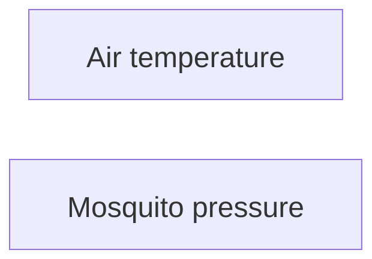

For this scenario, temperature and mosquito pressure are generated **independently**.

The true temperature effect is zero by construction. <!-- element class="lead" -->

note:
Independence is an explicit simulation assumption. **A missing direct arrow alone would not establish independence in a larger graph with common causes or indirect paths.** Here the two variables have independent generating processes.

A finite simulated dataset can still have a small nonzero estimated slope.

---

<!-- slide template="[[assets/fieldnote-academic/templates/fieldnote-figure-focus]]" -->

::: title
## Heat discourages net use
:::

::: figure

:::

::: interpretation
On hotter nights, discomfort makes residents less likely to sleep under a net.
:::

note:
This cartoon introduces the negative temperature effect on net use assumed in the scenario. It illustrates a behavioural mechanism, not an estimated temperature threshold.

Follow with the single-arrow causal diagram.

---

<!-- .slide: class="dag-slide" -->

## Temperature affects net use

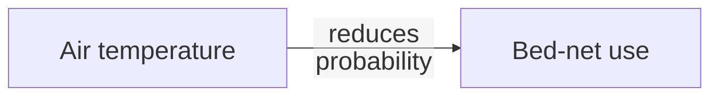

Higher temperature makes net use less likely in this scenario.

note:
The arrow denotes a causal effect on the probability of using a net. It does not mean that nobody uses a net on hot nights.

---

<!-- slide template="[[assets/fieldnote-academic/templates/fieldnote-figure-focus]]" -->

::: title
## Mosquito nuisance encourages net use
:::

::: figure

:::

::: interpretation
When mosquito nuisance is high, residents are more likely to use a net—even on a hot night.
:::

note:
The cartoon introduces the positive effect of mosquito pressure on net use. Distinguish pressure from successful bites: a net may prevent bites, while attacking mosquitoes still create the nuisance that prompts its use.

---

<!-- .slide: class="dag-slide" -->

## Mosquito pressure affects net use


More nuisance makes net use more likely in this scenario.

note:
**The toy model treats pressure as preceding the decision and does not model behavioural feedback through the night.**

---

<!-- .slide: class="dag-slide" -->

## Bed-net use is a collider

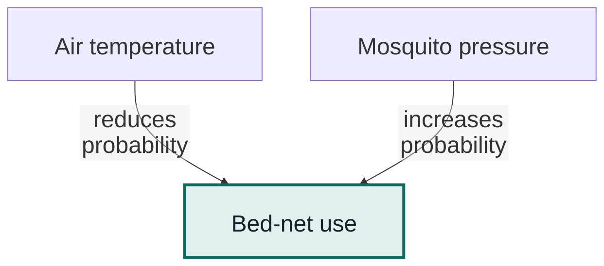

A **collider** is a variable where two arrows meet head-to-head.

note:
Temperature and mosquito pressure act in opposite directions on the same behavioural decision. Their effects on that decision do not imply a causal effect of temperature on mosquito pressure. Both variables cause bed-net use. **Merely having a collider in the graph does not create the association: selection on it, or on a descendant, opens this path.**

*Reference*: https://www.dagitty.net/learn/dsep/

---

<!-- .slide: class="dag-slide" -->

## Sampling selects net users

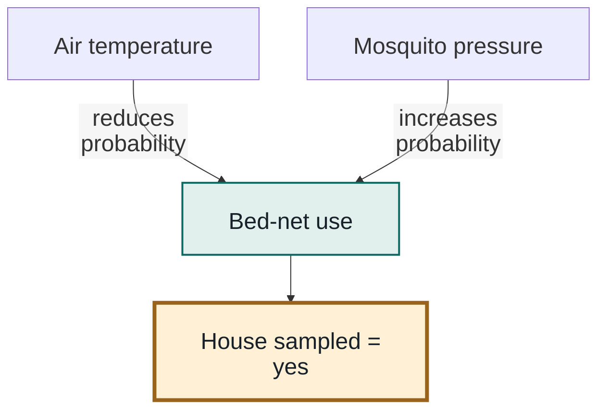

Selecting sampled houses conditions on a **descendant of the collider**.

Here, a house is sampled if and only if its net was used.

note:
The highlighted node identifies the restriction defining the dataset. In the simulation, `house_sampled` equals `bednet_used` exactly, so selecting sampled houses is equivalent to selecting net users. More generally, **conditioning on a collider’s descendant can also open the path**.

*Reference*: https://www.dagitty.net/learn/dsep/

---

<!-- .slide: class="dag-slide" -->

## Counts and observation availability

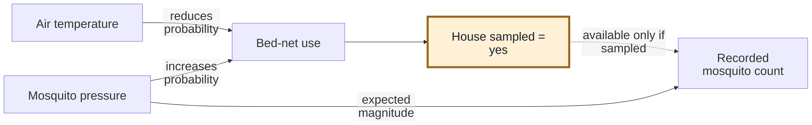

The dashed arrow denotes availability, not an ecological effect. <!-- element class="source" -->

**No sample means a missing count—not zero mosquitoes.**

note:
This combines the ecological and observation processes.

The diagram is an explanatory observation schematic: the dashed availability link must not be interpreted as an ordinary ecological causal arrow.

**A potential count could be defined for every record, but the count is recorded only for selected houses.**

Under the toy measurement model, mosquito pressure determines its expected magnitude.

---

<!-- slide bg="#e2f0ed" -->
<!-- .slide: class="takeaway-slide" -->

VERBAL EXPLANATION <!-- element class="eyebrow" -->

## Selecting net users creates an association

- On hot nights, houses with low mosquito nuisance are less likely to enter the sample.
- Houses with high nuisance are more likely to remain represented despite the heat.
- ***Among net users*, hotter nights can therefore *appear* to have more mosquitoes.**

In what follows we assess these explanations quantitatively.

note:
**This is collider selection bias.**

The example shows an association emerging after selection, rather than a reversal of a substantive population association.

**Its positive direction follows from the particular behavioural model; collider bias does not always have this sign.**

Ask the audience to predict the population and selected-sample patterns before showing the results.

---

<!-- slide bg="#132927" -->
<!-- .slide: class="section-slide" -->

# Simulating the world

note:
Live demonstration sequence: ask for predictions; show the ecological and behavioural assumptions; reveal population results before selected-sample results; then change one behavioural parameter and rerun in a separate working copy if desired. Keep the ecological process fixed when investigating selection.

---

## The data-generating mechanism

We simulate 6,000 *independent* house-nights.

1. Generate temperature and mosquito pressure independently.
2. Generate net use from temperature and mosquito nuisance.
3. Sample only records where a net was used.
4. Sample mosquito net entrants with a binomial model and entry probability.

**The true temperature effect on pressure is exactly zero.**

note:
The R objects call these records `houses`.

**This simple model represents one night per simulated house, without repeated measurements or village effects.** Its chosen coefficients are illustrative, not estimates from field data.

---

<!-- .slide: class="compact-code" -->

## R script: the ecological process

```r
set.seed(20260922)  # for reproducibility
n <- 6000L          # No. of independent samples

air_temperature_c <- rnorm(n, mean = 27, sd = 2.8)

# Poisson-lognormal mixture
true_attacking_mosquitoes <- rpois(n,    # one Poisson count per house-night
  lambda = exp(rnorm(n, log(28), 0.65))  # lognormal expected counts across house-nights
)
```

Mosquito pressure is generated independently of temperature. <!-- element class="lead" -->

note:
**The varying Poisson mean permits heterogeneity in pressure between houses;** 28 is the **median** of lambda, not its mean; 0.65 is the standard deviation of log(lambda). Temperature is not part of its generating equation.

These excerpts follow `R/01_simulate.R`; the following slides use these generated vectors directly.

--

<!-- slide template="[[assets/fieldnote-academic/templates/fieldnote-figure-wide]]" -->

::: title
## The simulated population on its original scales
:::

::: figure

:::

::: interpretation
**Temperature is approximately symmetric; mosquito pressure has a long right tail.**

All 6,000 house-nights before selection. Linear axes; bin widths: 1 °C and 10 mosquitoes. <!-- element class="caption" -->
:::

note:
These histograms show the two vectors generated on the parent slide, before standardisation, selection or capture. Both axes are linear and the complete observed ranges are retained. Bar heights are frequencies, not probability densities; the different bin widths and units mean heights should not be compared directly across panels.

Temperature follows a normal generating distribution. Attackers follow a Poisson–lognormal mixture: each house-night has its own lognormally distributed Poisson mean, creating a right-skewed count distribution. The mixture is neither a single Poisson distribution nor a lognormal distribution of counts. The median of $\lambda$ is 28, while its mean is $28 \cdot e^{(0.65^2 / 2)}$.

Marginal histograms do not establish independence; that comes from the generating model, and the subsequent scatterplot examines the realised association.

Descend from the code slide to inspect these distributions, then return to the main sequence for standardisation. To reproduce interactively, use `hist(air_temperature_c)` and `hist(true_attacking_mosquitoes)`; `R/03_make_plots.R` specifies the displayed bin boundaries.

---

<!-- .slide: class="compact-code" -->

## Standardise predictors for the behavioural model

```r
tz <- as.numeric(scale(air_temperature_c))

mz <- as.numeric(scale(true_attacking_mosquitoes))
```

- **Common units:** mean 0 and standard deviation 1.
- **Comparable changes:** each coefficient describes a one-SD increase.
- **Meaningful baseline:** the regression intercept refers to average temperature and pressure.

note:
Standardisation subtracts the mean and divides by the sample standard deviation: `z = (x - mean(x)) / sd(x)`. We use `tz` for standardised temperature and `mz` for standardised mosquito pressure throughout the model, analysis, and plotting scripts.

In the following logistic model, **-1.25 is the change in log odds of net use for a one-SD temperature increase, holding mosquito pressure fixed**; +1.75 is the corresponding change for pressure.

The intercept -1 is the log odds at both predictors' means.

**Scaling can also improve numerical conditioning when predictors have disparate scales, but it is not required for logistic regression.** It does not make skewed counts normal, remove confounding, or fix selection bias.

Run the code slides in order: this step scales the vectors generated on the preceding ecological-process slide. No pre-computed dataset is required.

---

<!-- .slide: class="compact-code" -->

## Check linear association before selection

```r
z_limits <- range(pretty(range(c(tz, mz))))
par(pty = "s")  # square plotting region

plot(tz, mz, xlim = z_limits, ylim = z_limits,
     asp = 1, xaxs = "i", yaxs = "i")

cor.test(tz, mz, method = "pearson")
```

Use the standardised variables from the previous slide.

Pearson correlation is unchanged by standardisation.  <!-- element class="lead" -->

note:
The variables are independent by construction, because their generating processes share no inputs or causal links.

A scatterplot and correlation test check the realised sample for linear association; they do not establish independence.

Use a square plotting region so the shared limits and asp = 1 give identical axis ranges and equal physical spacing per SD. Standardisation is optional for Pearson correlation: $r$, its test statistic, confidence interval, and p-value are unchanged.

The following diagnostic uses all 6,000 generated records, before any restriction to net users.

---

<!-- slide template="[[assets/fieldnote-academic/templates/fieldnote-figure-focus]]" -->

::: title
## Before selection: near-zero linear association
:::

::: figure

:::

::: interpretation
**Pearson test** · *n* = 6,000

| Statistic           |             Value |
| ------------------- | ----------------: |
| *r*                 |            0.0125 |
| 95% CI              | -0.0128 to 0.0378 |
| *t* (df = 5,998)    |            0.9698 |
| Two-sided *p*-value |            0.3322 |

No evidence of linear association; this does **not prove independence**.
:::

note:
The orange lines are least-squares fits. The standardised panel uses identical limits, tick marks, and unit spacing on both axes, covering the full range of `tz` and `mz` without clipping. Standardisation preserves Pearson correlation; the appearance changes when we give the axes a common scale. The null hypothesis is zero population Pearson correlation; the alternative is nonzero correlation.

The standard Pearson *t* test and Fisher-z confidence interval rely on distributional assumptions for exact or approximate inference. **Mosquito counts here are skewed and discrete, so treat these conventional outputs as a large-sample diagnostic, not an exact independence test.**

A nonsignificant p-value does not establish a null effect. **Independence is known from the simulation design, not inferred from this p-value.**

Full R output is saved in `data/population_correlation_test.txt`; machine-readable statistics are in `data/population_correlation.csv`. `R/run_all.R` regenerates both the output and figure.

---

<!-- .slide: class="compact-code" -->

## R script: the behavioural filter

```r
# average temperature and pressure: tz = 0, mz = 0
baseline_logit <- -1

plogis(baseline_logit)                                      # baseline net-use probability: 0.269

logit_p_net      <- baseline_logit - 1.25 * tz + 1.75 * mz  # linear predictor of prob. of net use

prob_bednet_used <- plogis(logit_p_net)                     # prob. of net use

bednet_used      <- rbinom(n, 1, prob_bednet_used)          # actual net use

house_sampled    <- bednet_used                             # house sampled where nets used
```

At average temperature and mosquito pressure (`tz = mz = 0`), **−1 is the logit of net-use probability**, corresponding to **26.9% net use**.

Heat reduces net use (`-1.25 * tz`); mosquito nuisance increases it (`+1.75 * mz`).

Actual bed net *use* for each house-night is drawn from a binomial process.

note:
The variables `tz` and `mz` are standardised temperature and pressure. When both are zero, the predictor equals the intercept, $-1 = log(p / (1 - p))$. The inverse-logit gives $p = plogis(-1) = 0.269$. **This is the conditional probability at both predictors’ means, not the average probability across all houses;** the inverse-logit is nonlinear.

The coefficients describe **changes in log odds for one-SD predictor increases,** holding the other predictor fixed. `rbinom` draws actual net use, not net ownership or allocation.

The final line implements the sampling rule exactly.

---

<!-- .slide: class="compact-code" -->

## R script: the recorded counts

```r
bed_net_entry_rate <- 0.7                            # constant prob. of net entry

# initialise count records vector
mosquitoes_counted_inside_net <- rep(NA_integer_, n) # unsampled house-nights return NA, not zero

sampled <- house_sampled == 1                        # identify count records
sample_size <- sum(sampled)                          # No. of house-nights sampled

# net entry binomial observational process
mosquitoes_counted_inside_net[sampled] <- rbinom(
  n = sample_size,
  size = true_attacking_mosquitoes[sampled],
  prob = bed_net_entry_rate
)
```

Each attacker has a **70% chance of entering**. Unsampled records remain **NA**.

note:
This is the measurement rule in `R/01_simulate.R`.

Conditional on $N$ attackers, the count is `Binomial(N, p)`, with `p = bed_net_entry_rate = 0.7`: mean `Np` and variance `Np(1-p)`. Zero attackers imply zero captures, and captures cannot exceed attackers. **The probability is illustrative and constant across houses and temperatures.**

We assume independent entry and that every entrant remains inside and is counted. This adds capture variation relative to perfect counting, not necessarily more variance than the previous Poisson measurement model.

---

<!-- slide template="[[assets/fieldnote-academic/templates/fieldnote-figure-focus]]" -->

::: title
## The behavioural/sampling filter
:::

::: figure

:::

::: interpretation
At higher temperatures, greater mosquito nuisance is needed to maintain the same probability of net use.
:::

note:
**Read the surface as the probability of entering the sample,** because net use and sampling coincide.

Ask which part of the population is least likely to be observed.

---

<!-- slide bg="#132927" -->
<!-- .slide: class="section-slide" -->

# Expected and observed results

What slopes do you expect before and after selection?

note:
Pause for predictions.

The generating effect is zero, but finite-sample estimates need not be exactly zero.

If demonstrating live, show the population plot first and the sampled plot second.

---

<!-- .slide: class="figure-slide plot-slide" -->

## Before and after selection


Log-scaled y-axes; tick labels show mosquito counts. Left: near-zero association. Right: positive association after selection. <!-- element class="caption" -->

On the left, the *population*: **near-zero** association.

On the right, the *sample*: **positive** association, after selection

note:
The panels change both selection and the measurement being plotted.

Both y-axes use the same logarithmic scale, with ticks labelled in original mosquito counts. The single zero population count cannot appear on a log axis and is omitted only from the display. The least-squares fits still include all records and use original, untransformed counts; they can appear curved on the log display.

The next comparison separates selection and measurement using true attackers in the selected sample as an intermediate step.

---

## Three comparisons separate selection from net entry

| Analysis                        | Records | Slope: mosquitoes per °C  |  
| ------------------------------- | ------: | ------------------------: |  
| All houses: true attackers      |   6,000 |                    +0.117 |  
| Sampled houses: true attackers  |   1,987 |                    +3.501 |  
| Sampled houses: recorded counts |   1,987 |                    +2.489 |  

Selection creates the positive association. <!-- element class="lead" -->

Partial net entry reduces the expected count slope to 70% of the selected-attacker slope.

note:
Slopes use the generated temperature and count vectors at full precision and are displayed to three decimals. They are *descriptive* linear associations, not causal effects inferred from the sample.

**The true-attacker analyses are available because this is a simulation; actual field investigators would not observe that latent quantity for all houses.**

---

<!-- .slide: class="compact-code" -->

## R script: the three regressions

```r
# Use the vectors and sampling indicator generated above
fit_full        <- lm(true_attacking_mosquitoes ~ air_temperature_c)

fit_sample_true <- lm(true_attacking_mosquitoes ~ air_temperature_c, subset = sampled)

fit_observed    <- lm(mosquitoes_counted_inside_net ~ air_temperature_c, subset = sampled)
```

The middle model isolates selection before partial net entry.

*Linear* regression is used to summarise the association transparently; changing to a GLM count regression would not by itself remove selection bias. <!-- element class="source" -->

note:
These are the three models in `R/02_analyse.R`.

The population model is an oracle comparison available in a simulation.

---

<!-- slide template="[[assets/fieldnote-academic/templates/fieldnote-figure-focus]]" -->

::: title
## The association appears at selection
:::

::: figure

:::

::: interpretation
Selection creates a positive attacker slope.

Partial net entry reduces the recorded-count slope while preserving the association.
:::

note:
Read the chart from top to bottom: all true attackers, selected true attackers, selected net counts. Bars show 95% confidence intervals.

**The first comparison isolates selection; the second introduces binomial net entry.**

With constant entry probability $p$, the expected count slope conditional on the selected attackers and temperatures is $p$ times their slope.

The realised count slope fluctuates around that expectation.

**The plotted slopes are on their original count scales.**

---

<!-- slide template="[[assets/fieldnote-academic/templates/fieldnote-two-column]]" -->

::: title
## Association and causal interpretation
:::

::: left
A regression can describe the observed sample **accurately** and still **fail** to answer the ecological question.
:::

::: right
Here, understanding **how records entered the dataset** is essential to interpreting the temperature slope.
:::
<br>
The linear regression is naïve but honest; association emerges due to collider selection bias. <!-- element class="lead" -->

note:
**The problem arises before model fitting.** Adding net use as a covariate cannot recover the missing comparison within a sample in which everyone used a net.

This tutorial does not claim that all selection problems have a simple statistical correction.

---

<!-- slide bg="#132927" -->
<!-- .slide: class="questions-slide" -->

# DISCUSSION

note:
Invite participants to identify the exposure, the outcome or its causes, the selection decision, and its behavioural or logistical determinants.

Sketch the proposed arrows before suggesting adjustments.

---

## Questions to investigate

| Question                                           | Change to explore                             |  
| -------------------------------------------------- | --------------------------------------------- |  
| 1. What if everyone used a net?                    | Force net use for every house                 |  
| 2. What if heat no longer affected net use?        | Set the temperature coefficient to zero       |  
| 3. What if nuisance no longer affected net use?    | Set the mosquito-pressure coefficient to zero |  
| 4. What if baseline net use changed?               | Vary `baseline_logit`                         |  
| 5. What if more mosquitoes entered the net?        | Vary `bed_net_entry_rate`                     |  
| 6. What if temperature affected mosquito pressure? | Add a direct ecological effect                |  

Predict first; change one assumption at a time.

> [!note]
> An intervention forcing universal use [Q1] differs from increasing the net-use intercept [Q4].

note:
Move down for answers, then right for the next question.

Question 1 compares a fixed population with regenerated populations; questions 2–6 use only the second approach.

Question 6 pairs observation regimes separately at each ecological effect.

For questions 2–5, each replicate generates a new population of 6,000 house-nights, then applies all scenarios to that same population.

Entry-rate variants retain that replicate’s baseline selected houses.

**Points are means; bars are central 95% Monte Carlo percentile ranges across 200 replicates, not confidence intervals.**

---

## 1. What if everyone used a net?

Under this simulation’s assumptions, what would happen to the temperature slope if every house used a net and was sampled?  <!-- element class="lead" -->

Pause and predict before revealing the answer.

note:
Keep the ecological and measurement models fixed.

**Universal use here is an imposed intervention on the toy model, not merely an increase in the net-use intercept** and not a prediction of the real effects of universal bed-net coverage.

--

<!-- slide template="[[assets/fieldnote-academic/templates/fieldnote-figure-causal]]" -->

::: title
## 1. Answer: universal use removes selection
:::

::: figure

:::

::: causal
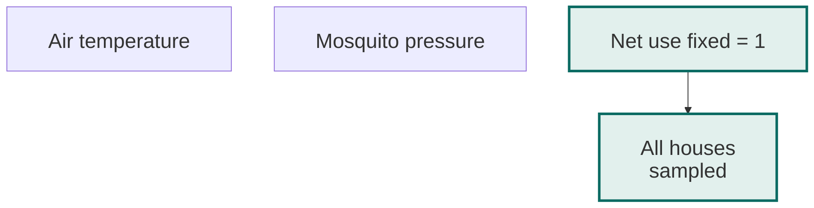
:::

::: interpretation
**Both arrows into net use are removed:** everyone is sampled.

**The slope returns close to zero** for this fixed population.
:::

note:
The diagram is the intervened graph: forcing U = 1 removes both incoming causal arrows, T → U and M → U. Sampling equals use and is now constant for everyone, so **no selective restriction opens a path between T and M.**

The disconnected temperature and pressure nodes preserve the assumed ecological independence.

The graph focuses on the selection mechanism; **the unchanged pressure-to-capture measurement model is omitted for readability.**

**Universal use removes the selection rule.**

Because this experiment holds one finite ecological population fixed, its expected count slope is 0.7 times that population’s small realised attacker slope, about 0.082, rather than exactly zero. **The displayed simulation range need not contain zero; it reflects capture randomness conditional on this fixed population, not repeated ecological populations.**

Points are means and bars are the central 95% of 200 observation/capture replicates; they are not confidence intervals or hypothesis tests.

This first comparison holds the ecological population fixed; the next slide regenerates it. `R/04_discussion.R` regenerates the baseline, simulations, summaries, and figures without reading pre-computed data.

--

<!-- slide template="[[assets/fieldnote-academic/templates/fieldnote-figure-focus]]" -->

::: title
## 1. Same intervention, two ways to repeat it
:::

::: figure

:::

::: interpretation
*Fixed population:* capture variability around +0.082.

*New population:* ecological and capture variability, mean ≈ 0.

**Chance covariance varies between populations.**
:::

note:
**The approaches answer different questions.**

With one **fixed** population, `E(count slope | T, N) = 0.7 × attacker slope ≈ 0.082`; the range is approximately [0.056, 0.103].

With **fresh** populations, the simulated mean is ≈ 0 and the range is [−0.143, 0.164].

Mechanisms and parameters stay the same; their realisations change.

These independent replicates represent new studies under the model; **they do not explicitly model spatial or temporal autocorrelation.**

Neither percentile range is a confidence interval for the ecological effect.

--

<!-- .slide: class="compact-code" -->

## 1. Reproduce and inspect the answer

```r
source("R/04_discussion.R")

subset(discussion_summary, scenario == "universal")
```

| Scenario         | Mean *n* | Mean slope |  
| ---------------- | -------: | ---------: |  
| Fixed: baseline  |    1,960 |     +2.490 |  
| Fixed: universal |    6,000 |     +0.081 |  
| New: baseline    |    1,964 |     +2.415 |  
| New: universal   |    6,000 |     +0.006 |  

200 replicates per design; slopes in mosquitoes per °C. <!-- element class="caption" -->

note:
The code displays both universal-coverage designs.

**The fixed population isolates observation/capture variability; regenerated populations also include ecological variability.**

Tables come from the same reproducible run.

---

## 2. What if heat no longer affected net use?

Set the temperature coefficient from **−1.25 to 0**, keeping nuisance and baseline net use unchanged.

Would hotter nights still select houses with greater mosquito pressure?  <!-- element class="lead" -->

Predict the count–temperature slope, then rerun the observation process.

note:
Replace the temperature term in `logit_p_net` with `0 * tz`, leaving `baseline_logit = -1` and the nuisance coefficient at 1.75. Regenerate `prob_bednet_used`, `bednet_used`, `house_sampled`, `sampled`, and recorded counts using a new population at each replicate.

**Temperature no longer causes selection, so this collider path is removed.** Under the independent ecological model and constant entry probability, the count–temperature association is zero in the population selected by this rule; finite simulations fluctuate around that expectation.

**The sample can still overrepresent high-pressure houses.**

Compare sample composition as well as the slope.

--

<!-- slide template="[[assets/fieldnote-academic/templates/fieldnote-figure-causal]]" -->

::: title
## 2. Answer: removing heat closes the path
:::

::: figure

:::

::: causal
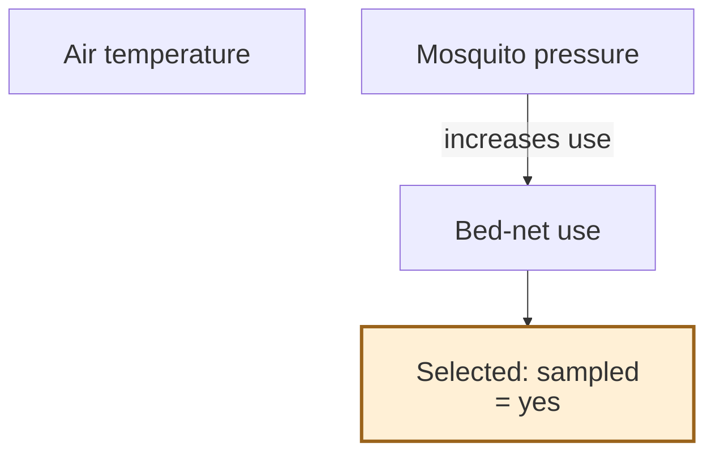
:::

::: interpretation
**Temperature → net use is removed:** selection no longer connects temperature to pressure.

High-pressure houses remain *overrepresented*.
:::

note:
Compare with the baseline collider T → U ← M → (mosquito counts), with U determining sampling. Here T → U is absent because its coefficient is zero.

The highlighted sampling node still denotes selection, but no path links temperature to mosquito pressure through U.

**M → U remains, so selection still favours high-pressure houses.**

The graph focuses on the selection mechanism; **the unchanged pressure-to-capture measurement model is omitted for readability.**

Temperature and mosquito pressure are independent in the generating model. Selection based only on pressure does not induce their dependence in that model.

**Mean attackers among selected houses rise from about 51.9 to 55.8;** absence of this bias does not imply a representative sample.

Each replicate generates a new population of 6,000 house-nights, then applies all scenarios to that same population. Entry-rate variants retain that replicate’s baseline selected houses.

Points are means; bars are central 95% Monte Carlo percentile ranges across 200 replicates, not confidence intervals.

--

<!-- .slide: class="compact-code" -->

## 2. Reproduce and inspect the answer

```r
source("R/04_discussion.R")

d <- generate_discussion_population()   # redraws without resetting the seed

observe_discussion(temperature_coef = 0, population = d)
```

| Scenario       | Mean *n* | Mean slope |
| -------------- | -------: | ---------: |
| Baseline       |    1,964 |     +2.415 |
| No heat effect |    1,787 |     +0.026 |


200 new populations; scenarios paired within each replicate. <!-- element class="caption" -->

note:
The table comes from the reproducible `R/04_discussion.R` run; subsequent commands illustrate an additional realisation whose values can differ. `generate_discussion_population()` redraws temperatures, attackers, standardised variables `tz` and `mz`, and baseline selection without resetting the seed.

Reuse `d` to compare scenarios within a replicate. Exported results identify design and replicate.

Each replicate generates a new population of 6,000 house-nights, then applies all scenarios to that same population. Entry-rate variants retain that replicate’s baseline selected houses.

Points are means; bars are central 95% Monte Carlo percentile ranges across 200 replicates, not confidence intervals.

---

## 3. What if nuisance no longer affected net use?

Set the mosquito-pressure coefficient from **+1.75 to 0**, keeping temperature and baseline net use unchanged.

Would selection for cooler nights alone create a temperature–mosquito association?  <!-- element class="lead" -->

Predict the slope and the sampled temperature distribution.

note:
Replace the nuisance term in `logit_p_net` with `0 * mz`, leaving `baseline_logit = -1` and the temperature coefficient at -1.25. Regenerate the observation process on each newly generated ecological population.

**Selection now depends on temperature but not mosquito pressure.** Given independent generating processes and a constant capture probability, **this removes the collider mechanism.**

**Cooler nights remain overrepresented**, but **the expected count–temperature association is zero.**

Sampling a narrower temperature range may alter precision. A selected sample need not represent all temperatures to lack bias from this particular collider path.

--

<!-- slide template="[[assets/fieldnote-academic/templates/fieldnote-figure-causal]]" -->

::: title
## 3. Answer: cooler nights, little association
:::

::: figure

:::

::: causal
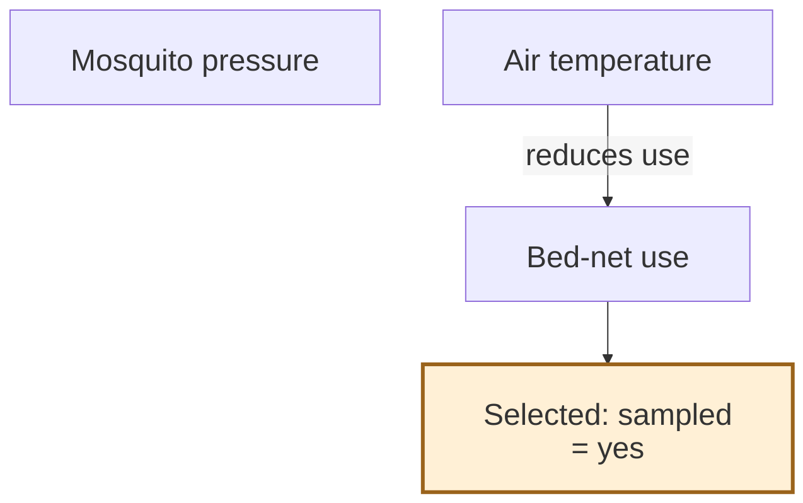
:::

::: interpretation
**Pressure → net use is removed:** selection no longer connects pressure to temperature.

Cooler nights remain *overrepresented*.
:::

note:
Compare with the baseline collider T → U ← M, with U determining sampling. Here M → U is absent because its coefficient is zero.

The highlighted sampling node still denotes selection, but U is no longer a collider on a T–M path. T → U remains, so cooler nights are still more likely to be sampled.

The graph focuses on the selection mechanism; **the unchanged pressure-to-capture measurement model is omitted for readability.**

**Mean selected temperature is about 25.13 °C versus 27.00 °C in the population. The expected association is zero, although selection changes temperature coverage and precision.**

Each replicate generates a new population of 6,000 house-nights, then applies all scenarios to that same population. Entry-rate variants retain that replicate’s baseline selected houses.

Points are means; bars are central 95% Monte Carlo percentile ranges across 200 replicates, not confidence intervals.

--

<!-- .slide: class="compact-code" -->

## 3. Reproduce and inspect the answer

```r
source("R/04_discussion.R")

d <- generate_discussion_population()   # redraws without resetting the seed

observe_discussion(nuisance_coef = 0, population = d)
```

| Scenario           | Mean *n* | Mean slope |  
| ------------------ | -------: | ---------: |  
| Baseline           |    1,964 |     +2.415 |  
| No nuisance effect |    1,897 |     +0.010 |  

200 new populations; scenarios paired within each replicate. <!-- element class="caption" -->

note:
The table comes from the reproducible `R/04_discussion.R` run; subsequent commands illustrate an additional realisation whose values can differ. `generate_discussion_population()` redraws temperatures, attackers, standardised variables `tz` and `mz`, and baseline selection without resetting the seed.

Reuse `d` to compare scenarios within a replicate. Exported results identify design and replicate.

Each replicate generates a new population of 6,000 house-nights, then applies all scenarios to that same population. Entry-rate variants retain that replicate’s baseline selected houses.

Points are means; bars are central 95% Monte Carlo percentile ranges across 200 replicates, not confidence intervals.

---

## 4. What if baseline net use changed?

Compare `baseline_logit` values **−10, −5, −4, −3, −2, −1, 0, and +1**.

At average temperature and pressure: **0.00454% at −10**, **0.67% at −5**, **26.9% at −1**, **50% at 0**, and **73.1% at +1**.

> [!question]
> How do sample size, composition, and the temperature slope change?

note:
Keep the temperature and nuisance coefficients at -1.25 and +1.75, respectively, and keep `bed_net_entry_rate` at 0.7.

Regenerate net use and capture for each intercept on the same population within a replicate; generate a fresh population for the next replicate.

The stated probabilities are conditional on `tz = mz = 0`, not population-wide sampling fractions.

**Raising the intercept increases each house's net-use probability but also changes which houses are represented; it does not merely increase sample size.**

Both parents still influence selection, so changing **the intercept does not remove the collider path.**

As net use approaches universal coverage the selected population approaches the full population, but do not promise a monotonic slope change in individual simulations or over every intercept range.

--

<!-- slide template="[[assets/fieldnote-academic/templates/fieldnote-figure-wide]]" -->

::: title
## 4. Answer: fewer houses, more variable slopes
:::

::: figure

:::

::: interpretation
**At −10: about 22 houses; mean slope +5.801, 95% range [−0.219, 13.857].**

6 of 200 slopes are negative; all remain estimable. The mean does not turn downward over the tested values.
:::

note:
The eight intercepts share one population within each replicate. The default is −1; the grid contains −10 followed by integers −5 through +1. Bars are central 95% Monte Carlo percentile ranges, not confidence intervals.

At −10: 14–32 houses (mean 21.88), about 181 attackers per selected house, and 6 negative slopes out of 200. Mean coverage is 0.365%, versus 0.00454% at average predictors.

At −5 the smallest sample contains 235 houses; all 200 slopes are estimable at every intercept. High pressure still encourages use.

The mean slope remains monotonic over tested values, without a general guarantee. No points between −10 and −5 were simulated.

Results have been regenerated after changing the default to −1; Q4’s dedicated seed causes small differences between its baseline and the other questions’ baseline.

--

<!-- .slide: class="compact-code" -->

## 4. Reproduce and inspect the answer

```r
source("R/04_discussion.R")

d <- generate_discussion_population()

observe_discussion(baseline_logit = -10, population = d)
```

| Intercept | Mean *n* | Mean attackers | Mean slope |
| --------- | -------: | -------------: | ---------: |
| -10       |       22 |          181.1 |     +5.801 |
| -5        |      268 |           94.6 |     +4.495 |
| -4        |      459 |           80.8 |     +4.010 |
| -3        |      774 |           69.4 |     +3.469 |
| -2        |    1,266 |           59.7 |     +2.918 |
| -1        |    1,964 |           52.0 |     +2.384 |
| 0         |    2,842 |           45.9 |     +1.816 |
| 1         |    3,774 |           41.6 |     +1.299 |

200 new populations; scenarios paired within each replicate. <!-- element class="caption" -->

note:
The table comes from `data/intercept_summary.csv`; `data/intercept_replicates.csv` retains all 1,600 results, including any missing slopes. `valid_slopes` and `empty_samples` explicitly report estimability problems.

This eight-value experiment uses a separate seed, preserving other questions. Its −1 baseline therefore differs slightly from other tables through Monte Carlo variation.

The code illustrates one additional realisation rather than reproducing the means.

--

## 4. Lower baseline use makes inclusion more unequal

At average temperature ($T_z=0$), compare average pressure ($M_z=0$) with very high pressure ($M_z=4$).

$$
\Pr(U = 1 \mid T_z, M_z)
=
\operatorname{logit}^{-1}
(\alpha - 1.25T_z + 1.75M_z)
\\
p_0=\operatorname{logit}^{-1}(\alpha),
\qquad
p_4=\operatorname{logit}^{-1}(\alpha+7)
$$

| $\alpha$ | Net use at $M_z=0$ ($p_0$) | Net use at $M_z=4$ ($p_4$) | Relative increase |
|---------:|---------------------------:|---------------------------:|------------------:|
| −1       | 26.89%                     | 99.75%.                    | **+271%**         |
| −5       | 0.669%                     | 88.08%                     | **+13,060%**      |
| −10      | 0.00454%                   | 4.743%                     | **+104,367%**     |

Relative increase = $100(p_4-p_0)/p_0$.
Calculated probabilities at fixed temperature, not simulation averages.
<!-- element class="caption" -->

> [!evidence]
> Lower baseline use reduces inclusion in both groups, but increases the relative sampling advantage of high-pressure house-nights.

note:
Read the table in two directions. Down each probability column, lowering alpha makes net use less likely at either pressure level. Across each row, high pressure makes net use more likely. The final column shows that this relative advantage grows sharply as alpha falls.

The relative increase is $100 × (p_4 − p_0) / p_0$, not the difference between two percentages expressed in percentage points. An increase of 271% means a probability 3.71 times as large, not 2.71 times. The corresponding probability ratios are approximately 3.71, 131.60, and 1,044.67. Calculate these from unrounded probabilities.

The nuisance coefficient remains 1.75 throughout. A four-SD pressure increase therefore multiplies the odds of net use by `exp(7)` in every row. However, a constant odds ratio does not imply a constant probability ratio. When use is already likely, probabilities approach their ceiling of one; when baseline use is very low, high pressure can confer a much larger relative advantage in inclusion.

These two pressure levels illustrate the mechanism; they are not the only levels present in the population. Actual sample composition also depends on how many house-nights occur at each pressure and temperature. The simulation averages over that complete distribution.

**A smaller random sample would not systematically have higher mean pressure. Here, mean pressure increases because the reduction in sampling is selective, not merely because fewer records remain.**

**The ecological population remains the same.**

---

## 5. What if more mosquitoes entered the net?

1. Compare `bed_net_entry_rate` values **0.1, 0.3, 0.7, and 0.9**.
2. Within each replicate, use the same selected houses for all entry rates.
3. Generate a new population and selection for the next replicate.

> [!question]
> Does a steeper slope mean a stronger ecological temperature effect?

note:
Conditional on each selected sample, the expected count slope is $p$ times its attacker slope.

**Increasing $p$ changes count scale and variability; a raw slope is not a standardised measure of association.**

The supplementary notes exercise keeps one population fixed; this figure regenerates populations. Each replicate generates a new population of 6,000 house-nights, then applies all scenarios to that same population. Entry-rate variants retain that replicate’s baseline selected houses.

Points are means; bars are central 95% Monte Carlo percentile ranges across 200 replicates, not confidence intervals.

--

<!-- slide template="[[assets/fieldnote-academic/templates/fieldnote-figure-focus]]" -->

::: title
## 5. Answer: higher entry increases the count slope
:::

::: figure

:::

::: interpretation
Same selected houses within each replicate. New population between replicates.

**Expected count slope = entry probability × selected-attacker slope.**

The ecological effect is still zero.
:::

::: source
As `bed_net_entry_rate` approaches zero, the expected recorded-count slope approaches zero. At exactly zero, all recorded counts—and their fitted linear slope—are zero, so captures provide no information about the underlying attacking-mosquito–temperature relationship.
:::

note:
The expected slope is $p$ times the selected-attacker slope within each replicate. Baseline and entry = 0.7 share selected houses but draw independent captures; their means are therefore close, rather than identical.

Each replicate generates a new population of 6,000 house-nights, then applies all scenarios to that same population. Entry-rate variants retain that replicate’s baseline selected houses.

Points are means; bars are central 95% Monte Carlo percentile ranges across 200 replicates, not confidence intervals.

--

<!-- .slide: class="compact-code" -->

## 5. Reproduce and inspect the answer

```r
source("R/04_discussion.R")

d <- generate_discussion_population()   # redraws without resetting the seed

observe_discussion(entry_rate = 0.9, fixed_sample = TRUE, population = d)
```

| Scenario | Mean *n* | Mean slope |  
| -------- | -------: | ---------: |  
| 0.1      |    1,964 |     +0.343 |  
| 0.3      |    1,964 |     +1.034 |  
| 0.7      |    1,964 |     +2.413 |  
| 0.9      |    1,964 |     +3.106 |  

200 new populations; scenarios paired within each replicate. <!-- element class="caption" -->

note:
The table comes from the reproducible `R/04_discussion.R` run; subsequent commands illustrate an additional realisation whose values can differ. `generate_discussion_population()` redraws temperatures, attackers, standardised variables `tz` and `mz`, and baseline selection without resetting the seed.

Reuse `d` to compare scenarios within a replicate. Exported results identify design and replicate.

Each replicate generates a new population of 6,000 house-nights, then applies all scenarios to that same population. Entry-rate variants retain that replicate’s baseline selected houses.

Points are means; bars are central 95% Monte Carlo percentile ranges across 200 replicates, not confidence intervals.

---

## 6. What if temperature affected mosquito pressure?

Introduce a **direct causal effect** $\beta$ of temperature on attacking mosquitoes, while retaining both influences on net use.

> [!question]
> Does sampling net users recover, amplify, or attenuate the ecological relationship?

Explore a **negative, zero, then positive** effect.

note:
This question changes the causal model.

Dependence could also arise from shared environmental causes; here we explicitly choose T → M.

Net use changes neither attacker abundance nor entry probability in this toy model; it determines whether counts are available.

--

<!-- .slide: class="compact-code" -->

## Temperature effect on pressure

```r
temperature_effect <- 0.3  # beta

n <- 6000L

air_temperature_c <- rnorm(n, mean = 27, sd = 2.8)
tz <- as.numeric(scale(air_temperature_c))  # standardised temperature (as before)

Z <- rnorm(n, mean = 0, sd = 0.65)  # random effects in house-night log expected pressure
log_pressure <- log(28) + temperature_effect * tz + Z  # temperature-dependent log(lambda)

true_attacking_mosquitoes <- rpois(n, lambda = exp(log_pressure))  # realised house-night pressure
mz <- as.numeric(scale(true_attacking_mosquitoes))  # standardised realised pressure

prob_bednet_used <- plogis(-1 - 1.25 * tz + 1.75 * mz)  # probability of net use
```

$N\mid T_z,Z \sim \operatorname{Poisson}(\lambda)$, so $E[N\mid T_z,Z]=\lambda$.

$\log(\lambda)=\log(28)+\beta T_z+Z$, $Z\sim\mathcal{N}(0,0.65^2)$, $Z\perp T_z$.

$Z$: house-night heterogeneity in log expected pressure, independent of temperature.

A one-SD increase in temperature—one unit of `tz`—multiplies expected mosquito pressure by $e^\beta$; $\beta=0.3$ gives approximately **×1.35, or a 35% increase**.

note:
This slide adds a direct ecological effect of temperature while retaining the behavioural filter introduced earlier. Follow the generating sequence: generate temperature; standardise it; generate expected mosquito pressure from temperature and independent house-night heterogeneity; draw the actual number of attackers; standardise those counts; then calculate the probability of net use.

$N$ is the actual number of attacking mosquitoes in a house-night. $\lambda$ is its conditional expected value, given standardised temperature and the house-night effect $Z$. The Poisson draw generates an integer count around that expectation; the realised count need not equal $\lambda$.

**$Z$ is a random house-night effect on log expected mosquito pressure, not a standardised score.** The code draws one value per house-night from a normal distribution with mean zero and standard deviation 0.65. **It represents ecological heterogeneity not explained by temperature.** Positive values increase expected pressure and negative values decrease it. In this toy model, these effects are generated independently of temperature. This is an assumption, not a claim that all unmeasured influences on mosquito pressure would be independent of temperature in a real study.

The equation can also be read as $\lambda=28\times e^{\beta T_z}\times e^Z$. Temperature and house-night heterogeneity act additively on log expected pressure and multiplicatively on expected pressure. The normal draw introduces differences in expected pressure among house-nights, while the subsequent Poisson draw introduces variation in actual attacker counts around those expectations. These are ecological components of the simulation, not the later process of mosquito entry into a net.

**Interpret $\beta$ on the correct response scale.** A one-standard-deviation increase in temperature corresponds to a one-unit increase in `tz`. Holding $Z$ fixed, it multiplies expected attacker count by $e^\beta$. With $\beta=0.3$, the multiplier is approximately 1.35: a 35% increase in expected mosquito pressure. It is not an increase of 1.35 standard deviations in `mz`, nor a guarantee that two individual house-nights differ by exactly 35%.

The same multiplier holds after averaging over the independent distribution of $Z$: $E[N\mid T_z]=28\exp(\beta T_z+0.65^2/2)$. At average temperature, the expected count is therefore approximately 34.6, not 28. The value 28 is the conditional expectation when both $T_z=0$ and $Z=0$; it is also the median of the distribution of $\lambda$ at $T_z=0$, not necessarily the median of the realised mosquito counts.

`mz` is calculated only after generating the attacker counts. It expresses those counts in standard-deviation units for the behavioural filter; it does not change the response scale of the ecological model. The same temperature variable now enters two different processes: $\beta$ changes log expected mosquito pressure, whereas −1.25 changes the log odds of net use. Their coefficients are not directly comparable because their response scales differ.

The final line computes net-use probabilities only. Actual net use, selection, and captured counts are generated in subsequent steps. Standardisation uses the complete generated population before selection and is not recalculated within the selected sample.

**The teaching question is whether selective observation recovers or distorts an ecological relationship that now genuinely exists in the simulated world.** The ecological coefficient $\beta$ is not the fitted linear count–temperature slope shown in the subsequent comparisons.

--

<!-- slide template="[[assets/fieldnote-academic/templates/fieldnote-figure-causal]]" -->

::: title
## 6. Answer: two paths contribute
:::

::: figure

:::

::: causal
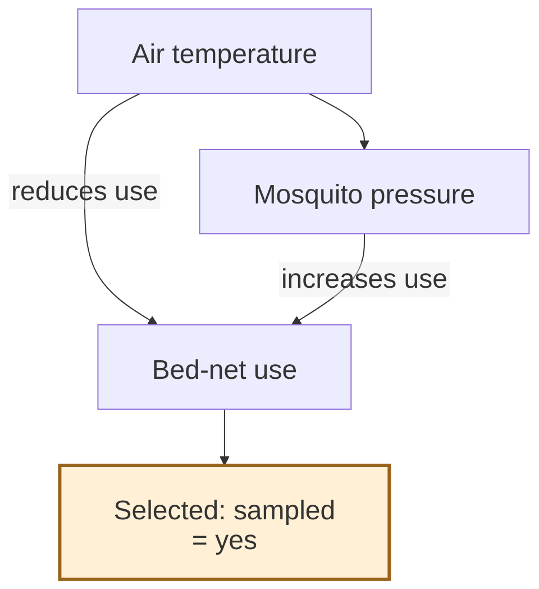
:::

::: interpretation
**An ecological path now exists: T → M.**

Selection also opens the collider path T → U ← M. The observed relationship reflects both processes.
:::

note:
One example with temperature_effect = 0.3: each one-SD temperature increase in the complete generated population multiplies expected abundance by exp(0.3), about 1.35.

Both panels share the population, capture draws, and axis limits. Selection reveals a subset of the same potential counts. The vertical axis displays log(1 + count), with original counts as ticks, including zeros.

Curves are linear regressions on raw counts, transformed only for display; negative predictions are omitted. They are descriptive fits, not the exponential generating model. The graph focuses on selection; the unchanged capture model is omitted.

--

<!-- slide template="[[assets/fieldnote-academic/templates/fieldnote-figure-focus]]" -->

::: title
## 6. Vary the ecological effect
:::

::: figure

:::

::: interpretation
**Compare with universal coverage at the same ecological effect.**

At −0.15, the sign reverses; at +0.30, the positive slope is amplified.

The generating coefficient and count slope have different units.
:::

note:
For each effect, 200 independent populations of 6,000 house-nights are generated. Within a replicate, universal coverage and net users share the same captures, with entry probability 0.7. Bars are central 95% Monte Carlo percentile ranges, not confidence intervals.

The vertical line at zero marks the original ecological model.

The ecological coefficient $\beta$ acts on log expected abundance per temperature SD in the complete generated population; the fitted slope describes mosquitoes per °C. Their numerical difference is therefore not a bias measure. Compare the two count slopes instead.

`tz` and `mz` are recomputed in every complete population before selection: **temperature and nuisance sensitivity are held constant per realised standard deviation, not per degree or mosquito.**

Changing the ecological effect also changes marginal pressure; the ecological intercept holds expected abundance at `tz = 0`, the generated population's mean temperature, constant, not its marginal mean.

--

<!-- .slide: class="compact-code" -->

## 6. Reproduce and compare the slopes

```r
source("R/04_discussion.R")

d <- generate_ecological_population(temperature_effect = 0.3)

ecological_slopes(d)

subset(ecological_summary, temperature_effect %in% c(-0.15, 0, 0.3))
```

| Effect | Universal | Net users | Difference |  
| ------ | --------: | --------: | ---------: |  
| -0.15  |    -1.307 |    +0.703 |     +2.009 |  
| +0.00  |    +0.006 |    +2.398 |     +2.392 |  
| +0.30  |    +2.717 |    +5.716 |     +2.999 |  

200 populations per effect; slopes in mosquitoes per °C. <!-- element class="caption" -->

note:
`R/04_discussion.R` generates all results without pre-computed data. `generate_ecological_population()` calculates `tz = as.numeric(scale(air_temperature_c))`, draws `Z = rnorm(n, 0, 0.65)`, and uses `log_pressure = log(28) + temperature_effect * tz + Z`, followed by Poisson counts and the existing net-use model. `mz` is calculated from the realised attackers before selection.

The first output illustrates an additional realisation; the table summarises the 200 seeded replicates.

Difference = selected slope − universal slope within the same replicate.

Results are exported to `data/ecological_replicates.csv` and `data/ecological_summary.csv`. The replicate file also contains `expected_universal`, the expected universal OLS count slope conditional on that population's temperatures, integrated over ecological heterogeneity and capture.

A negative universal slope and positive selected slope illustrate reversal; the selected regression alone cannot establish a new causal effect.

---

<!-- slide bg="#132927" -->
<!-- .slide: class="questions-slide" -->

# CONCLUSIONS

note:
Final take-home message, study design, and model improvements.

---

<!-- slide bg="#e2f0ed" -->
<!-- .slide: class="takeaway-slide" -->

TAKE-HOME MESSAGE <!-- element class="eyebrow" -->
## Distinguish the ecological and observational processes

1. Specify the ecological question and its causal assumptions.
2. Map the process that determines which observations are available.
3. Check whether selection depends on both exposure and outcome causes.

> [!warning]
> A sample of net users does not automatically represent all houses.

note:
Connect these messages to the participants’ fieldwork examples.

Colliders are properties of paths in a causal graph; an association alone cannot identify the selection mechanism.

---

<!-- slide bg="#e2f0ed" -->
<!-- .slide: class="takeaway-slide" -->

Designing a more informative study <!-- element class="eyebrow" -->
## How could we measure mosquito pressure independently of residents’ decisions to use nets?

1. Consider sampling house-nights irrespective of net use, with a measurement method that works in both groups.
2. Record net use and the reasons observations are missing.

> [!evidence]
> Observing net use helps diagnose selection but does not, by itself, identify the missing mosquito counts or guarantee an unbiased causal estimate.

note:
The design goal is to break the dependence of observation on the behavioural collider.

Ask participants to propose and assess an appropriate entomological measurement method; this deck does not validate a specific device.

---

<!-- slide template="[[assets/fieldnote-academic/templates/fieldnote-figure-focus]]" -->
<!-- .slide: class="disclaimer-dag-slide" -->

::: title
## Model improvements: seasonal confounding
:::

::: figure
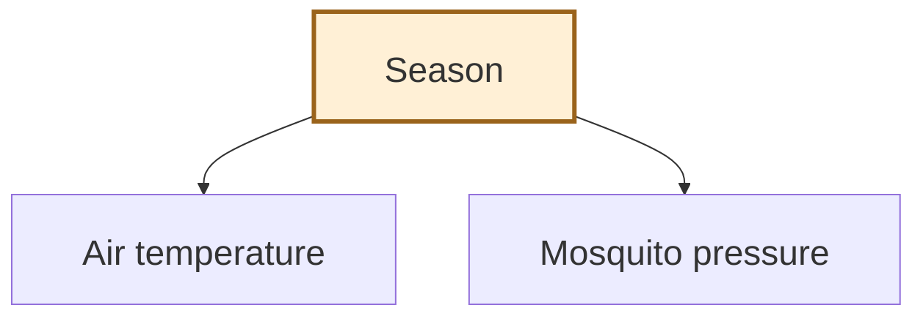
:::

::: interpretation
**A shared cause can create an association.**

Season may affect both temperature and mosquito pressure, even without a direct temperature effect.

This pathway is omitted from the previous toy models.
:::

::: source
A realistic study must investigate seasonal pathways alongside selection.
:::

note:
The toy models isolate selected mechanisms; **they are not complete causal accounts of mosquito ecology or observation.**

**Season represents seasonal processes that may jointly influence air temperature and mosquito pressure. This common-cause pathway can produce a population association even without a direct temperature effect on pressure.**

**Temperature may also affect mosquito behaviour and the probability of entering a net**, as discussed in the next slide. If entry probability varies with temperature, recorded counts can depend on temperature even under universal coverage and without a temperature effect on attacking abundance.

**Universal coverage removes the net-use selection mechanism in the toy model; it does not remove seasonal confounding or temperature-dependent capture.**

A realistic analysis should specify relevant seasonal processes and time scales, investigate capture efficiency across temperatures, and assess these pathways using field knowledge, calibration data, and sensitivity analyses. Question 6 adds a direct ecological effect but still omits these two pathways.

None of the simulation results establishes whether these omitted effects are present or how large they are in the field.

---

<!-- slide template="[[assets/fieldnote-academic/templates/fieldnote-figure-focus]]" -->
<!-- .slide: class="disclaimer-dag-slide" -->

::: title
## Model improvements: temperature-dependent capture
:::

::: figure
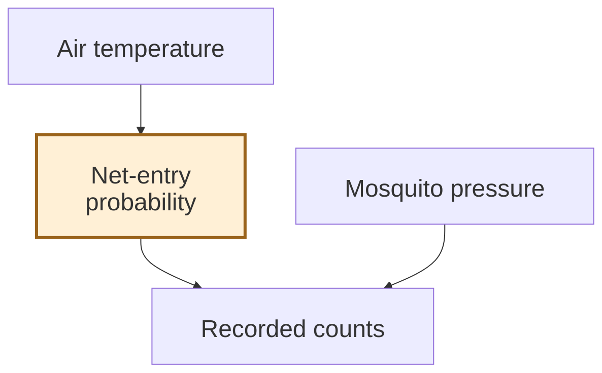
:::

::: interpretation
**Counts reflect abundance and capture.**

Temperature may change `bed_net_entry_rate`, even if attacking abundance stays constant.

Universal coverage does not remove this pathway.
:::

::: source
An association in recorded counts need not be an ecological temperature effect.
:::

note:
The highlighted entry probability is a measurement mechanism. Mosquito pressure also determines recorded counts, so both causes are shown. This diagram isolates the omitted capture pathway; it does not replace the net-use selection graph or assert that all other paths are absent.

All scenarios, including question 6, hold entry probability constant within a scenario. A realistic study should investigate temperature-dependent capture alongside seasonal confounding and selection.

Universal coverage alone resolves neither omitted pathway.

---

<!-- slide template="[[assets/fieldnote-academic/templates/fieldnote-figure-wide]]" -->

::: title
## An expanded causal model to investigate
:::

::: figure
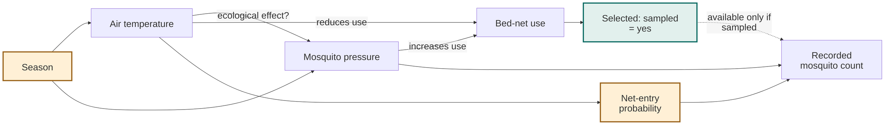
:::

::: interpretation
**Ecology, seasonal confounding, selection, and capture all matter.**

The dashed link denotes observation availability; proposed causal effects require investigation.
:::

note:
This combines the mechanisms explored separately in the presentation.

Season is a common cause of temperature and mosquito pressure.

The T → M arrow represents the direct ecological effect to investigate; its presence and magnitude are not established here, and the zero-effect model omits it.

T → U ← M remains the behavioural collider, with sampling determined by net use.

Temperature also affects entry probability, while both pressure and entry determine potential captured counts.

The dashed sampling-to-count link denotes whether a count is recorded; it is an observation-availability link, not an ecological effect on abundance or a claim that missing counts equal zero. The highlighted sampling node marks the restriction defining the available dataset.

**This is an expanded causal and observation schematic, not a claim that every relevant pathway has been included.** It still omits possible feedback, other environmental causes, and heterogeneity in measurement. The seasonal and entry pathways are proposed extensions, not additions already fitted or simulated by the existing scripts.

Discuss which arrows field knowledge supports and which data could identify their effects. **Universal sampling alone would not resolve seasonal confounding or temperature-dependent capture.**

---

# Disclaimer

> [!warning] _Nota Bene_
> - This fictional study and its simulated results illustrate selection bias.
> - They do not establish the presence or absence of real effects of temperature or climate change on mosquito-borne transmission.
> - Named institutions appear in illustrative cartoons. The depicted policies, statements, and funding decisions are fictional and imply no endorsement.

note:
The ecological independence assumption serves only to isolate the observation mechanism. This presentation makes no assessment of the scientific evidence underlying actual WHO policies or funding decisions. Climate and environmental questions require evidence appropriate to the ecological processes and populations under study.

---

<!-- slide bg="#132927" -->
<!-- .slide: class="questions-slide" -->

# Homework

What part of your own mosquito-fieldwork pipeline could select observations according to both exposure and mosquito pressure? <!-- element class="subtitle" -->

note:
Ask participants to come up with their own examples at the next meeting.

---

<!-- .slide: class="references-slide" -->
<!-- slide template="[[assets/fieldnote-academic/templates/fieldnote-references]]" -->

::: title
## Selected references
:::

::: references
1. Lindsay SW, Schellenberg JRMA, Zeiler HA, Daly, RJ, Salum, FM, Wilkins, HA Exposure of Gambian children to *Anopheles gambiae* malaria vectors in an irrigated rice production area. *Medical and Veterinary Entomology* **9**, 50–58 (1995). <a href="https://doi.org/10.1111/j.1365-2915.1995.tb00116.x" target="_blank" rel="noopener noreferrer">10.1111/j.1365-2915.1995.tb00116.x</a> **Mosquito survey using the bed net method**
2. Pulford J, Hetzel MW, Bryant M, Siba PM, Mueller I. Reported reasons for not using a mosquito net when one is available: a review of the published literature. _Malaria Journal_ **10**, 83 (2011). <a href="https://doi.org/10.1186/1475-2875-10-83" target="_blank" rel="noopener noreferrer">10.1186/1475-2875-10-83</a> **Heat reported as one reason for decreased bed net use**
3. Moiroux N, Boussari O, Djénontin A, Damien G, Cottrell G, Henry M-C, *et al.* Dry season determinants of malaria disease and net use in Benin, West Africa. _PLoS One_ **7**, e30558 (2012). <a href="https://doi.org/10.1371/journal.pone.0030558" target="_blank" rel="noopener noreferrer">10.1371/journal.pone.0030558</a> **Increased bed net use with greater mosquito nuisance**
4. Briët, OJT, Yukich, JO, Pfeiffer, C _et al._ The effect of small solar powered ‘Bͻkͻͻ’ net fans on mosquito net use: results from a randomized controlled cross-over trial in southern Ghana. _Malaria Journal_ **16**, 12 (2017). <a href="https://doi.org/10.1186/s12936-016-1654-2" target="_blank" rel="noopener noreferrer">10.1186/s12936-016-1654-2</a> **Bed net usage in more confortable thermic conditions**
:::

::: note
Studies investigating some factors discussed in this presentation.
:::
