<!-- slide template="[[assets/fieldnote-academic/templates/fieldnote-title-footer]]" -->
<!-- .slide: class="title-slide" -->

# Collisionneurs en entomologie médicale

Comment un échantillonnage sélectif dû à l’utilisation des moustiquaires peut créer un effet apparent d’une covariable environnementale

Une étude de terrain fictive avec des données simulées <!-- element class="subtitle" -->

**Carlo Costantini • 24 sept. 2026** <!-- element class="byline" -->

 <!-- element class="title-decoration" -->

[![[assets/licensing/cc-by.svg|118]]](https://creativecommons.org/licenses/by/4.0/deed.fr) <!-- element class="corner-logo" -->

::: footer
[](https://mivegec.fr/) [](https://www.ird.fr/) [](https://www.cnrs.fr/) [](https://www.umontpellier.fr/)
:::

note:
Ce tutoriel distingue le processus écologique du processus d’observation. Le scénario source est `source/colliders_medical_entomology.md`. L’absence supposée d’effet de la température est un dispositif pédagogique, et non une conclusion sur l’écologie réelle des moustiques ou le changement climatique.

---

## À propos de cette présentation

> [!warning] _Nota Bene_
> - L’étude, les résultats et les réactions institutionnelles représentés dans les dessins sont fictifs.
> - Les illustrations ne représentent aucune politique ni action réelle des institutions citées.

note:
Présenter ce cadre avant les dessins. L’avertissement final reprend et développe ces limites.

---

<!-- slide template="[[assets/fieldnote-academic/templates/fieldnote-figure-focus]]" -->

::: title
## La question de recherche
:::

::: figure

:::

::: interpretation
Une température de l’air plus élevée augmente-t-elle le nombre de moustiques attaquant un hôte ?
:::

note:
Dans un contexte de préoccupations concernant le changement climatique et les maladies vectorielles, des chercheurs étudient la température nocturne et la pression des moustiques. Cette pression désigne ici le nombre de moustiques tentant de piquer un hôte, et non le nombre de piqûres réussies.

---

<!-- slide template="[[assets/fieldnote-academic/templates/fieldnote-figure-focus]]" -->

::: title
## L’objectif de l’étude
:::

::: figure

:::

::: interpretation
Les chercheurs souhaitent estimer l’effet causal de la température nocturne sur la pression des moustiques.
:::

::: source
Pression = abondance par hôte des moustiques attaquants tentant de piquer, et non le nombre de piqûres réussies.
:::

note:
La question visée concerne un effet écologique. Une régression des comptages disponibles sur la température n’y répond pas automatiquement. **Les conséquences possibles pour la transmission motivent l’étude, mais ne sont pas mesurées directement.**

---

<!-- .slide: class="dag-slide" -->

## L’hypothèse des chercheurs

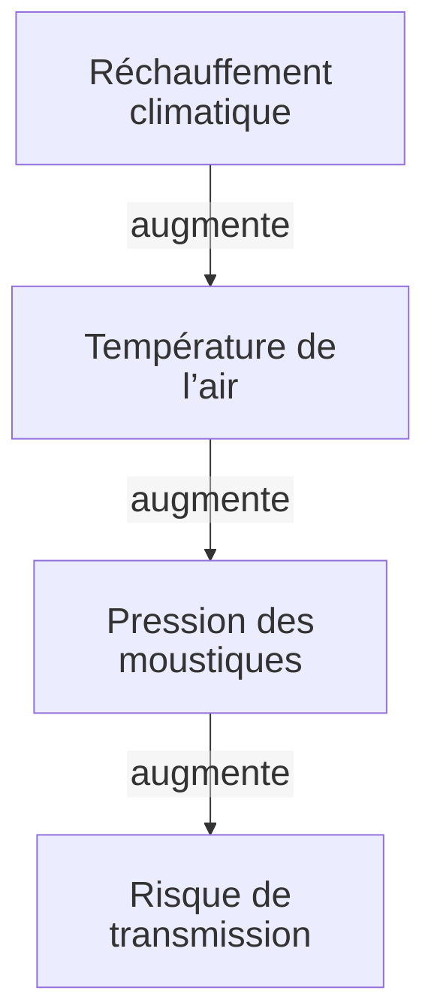

Il s’agit du chemin causal proposé, et non d’un résultat établi.

note:
La pression des moustiques, les comptages dans les pièges et le risque de transmission sont des quantités distinctes. Cette hypothèse simplifiée omet d’autres déterminants de la transmission. La simulation porte sur la pression et les comptages ; elle ne simule pas les infections.

---

<!-- slide template="[[assets/fieldnote-academic/templates/fieldnote-figure-focus]]" -->

::: title
## Les moustiquaires comme pièges
:::

::: figure

:::

::: interpretation
Les moustiquaires usées et non imprégnées piègent certains moustiques. Les chercheurs supposent que ces comptages reflètent la pression des moustiques.

> [!danger]
> Les conséquences pour la transmission motivent l’étude, mais ne sont pas mesurées directement.

:::

::: source
Faute de budget, les scientifiques n’ont pas pu s’offrir des dispositifs d’échantillonnage *actifs*.
:::

note:
Sous contrainte budgétaire, les chercheurs choisissent un échantillonnage passif avec les moustiquaires existantes. Les moustiques peuvent entrer par des trous, des fentes ou des ouvertures non bordées et rester à l’intérieur jusqu’au matin. La proportionnalité entre comptages et attaquants est une hypothèse du modèle fictif de mesure, pas une mesure validée du risque de transmission. Chaque attaquant entre indépendamment dans une moustiquaire utilisée avec la probabilité bed_net_entry_rate = 0.7, y reste et est compté le lendemain matin.

---

<!-- slide template="[[assets/fieldnote-academic/templates/fieldnote-figure-focus]]" -->

::: title
## Qui entre dans l’échantillon ?
:::

::: figure

:::

::: interpretation
Seules les maisons où quelqu’un a dormi sous une moustiquaire la nuit précédente sont échantillonnées.

> [!evidence]
> Posséder une moustiquaire ne rend pas la maison éligible.

:::

note:
Chaque matin, l’équipe interroge les habitants sur l’utilisation effective, indépendamment de la possession d’une moustiquaire. **En posséder une ne suffit pas à rendre la maison éligible.** Aucun comptage n’est enregistré lorsqu’elle n’a pas été utilisée.

---

<!-- slide template="[[assets/fieldnote-academic/templates/fieldnote-figure-focus]]" -->

::: title
## Mesurer la température nocturne
:::

::: figure

:::

::: interpretation
L’équipe associe chaque comptage aux mesures de température de la nuit précédente.
:::

note:
Des sondes de température sont installées dans les villages étudiés. La visite matinale permet de recueillir les comptages et les températures de la nuit précédente. La simulation simplifie ensuite le dispositif en observations maison-nuit indépendantes ; elle ne modélise ni les visites répétées ni le regroupement par village.

---

<!-- slide template="[[assets/fieldnote-academic/templates/fieldnote-figure-focus]]" -->

::: title
## L’association observée
:::

::: figure

:::

::: interpretation
Dans les maisons échantillonnées, les nuits plus chaudes sont associées à des comptages plus élevés.

> [!evidence]
> L’association ajustée décrit les données sélectionnées.

:::

note:
Les chercheurs régressent les comptages sur la température. L’association ajustée décrit les données sélectionnées. Ils l’interprètent comme un effet causal sans examiner comment les maisons sont entrées dans l’échantillon.

---

<!-- slide template="[[assets/fieldnote-academic/templates/fieldnote-figure-focus]]" -->

::: title
## Interpréter le résultat
:::

::: figure

:::

::: interpretation
Les chercheurs interprètent l’association comme un effet de la température et concluent à un risque accru de transmission.

> [!danger]
> Deux inférences doivent être examinées :
> 1. des comptages sélectionnés vers un effet causal sur la pression des moustiques.
> 2. de la pression des moustiques vers le risque de transmission.

:::

note:
Dans ce récit fictif, les responsables sanitaires diffusent des recommandations fondées sur cette interprétation. Deux inférences doivent être examinées : des comptages sélectionnés vers un effet causal sur la pression, puis de la pression vers le risque de transmission. Aucune infection n’a été mesurée.

---

<!-- slide template="[[assets/fieldnote-academic/templates/fieldnote-figure-focus]]" -->

::: title
## Agir sur cette interprétation
:::

::: figure

:::

::: interpretation
Dans ce récit fictif, les institutions agissent sur la base de l’interprétation causale des chercheurs.

> [!note]
> Le dessin exagère les conséquences politiques d’inférences non examinées.

:::

note:
**Le dessin exagère les conséquences politiques d’une inférence non examinée.** Les institutions et logos sont des références illustratives ; la scène ne rapporte aucune recommandation réelle de l’OMS ni décision réelle de financement. Demander quelles preuves manquent avant de présenter le mécanisme d’échantillonnage.

---

<!-- slide template="[[assets/fieldnote-academic/templates/fieldnote-two-column]]" -->

::: title
## La question et la règle d’échantillonnage
:::

::: left
**Cible :** l’effet de la température sur la pression des moustiques parmi les maisons-nuits.

Quel est le processus écologique sous-jacent aux données ?
:::

::: right
**Données disponibles :** les comptages matinaux dans les maisons où une moustiquaire a été utilisée.

Qu’est-ce qui détermine l’utilisation d’une moustiquaire ?
:::

note:
Cette diapositive réunit la question de recherche et la règle d’observation. Une maison-nuit correspond à une maison pendant une nuit. La simulation contient 6 000 observations indépendantes, sans plan longitudinal ni échantillonnage en grappes. Recueillir les propositions du public avant de révéler les deux causes comportementales.

---

<!-- .slide: class="dag-slide" -->

## Le processus écologique supposé

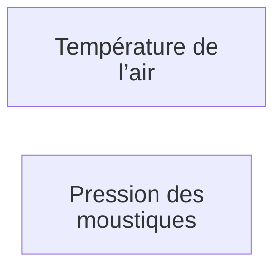

Dans cet exemple, la température et la pression des moustiques sont générées indépendamment.

L’effet réel de la température est nul par construction. <!-- element class="lead" -->

note:
L’indépendance est une hypothèse explicite de simulation. L’absence de flèche directe ne suffirait pas à l’établir dans un graphe plus large comportant des causes communes ou des chemins indirects. Ici, les processus de génération sont indépendants. Un jeu de données simulé fini peut néanmoins présenter une petite pente estimée non nulle.

---

<!-- slide template="[[assets/fieldnote-academic/templates/fieldnote-figure-focus]]" -->

::: title
## La chaleur décourage l’utilisation
:::

::: figure

:::

::: interpretation
Lors des nuits chaudes, l’inconfort réduit la probabilité de dormir sous une moustiquaire.
:::

note:
Ce dessin introduit l’effet négatif supposé de la température sur l’utilisation. Il illustre un mécanisme comportemental, pas un seuil de température estimé. Poursuivre avec le diagramme causal à une flèche.

---

<!-- .slide: class="dag-slide" -->

## La température agit sur l’utilisation

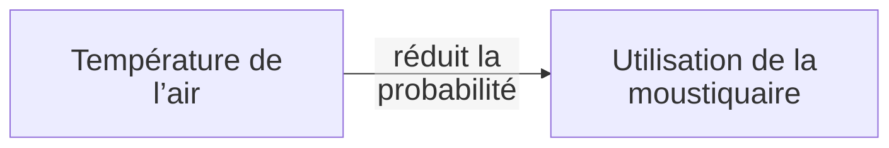

Dans ce scénario, une température plus élevée réduit la probabilité d’utiliser une moustiquaire.

note:
La flèche représente un effet causal sur la probabilité d’utilisation. Elle ne signifie pas que personne n’utilise de moustiquaire lors des nuits chaudes.

---

<!-- slide template="[[assets/fieldnote-academic/templates/fieldnote-figure-focus]]" -->

::: title
## La nuisance encourage l’utilisation
:::

::: figure
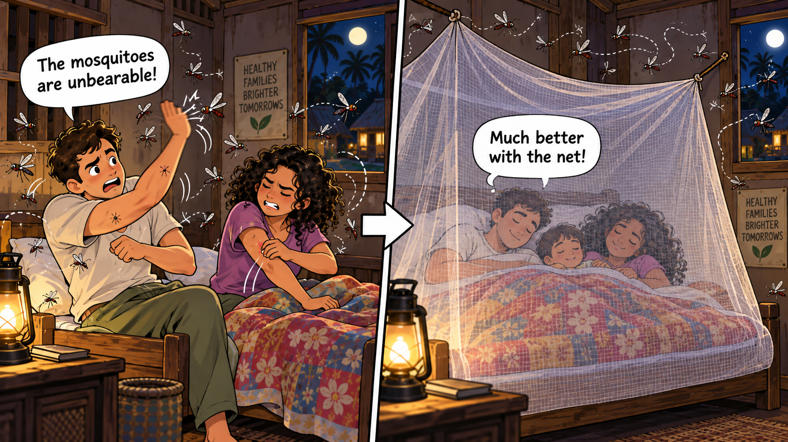
:::

::: interpretation
Une forte nuisance incite les habitants à utiliser une moustiquaire, même par une nuit chaude.
:::

note:
Le dessin introduit l’effet positif de la pression sur l’utilisation. Distinguer pression et piqûres réussies : une moustiquaire peut éviter les piqûres, alors que les attaquants créent la nuisance qui incite à l’utiliser.

---

<!-- .slide: class="dag-slide" -->

## La pression agit sur l’utilisation

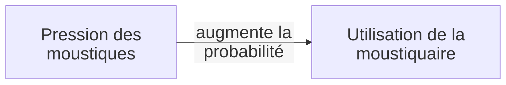

Dans ce scénario, davantage de nuisance favorise l’utilisation de la moustiquaire.

note:
**Le modèle simplifié place la pression avant la décision et ne représente pas les rétroactions comportementales durant la nuit.**

---

<!-- .slide: class="dag-slide" -->

## L’utilisation est un collisionneur

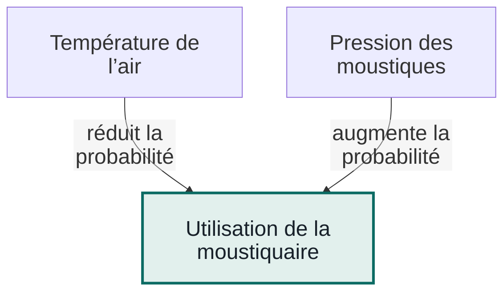

Un **collisionneur** est une variable vers laquelle convergent deux flèches.

note:
La température et la pression agissent en sens opposés sur la même décision comportementale. Leurs effets sur cette décision n’impliquent pas un effet causal de la température sur la pression. Les deux variables causent l’utilisation. La seule présence d’un collisionneur dans le graphe ne crée pas l’association : la sélection sur ce nœud, ou sur l’un de ses descendants, ouvre le chemin. Référence : https://www.dagitty.net/learn/dsep/

---

<!-- .slide: class="dag-slide" -->

## L’échantillonnage sélectionne les utilisateurs

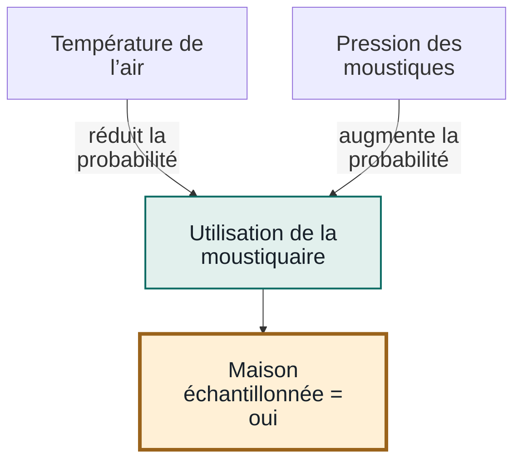

Sélectionner les maisons échantillonnées revient à conditionner sur un **descendant du collisionneur**.

Ici, une maison est échantillonnée si et seulement si sa moustiquaire a été utilisée.

note:
Le nœud mis en évidence indique la restriction qui définit le jeu de données. Dans la simulation, house_sampled est exactement égal à bednet_used : sélectionner les maisons échantillonnées revient donc à sélectionner les utilisateurs. Plus généralement, conditionner sur un descendant du collisionneur peut aussi ouvrir le chemin. Référence : https://www.dagitty.net/learn/dsep/

---

<!-- .slide: class="dag-slide" -->

## Comptages et disponibilité des observations

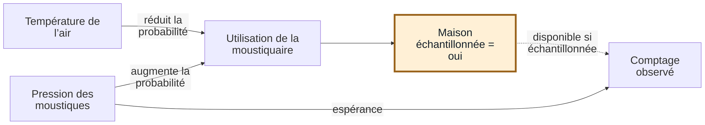

La flèche en pointillés indique la disponibilité, et non un effet écologique. <!-- element class="source" -->

**Pas d’échantillonnage signifie un comptage manquant, pas zéro moustique.**

note:
Ce schéma réunit processus écologique et observation. Le lien pointillé de disponibilité ne doit pas être interprété comme une flèche causale écologique ordinaire. Un comptage potentiel pourrait être défini pour chaque observation, mais il n’est enregistré que pour les maisons sélectionnées. Dans le modèle simplifié, la pression détermine son espérance.

---

<!-- slide bg="#e2f0ed" -->
<!-- .slide: class="takeaway-slide" -->

EXPLICATION VERBALE <!-- element class="eyebrow" -->

## Sélectionner les utilisateurs crée une association

- Par nuit chaude, les maisons où la nuisance est faible ont moins de chances d’entrer dans l’échantillon.
- Celles où la nuisance est forte restent plus souvent représentées malgré la chaleur.
- ***Chez les utilisateurs de moustiquaires*, les nuits chaudes peuvent donc *sembler* compter davantage de moustiques.**

Nous évaluons ensuite ces explications quantitativement.

note:
**Il s’agit d’un biais de sélection sur un collisionneur.** L’exemple montre une association qui apparaît après sélection, plutôt qu’une inversion d’une association substantielle préexistante. **Son signe positif découle du modèle comportemental choisi ; un biais de collisionneur n’a pas toujours ce signe.** Faire prédire les tendances dans la population et l’échantillon avant de montrer les résultats.

---

<!-- slide bg="#132927" -->
<!-- .slide: class="section-slide" -->

# Simuler le monde

note:
Déroulement d’une démonstration : demander des prédictions ; montrer les hypothèses écologiques et comportementales ; présenter la population avant l’échantillon ; puis modifier un paramètre comportemental et relancer, si souhaité dans une copie de travail distincte. Garder le processus écologique fixe pour étudier la sélection.

---

## Le mécanisme de génération des données

Nous simulons 6 000 maisons-nuits indépendantes.

1. Générer indépendamment la température et la pression des moustiques.
2. Générer l’utilisation selon la température et la nuisance.
3. Échantillonner uniquement les maisons où la moustiquaire est utilisée.
4. Simuler les entrées par une loi binomiale de probabilité.

**L’effet réel de la température sur la pression est exactement nul.**

note:
Les objets R nomment ces observations houses. Le modèle représente une nuit par maison simulée, sans mesures répétées ni effets de village. Les coefficients sont illustratifs et ne sont pas estimés sur le terrain.

---

<!-- .slide: class="compact-code" -->

## Script R : le processus écologique

```r
set.seed(20260922)  # reproductibilité
n <- 6000L          # nb d’échantillons indépendants

air_temperature_c <- rnorm(n, mean = 27, sd = 2.8)

# mélange Poisson-lognormal
true_attacking_mosquitoes <- rpois(n,    # un comptage de Poisson par maison-nuit
  lambda = exp(rnorm(n, log(28), 0.65))  # espérances lognormales entre maisons-nuits
)
```

La pression des moustiques est générée indépendamment de la température.

note:
**La moyenne variable de la loi de Poisson autorise une hétérogénéité de pression entre maisons ;** 28 est la **médiane** de lambda, pas sa moyenne ; 0,65 est l’écart-type de log(lambda). La température n’intervient pas dans son équation de génération. Ces extraits suivent `R/01_simulate.R` ; les diapositives suivantes utilisent directement les vecteurs générés.

--

<!-- slide template="[[assets/fieldnote-academic/templates/fieldnote-figure-wide]]" -->

::: title
## La population simulée sur ses échelles originales
:::

::: figure
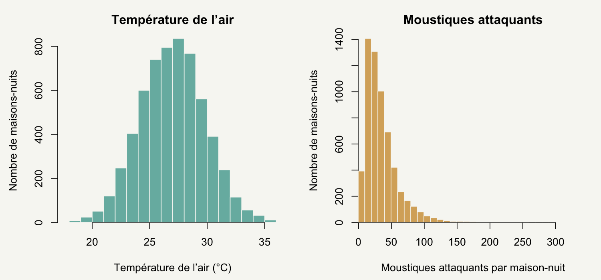
:::

::: interpretation
**Température presque symétrique ; pression avec une longue queue à droite.**

Les 6 000 maisons-nuits avant sélection. Axes linéaires ; classes de 1 °C et 10 moustiques.
:::

note:
Ces histogrammes montrent les deux vecteurs générés sur la diapositive parente, avant standardisation, sélection ou capture. Les deux axes sont linéaires et toute l’étendue observée est conservée. La hauteur des barres représente des effectifs, pas des densités ; les unités et largeurs de classes différentes ne permettent pas de comparer directement les hauteurs entre panneaux. La température suit une loi normale. Les attaquants suivent un mélange Poisson–lognormal : chaque maison-nuit possède sa propre moyenne de Poisson, distribuée selon une loi lognormale, produisant une distribution asymétrique à droite. Ce mélange n’est ni une loi de Poisson unique ni une loi lognormale des comptages. La médiane de lambda vaut 28 ; sa moyenne vaut 28 * exp(0.65^2 / 2). Ces distributions marginales ne prouvent pas l’indépendance : celle-ci découle du modèle générateur ; le nuage de points suivant examine l’association réalisée. Descendre depuis le code pour voir les distributions, puis reprendre la séquence principale pour la standardisation. Pour reproduire les histogrammes interactivement, utiliser hist(air_temperature_c) et hist(true_attacking_mosquitoes) ; R/03_make_plots.R précise les limites de classes affichées.

---

<!-- .slide: class="compact-code" -->

## Standardiser pour le modèle comportemental

```r
tz <- as.numeric(scale(air_temperature_c))
mz <- as.numeric(scale(true_attacking_mosquitoes))
```

- **Unités communes :** moyenne 0 et écart-type 1.
- **Variations comparables :** chaque coefficient décrit une hausse d’un écart-type.
- **Référence interprétable :** la constante correspond à une température et une pression moyennes.

note:
Standardiser consiste à soustraire la moyenne et à diviser par l’écart-type de l’échantillon : z = (x - mean(x)) / sd(x). Les noms tz et mz désignent respectivement température et pression standardisées dans tous les scripts. Dans le modèle logistique suivant, −1,25 est la variation du logarithme des cotes d’utilisation pour une hausse d’un écart-type de température, à pression constante ; +1,75 est la variation correspondante pour la pression. La constante −1 est le logarithme des cotes lorsque les deux prédicteurs sont à leur moyenne. La standardisation peut améliorer le conditionnement numérique lorsque les échelles diffèrent, mais n’est pas obligatoire pour une régression logistique. Elle ne rend pas les comptages asymétriques normaux, ne supprime pas la confusion et ne corrige pas la sélection. Exécuter les diapositives de code dans l’ordre : cette étape transforme les vecteurs générés précédemment. Aucun jeu de données pré-calculé n’est nécessaire.

---

<!-- .slide: class="compact-code" -->

## Vérifier l’association avant sélection

```r
z_limits <- range(pretty(range(c(tz, mz))))
par(pty = "s")  # zone de tracé carrée
plot(tz, mz, xlim = z_limits, ylim = z_limits,
     asp = 1, xaxs = "i", yaxs = "i")

cor.test(tz, mz, method = "pearson")
```

Utiliser les variables standardisées de la diapositive précédente.

La standardisation ne change pas la corrélation de Pearson.

note:
Les variables sont indépendantes par construction : leurs processus de génération ne partagent ni entrées ni liens causaux. Le nuage de points et le test recherchent une association linéaire dans la réalisation simulée ; ils ne prouvent pas l’indépendance. Une zone carrée, des limites communes et asp = 1 assurent la même étendue et le même espacement physique par écart-type sur les deux axes. La standardisation est facultative pour Pearson : r, la statistique du test, l’intervalle de confiance et la valeur p restent inchangés. Le diagnostic porte sur les 6 000 observations générées, avant toute restriction aux utilisateurs.

---

<!-- slide template="[[assets/fieldnote-academic/templates/fieldnote-figure-focus]]" -->

::: title
## Avant sélection : une association quasi nulle
:::

::: figure
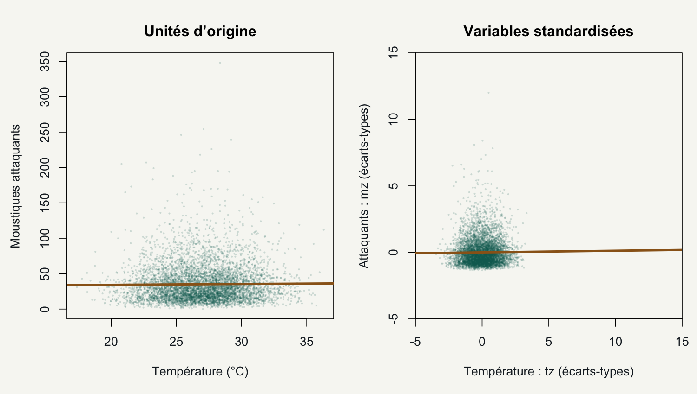
:::

::: interpretation
**Test de Pearson** · n = 6 000

| Statistique | Valeur |
|---|---:|
| r | 0,0125 |
| IC à 95 % | −0,0128 à 0,0378 |
| t (ddl = 5 998) | 0,9698 |
| p bilatérale | 0,3322 |

Pas d’association linéaire mise en évidence ; cela **ne prouve pas l’indépendance**.
:::

note:
Les lignes orange sont des ajustements par moindres carrés. Le panneau standardisé utilise les mêmes limites, graduations et espacements sur les deux axes, sans tronquer tz ni mz. La standardisation conserve la corrélation ; l’apparence change lorsque les axes partagent une échelle commune. L’hypothèse nulle est une corrélation de Pearson nulle dans la population ; l’alternative est une corrélation non nulle. Le test t et l’intervalle fondé sur la transformation z de Fisher reposent sur des hypothèses de distribution pour une inférence exacte ou approchée. Les comptages sont ici discrets et asymétriques : considérer ces résultats comme un diagnostic sur grand échantillon, pas comme un test exact d’indépendance. Une valeur p non significative n’établit pas un effet nul. L’indépendance est connue par le plan de simulation. La sortie R complète est dans data/population_correlation_test.txt et les statistiques dans data/population_correlation.csv. R/run_all.R régénère les sorties ; R/05_make_french_plots.R produit les figures françaises.

---

<!-- .slide: class="compact-code" -->

## Script R : le filtre comportemental

```r
# température et pression moyennes : tz = 0, mz = 0
baseline_logit <- -1
plogis(baseline_logit)  # probabilité d’utilisation de référence : 0.269

logit_p_net      <- baseline_logit - 1.25 * tz + 1.75 * mz  # prédicteur linéaire du logit
prob_bednet_used <- plogis(logit_p_net)  # probabilité d’utilisation
bednet_used      <- rbinom(n, 1, prob_bednet_used)  # utilisation effective
house_sampled    <- bednet_used  # maison échantillonnée si utilisation
```

À température et pression moyennes (`tz = mz = 0`), **−1 est le logit de la probabilité d’utilisation**, soit **26,9 % d’utilisation**.

La chaleur réduit l’utilisation (`-1.25 * tz`) ; la nuisance l’augmente (`+1.75 * mz`).

L’*utilisation* effective pour chaque maison-nuit est tirée d’un processus binomial.

note:
tz et mz sont la température et la pression standardisées. Lorsqu’elles valent zéro, le prédicteur égale la constante : -1 = log(p / (1 - p)). L’inverse du logit donne p = plogis(-1) = 0.2689. Il s’agit de la probabilité conditionnelle aux moyennes des deux prédicteurs, pas de la probabilité moyenne parmi les maisons : l’inverse du logit est non linéaire. Les coefficients donnent la variation du logarithme des cotes pour une hausse d’un écart-type, l’autre prédicteur étant fixé. rbinom simule l’utilisation effective, pas la possession ni l’attribution d’une moustiquaire. La dernière ligne applique exactement la règle d’échantillonnage.

---

<!-- .slide: class="compact-code" -->

## Script R : les comptages observés

```r
bed_net_entry_rate <- 0.7                            # probabilité d’entrée constante

# initialiser le vecteur des comptages
mosquitoes_counted_inside_net <- rep(NA_integer_, n) # non échantillonnées : NA, pas zéro

sampled <- house_sampled == 1                        # identifier les comptages
sample_size <- sum(sampled)                          # nb de maisons-nuits échantillonnées

# processus binomial d’entrée dans la moustiquaire
mosquitoes_counted_inside_net[sampled] <- rbinom(
  n = sample_size,
  size = true_attacking_mosquitoes[sampled],
  prob = bed_net_entry_rate
)
```

Chaque attaquant a **70 % de chances d’entrer**. Les observations non échantillonnées restent **NA**.

note:
C’est la règle de mesure de R/01_simulate.R. Conditionnellement à N attaquants, le comptage suit Binomiale(N, p), avec p = bed_net_entry_rate = 0.7 : espérance Np et variance Np(1-p). Zéro attaquant implique zéro capture, et les captures ne dépassent jamais les attaquants. La probabilité est illustrative et constante entre maisons et températures. Les entrées sont indépendantes et chaque entrant reste à l’intérieur et est compté. Cela ajoute une variabilité par rapport à un comptage parfait, mais pas nécessairement davantage de variance que l’ancien modèle de mesure de Poisson.

---

<!-- slide template="[[assets/fieldnote-academic/templates/fieldnote-figure-focus]]" -->

::: title
## Le filtre comportemental
:::

::: figure
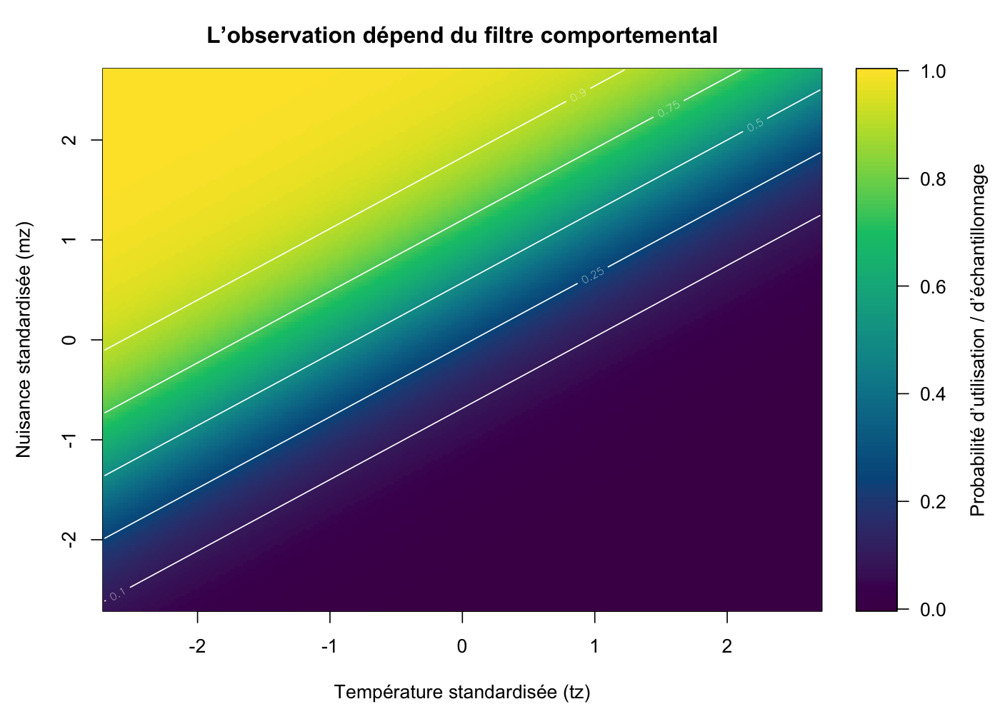
:::

::: interpretation
À température plus élevée, il faut davantage de nuisance pour maintenir la même probabilité d’utilisation.
:::

note:
Lire la surface comme la probabilité d’entrer dans l’échantillon, car utilisation et échantillonnage coïncident. Demander quelle partie de la population a le moins de chances d’être observée.

---

<!-- slide bg="#132927" -->
<!-- .slide: class="section-slide" -->

# Résultats attendus et observés

Quelles pentes attendez-vous avant et après sélection ?

note:
Faire une pause pour les prédictions. L’effet générateur est nul, mais les estimations sur un échantillon fini ne le sont pas nécessairement exactement. En démonstration, présenter d’abord la population puis l’échantillon.

---

<!-- .slide: class="figure-slide plot-slide" -->

## Avant et après sélection

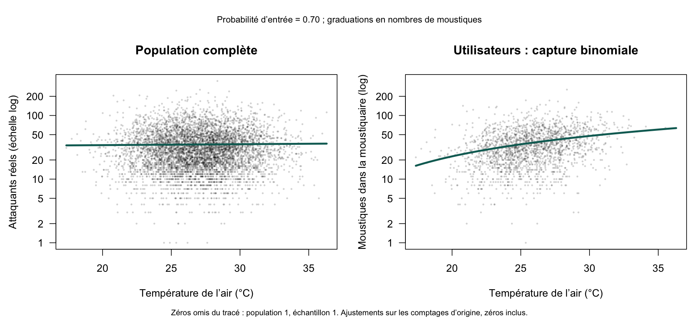

Ordonnées logarithmiques, graduées en nombres de moustiques. À gauche : association quasi nulle. À droite : association positive après sélection. <!-- element class="caption" -->

note:
Les panneaux changent à la fois la sélection et la mesure représentée. Les ordonnées partagent la même échelle logarithmique, avec des graduations en nombres de moustiques. L’unique comptage nul de la population est omis seulement de l’affichage, car zéro ne peut figurer sur cet axe. Les ajustements incluent toutes les observations et utilisent les comptages non transformés ; ils peuvent donc paraître courbes sur l’échelle logarithmique. La comparaison suivante distingue sélection et mesure en utilisant les attaquants réels dans l’échantillon comme étape intermédiaire.

---

## Distinguer sélection et entrée dans la moustiquaire

| Analyse | Observations | Pente : moustiques par °C |
|---|---:|---:|
| Toutes les maisons : attaquants réels | 6 000 | +0,117 |
| Maisons sélectionnées : attaquants réels | 1 987 | +3,501 |
| Maisons sélectionnées : comptages | 1 987 | +2,489 |

La sélection crée l’association positive. L’entrée partielle ramène la pente attendue des comptages à 70 % de celle des attaquants sélectionnés.

note:
Les pentes utilisent les vecteurs générés à pleine précision et sont affichées avec trois décimales. Ce sont des associations linéaires descriptives, pas des effets causaux inférés de l’échantillon. L’analyse des attaquants réels est possible grâce à la simulation ; sur le terrain, cette quantité latente ne serait pas observée pour toutes les maisons.

---

<!-- .slide: class="compact-code" -->

## Script R : les trois régressions

```r
# Utiliser les vecteurs et l’indicateur générés précédemment
fit_full <- lm(true_attacking_mosquitoes ~ air_temperature_c)
fit_sample_true <- lm(true_attacking_mosquitoes ~
                        air_temperature_c, subset = sampled)
fit_observed <- lm(mosquitoes_counted_inside_net ~
                     air_temperature_c, subset = sampled)
```

Le modèle intermédiaire isole la sélection avant l’entrée partielle.

La régression linéaire résume l’association de manière transparente ; passer à une régression de comptage (GLM) ne supprimerait pas, à lui seul, le biais de sélection.

note:
Ce sont les trois modèles de R/02_analyse.R. La régression linéaire résume ici l’association de manière transparente ; **utiliser une régression pour données de comptage ne supprimerait pas, à lui seul, le biais de sélection.** Le modèle de population est une comparaison de référence accessible grâce à la simulation.

---

<!-- slide template="[[assets/fieldnote-academic/templates/fieldnote-figure-focus]]" -->

::: title
## L’association apparaît lors de la sélection
:::

::: figure
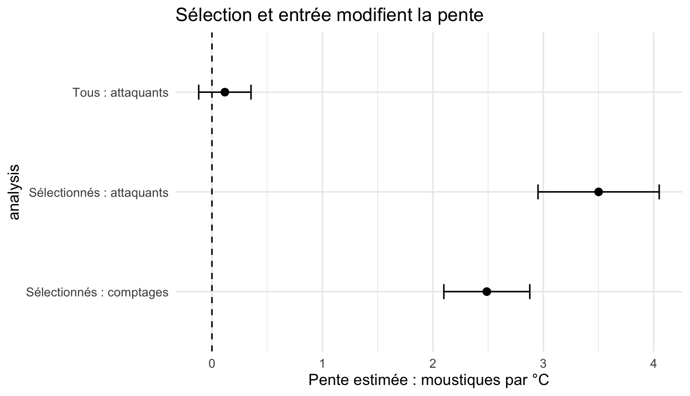
:::

::: interpretation
La sélection crée une pente positive chez les attaquants. L’entrée partielle réduit la pente des comptages, tout en préservant l’association.
:::

note:
Lire de haut en bas : tous les attaquants réels, les attaquants sélectionnés, puis les comptages sélectionnés. Les barres sont des intervalles de confiance à 95 %. La première comparaison isole la sélection ; la seconde introduit l’entrée binomiale. Avec une probabilité constante p, l’espérance de la pente des comptages, conditionnelle aux attaquants et températures sélectionnés, vaut p fois leur pente. La pente réalisée fluctue autour de cette espérance. Les pentes sont dans les unités de comptage d’origine.

---

<!-- slide template="[[assets/fieldnote-academic/templates/fieldnote-two-column]]" -->

::: title
## Association et interprétation causale
:::

::: left
Une régression peut décrire correctement l’échantillon observé sans répondre à la question écologique.
:::

::: right
Comprendre **comment les observations sont entrées dans le jeu de données** est ici essentiel pour interpréter la pente.
:::

La régression linéaire est naïve mais honnête ; l’association naît du biais de sélection sur un collisionneur. <!-- element class="lead" -->

note:
Le problème précède l’ajustement du modèle. Ajouter l’utilisation comme covariable ne rétablit pas la comparaison manquante dans un échantillon où tout le monde utilise une moustiquaire. Ce tutoriel ne prétend pas que tout problème de sélection possède une correction statistique simple.

---

<!-- slide bg="#132927" -->
<!-- .slide: class="questions-slide" -->

# DISCUSSION

note:
Inviter les participants à identifier l’exposition, le résultat ou ses causes, la décision de sélection et ses déterminants comportementaux ou logistiques. Dessiner les flèches avant de proposer des ajustements.

---

## Questions à explorer

| Question | Modification à explorer |
|---|---|
| 1. Et si tout le monde utilisait une moustiquaire ? | Imposer l’utilisation dans toutes les maisons |
| 2. Et si la chaleur n’agissait plus sur l’utilisation ? | Annuler le coefficient de température |
| 3. Et si la nuisance n’agissait plus sur l’utilisation ? | Annuler le coefficient de pression |
| 4. Et si l’utilisation de référence changeait ? | Faire varier `baseline_logit` |
| 5. Et si davantage de moustiques entraient ? | Faire varier `bed_net_entry_rate` |
| 6. Et si la température affectait la pression ? | Ajouter un effet écologique direct |

Prédire d’abord ; modifier une seule hypothèse à la fois.

> [!note]
> Une intervention imposant l’utilisation universelle [Q1] diffère d’une augmentation de la constante d’utilisation [Q4].

note:
Descendre pour les réponses, puis aller à droite pour la question suivante. La question 1 compare une population fixe et des populations renouvelées ; les questions 2–6 utilisent uniquement la seconde approche. La question 6 apparie les régimes d’observation séparément pour chaque effet écologique. Pour les questions 2–5, chaque répétition génère une nouvelle population de 6 000 maisons-nuits, puis applique tous les scénarios à cette même population. Les variantes d’entrée conservent les maisons sélectionnées par le scénario de référence de cette répétition. Les points sont les moyennes ; les barres sont les plages centrales à 95 % de Monte-Carlo sur 200 répétitions, et non des intervalles de confiance.

---

## 1. Et si tout le monde utilisait une moustiquaire ?

Sous les hypothèses de cette simulation, que deviendrait la pente si toutes les maisons utilisaient une moustiquaire et étaient échantillonnées ? <!-- element class="lead" -->

Faire une pause et prédire avant de révéler la réponse.

note:
Garder les modèles écologique et de mesure fixes. L’utilisation universelle est ici une intervention imposée au modèle simplifié, pas une simple hausse de la constante ni une prédiction des effets réels d’une couverture universelle.

--

<!-- slide template="[[assets/fieldnote-academic/templates/fieldnote-figure-causal]]" -->

::: title
## 1. Réponse : tous inclus, sans sélection
:::

::: figure
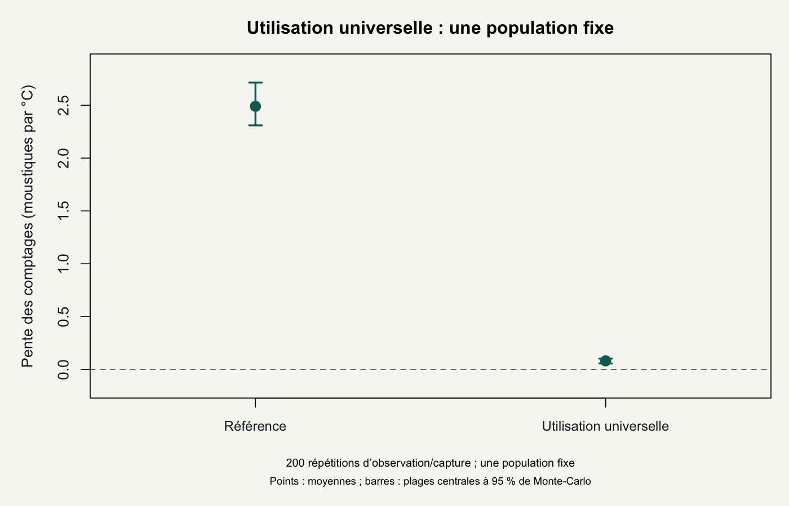
:::

::: causal
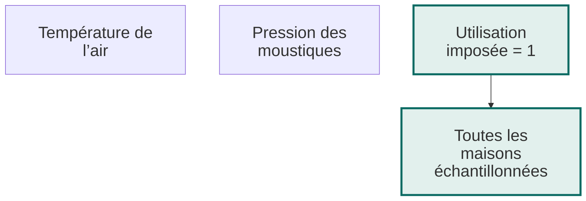
:::

::: interpretation
**Les deux flèches vers l’utilisation sont supprimées :** toutes les maisons sont échantillonnées. **La pente redevient proche de zéro** pour cette population fixe.
:::

note:
Le graphe représente l’intervention : imposer U = 1 supprime les deux flèches entrantes, T → U et M → U. L’échantillonnage égale l’utilisation et devient constant pour tous ; aucune restriction sélective n’ouvre donc de chemin entre T et M. Les nœuds déconnectés préservent l’indépendance écologique supposée. Le modèle inchangé de mesure pression–capture est omis pour la lisibilité. L’utilisation universelle supprime la sélection. Pour cette population écologique finie et fixe, la pente attendue des comptages vaut 0,7 fois la petite pente réalisée des attaquants, soit environ 0,082, et non exactement zéro. L’intervalle de simulation n’a donc pas à contenir zéro : il représente l’aléa de capture conditionnel à cette population, pas des populations écologiques répétées. Les points sont les moyennes ; les barres couvrent les 95 % centraux de 200 répétitions d’observation/capture, et ne sont ni des intervalles de confiance ni des tests. Cette première comparaison conserve la population ; la diapositive suivante la renouvelle. R/04_discussion.R régénère les simulations sans lire de données pré-calculées ; R/05_make_french_plots.R produit les graphiques français.

--

<!-- slide template="[[assets/fieldnote-academic/templates/fieldnote-figure-focus]]" -->

::: title
## 1. Même intervention, deux répétitions possibles
:::

::: figure
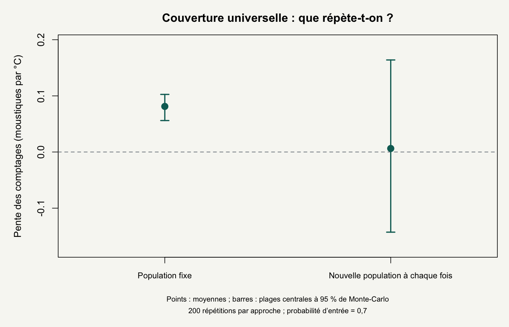
:::

::: interpretation
**Population fixe :** aléa de capture autour de +0,082.

**Population renouvelée :** aléas écologique et de capture, moyenne ≈ 0.

La covariance réalisée peut être non nulle par hasard.
:::

note:
Les deux approches répondent à des questions différentes. Avec une population fixe, E(pente des comptages | T, N) = 0,7 × pente des attaquants ≈ 0,082 ; la plage vaut environ [0,056 ; 0,103]. Avec de nouvelles populations, la moyenne simulée est ≈ 0 et la plage vaut [−0,143 ; 0,164]. Les mécanismes et paramètres restent identiques : seules les réalisations changent. Ces répétitions indépendantes représentent de nouvelles études sous le modèle ; elles ne modélisent pas explicitement l’autocorrélation spatiale ou temporelle. Aucune des deux plages n’est un intervalle de confiance pour l’effet écologique.

--

<!-- .slide: class="compact-code" -->

## 1. Reproduire et examiner la réponse

```r
source("R/04_discussion.R")
subset(discussion_summary, scenario == "universal")
```

| Scénario | n moyen | Pente moyenne |
|---|---:|---:|
| Fixe : référence | 1 960 | +2,490 |
| Fixe : universelle | 6 000 | +0,081 |
| Nouvelle : référence | 1 964 | +2,415 |
| Nouvelle : universelle | 6 000 | +0,006 |

200 répétitions par approche ; pentes en moustiques par °C. <!-- element class="caption" -->

note:
Le code affiche les deux approches pour la couverture universelle. La population fixe isole l’aléa d’observation/capture ; les populations renouvelées incluent aussi l’aléa écologique. Les tables proviennent de la même exécution reproductible.

---

## 2. Et si la chaleur n’agissait plus sur l’utilisation ?

Passer le coefficient de température de **−1,25 à 0**, sans changer la nuisance ni l’utilisation de référence.

Les nuits chaudes sélectionneraient-elles encore les maisons où la pression est plus forte ? <!-- element class="lead" -->

Prédire la pente comptage–température, puis relancer le processus d’observation.

note:
Remplacer le terme de température dans logit_p_net par 0 * tz, en gardant baseline_logit = -1 et le coefficient de nuisance à 1.75. Régénérer prob_bednet_used, bednet_used, house_sampled, sampled et les comptages sur une nouvelle population à chaque répétition. La température ne cause plus la sélection, donc ce chemin de collisionneur disparaît. Avec les processus écologiques indépendants et une probabilité d’entrée constante, l’association est nulle dans la population sélectionnée par cette règle ; les simulations finies fluctuent autour de cette attente. Les maisons à forte pression peuvent rester surreprésentées. Comparer la composition autant que la pente.

--

<!-- slide template="[[assets/fieldnote-academic/templates/fieldnote-figure-causal]]" -->

::: title
## 2. Réponse : sans chaleur, chemin supprimé
:::

::: figure
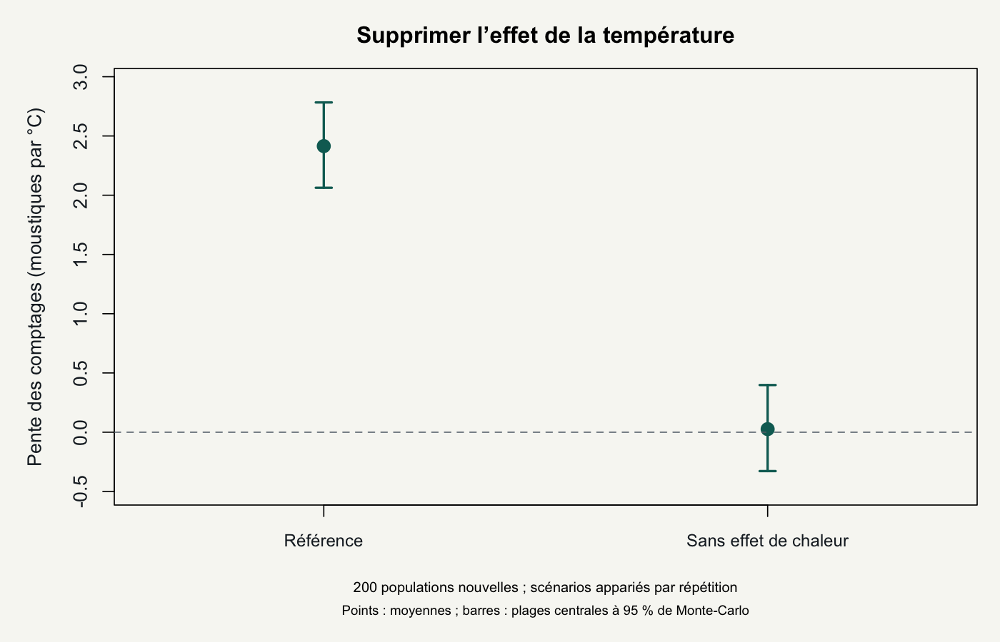
:::

::: causal
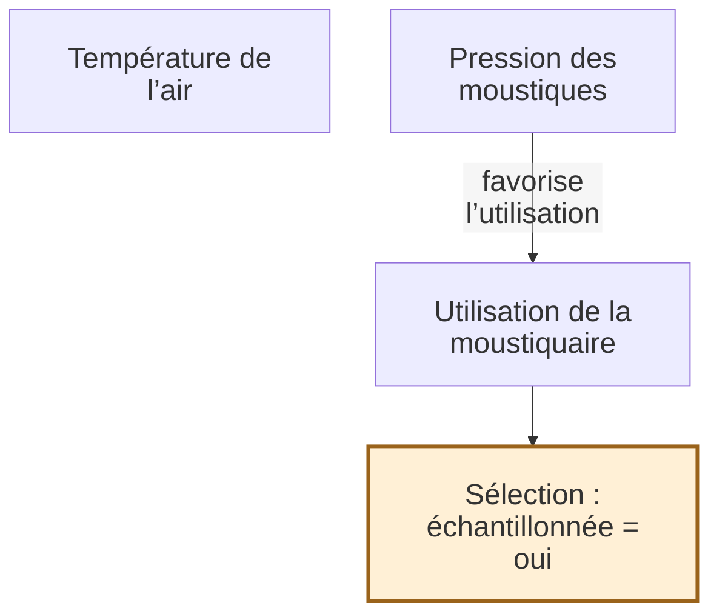
:::

::: interpretation
**Température → utilisation est supprimée :** la sélection ne relie plus température et pression. Les maisons à forte pression restent surreprésentées.
:::

note:
Comparer au collisionneur initial T → U ← M → (comptages), où U détermine l’échantillonnage. T → U est ici absent car son coefficient est nul. Le nœud surligné représente toujours la sélection, mais aucun chemin ne relie température et pression via U. M → U subsiste et favorise les maisons à forte pression. Le modèle inchangé pression–capture est omis pour la lisibilité. Température et pression sont indépendantes dans le modèle générateur ; sélectionner selon la pression seule ne les rend pas dépendantes. La moyenne des attaquants sélectionnés passe d’environ 51,9 à 55,8 ; l’absence de ce biais ne rend pas l’échantillon représentatif. Chaque répétition génère une nouvelle population de 6 000 maisons-nuits, puis applique tous les scénarios à cette même population. Les variantes d’entrée conservent les maisons sélectionnées par le scénario de référence de cette répétition. Les points sont les moyennes ; les barres sont les plages centrales à 95 % de Monte-Carlo sur 200 répétitions, et non des intervalles de confiance.

--

<!-- .slide: class="compact-code" -->

## 2. Reproduire et examiner la réponse

```r
source("R/04_discussion.R")
d <- generate_discussion_population()
observe_discussion(temperature_coef = 0, population = d)
```

| Scénario | n moyen | Pente moyenne |
|---|---:|---:|
| Référence | 1 964 | +2,415 |
| Sans effet de chaleur | 1 787 | +0,026 |

200 populations nouvelles ; scénarios appariés par répétition. <!-- element class="caption" -->

note:
Le tableau provient de l’exécution reproductible de R/04_discussion.R ; les commandes suivantes illustrent une réalisation supplémentaire, dont les valeurs peuvent différer. generate_discussion_population() renouvelle températures, attaquants, variables standardisées tz et mz, et sélection de référence, sans réinitialiser la graine. Réutiliser d pour comparer les scénarios au sein d’une répétition. Les résultats exportés portent les colonnes design et replicate. Chaque répétition génère une nouvelle population de 6 000 maisons-nuits, puis applique tous les scénarios à cette même population. Les variantes d’entrée conservent les maisons sélectionnées par le scénario de référence de cette répétition. Les points sont les moyennes ; les barres sont les plages centrales à 95 % de Monte-Carlo sur 200 répétitions, et non des intervalles de confiance.

---

## 3. Et si la nuisance n’agissait plus sur l’utilisation ?

Passer le coefficient de pression de **+1,75 à 0**, sans changer la température ni l’utilisation de référence.

Sélectionner uniquement les nuits fraîches créerait-il une association température–moustiques ? <!-- element class="lead" -->

Prédire la pente et la distribution des températures échantillonnées.

note:
Remplacer le terme de nuisance par 0 * mz, en gardant baseline_logit = -1 et le coefficient de température à -1.25. Régénérer le processus d’observation sur chaque population nouvellement générée. La sélection dépend désormais de la température, mais plus de la pression. Sous les hypothèses d’indépendance et de probabilité de capture constante, cela supprime le mécanisme de collisionneur. Les nuits fraîches restent surreprésentées, mais l’association attendue est nulle. Une plage de températures plus étroite peut modifier la précision. L’échantillon n’a pas besoin de représenter toutes les températures pour être exempt de ce biais particulier.

--

<!-- slide template="[[assets/fieldnote-academic/templates/fieldnote-figure-causal]]" -->

::: title
## 3. Réponse : nuits fraîches, faible association
:::

::: figure
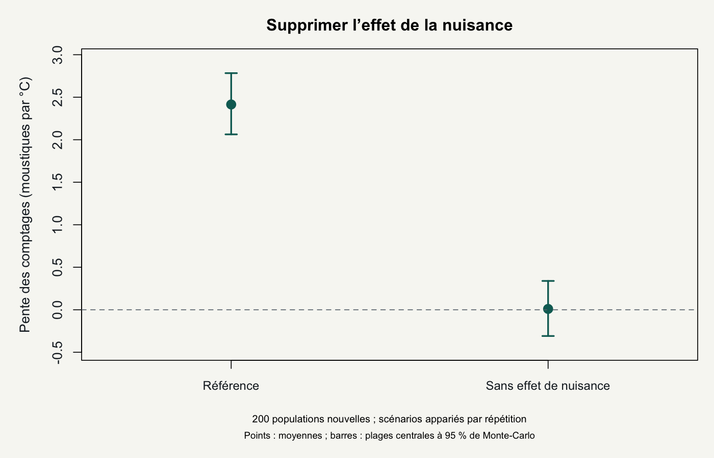
:::

::: causal
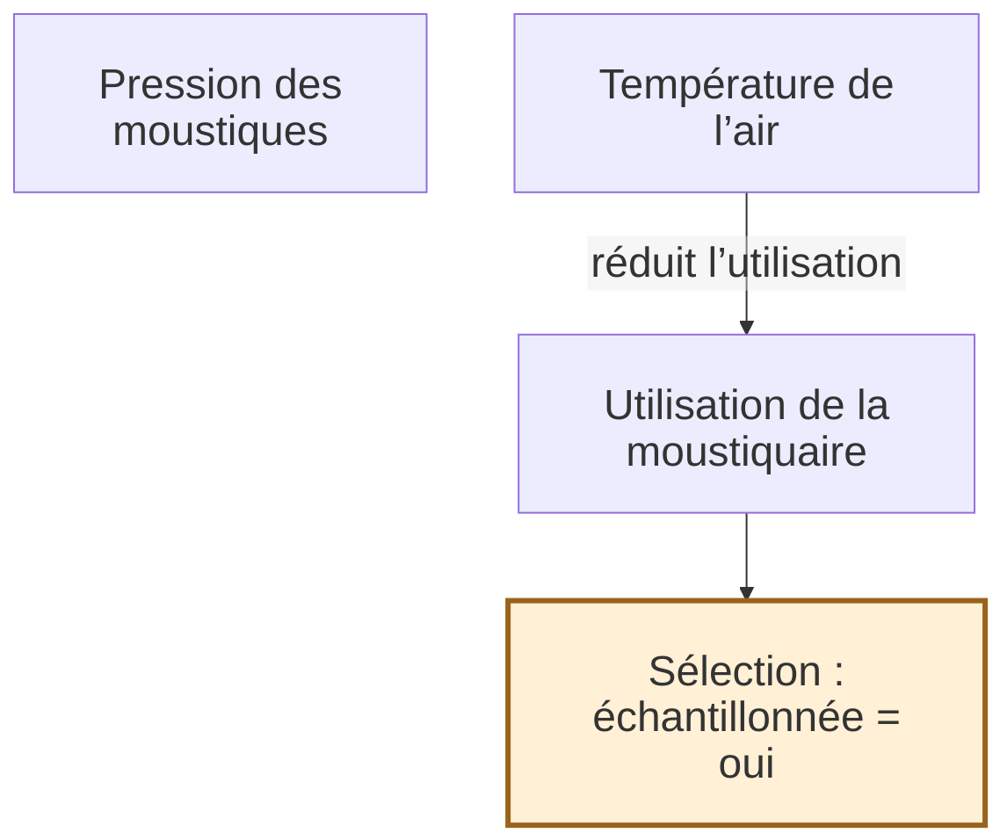
:::

::: interpretation
**Pression → utilisation est supprimée :** la sélection ne relie plus pression et température. Les nuits fraîches restent surreprésentées.
:::

note:
Comparer au collisionneur initial T → U ← M, où U détermine l’échantillonnage. M → U disparaît car son coefficient est nul. Le nœud surligné représente toujours la sélection, mais U n’est plus un collisionneur sur un chemin T–M. T → U subsiste : les nuits fraîches sont plus souvent échantillonnées. Le modèle inchangé pression–capture est omis pour la lisibilité. La température moyenne sélectionnée est d’environ 25,13 °C contre 27,00 °C dans la population. L’association attendue est nulle, même si la sélection modifie la couverture thermique et la précision. Chaque répétition génère une nouvelle population de 6 000 maisons-nuits, puis applique tous les scénarios à cette même population. Les variantes d’entrée conservent les maisons sélectionnées par le scénario de référence de cette répétition. Les points sont les moyennes ; les barres sont les plages centrales à 95 % de Monte-Carlo sur 200 répétitions, et non des intervalles de confiance.

--

<!-- .slide: class="compact-code" -->

## 3. Reproduire et examiner la réponse

```r
source("R/04_discussion.R")
d <- generate_discussion_population()
observe_discussion(nuisance_coef = 0, population = d)
```

| Scénario | n moyen | Pente moyenne |
|---|---:|---:|
| Référence | 1 964 | +2,415 |
| Sans effet de nuisance | 1 897 | +0,010 |

200 populations nouvelles ; scénarios appariés par répétition. <!-- element class="caption" -->

note:
Le tableau provient de l’exécution reproductible de R/04_discussion.R ; les commandes suivantes illustrent une réalisation supplémentaire, dont les valeurs peuvent différer. generate_discussion_population() renouvelle températures, attaquants, variables standardisées tz et mz, et sélection de référence, sans réinitialiser la graine. Réutiliser d pour comparer les scénarios au sein d’une répétition. Les résultats exportés portent les colonnes design et replicate. Chaque répétition génère une nouvelle population de 6 000 maisons-nuits, puis applique tous les scénarios à cette même population. Les variantes d’entrée conservent les maisons sélectionnées par le scénario de référence de cette répétition. Les points sont les moyennes ; les barres sont les plages centrales à 95 % de Monte-Carlo sur 200 répétitions, et non des intervalles de confiance.

---

## 4. Et si l’utilisation de référence changeait ?

Comparer `baseline_logit` pour **−10, −5, −4, −3, −2, −1, 0 et +1**.

À température et pression moyennes : **0,00454 % à −10**, **0,67 % à −5**, **26,9 % à −1**, **50 % à 0** et **73,1 % à +1**.

> [!question]
> Comment changent la taille de l’échantillon, sa composition et la pente ?

note:
Conserver les coefficients de température et de nuisance à −1,25 et +1,75, et bed_net_entry_rate à 0.7. Régénérer utilisation et capture pour chaque constante sur la même population au sein d’une répétition ; renouveler cette population à la répétition suivante. Les probabilités citées sont conditionnelles à tz = mz = 0 et ne sont pas les fractions échantillonnées dans toute la population. Augmenter la constante accroît la probabilité d’utilisation de chaque maison, mais change aussi la composition : pas seulement la taille. Les deux parents agissent toujours, donc le chemin de collisionneur subsiste. À l’approche d’une utilisation universelle, l’échantillon se rapproche de la population complète ; ne pas garantir une variation monotone de pente pour chaque réalisation ou sur toute plage de constantes.

La référence vaut désormais −1 (26,9 % aux prédicteurs moyens). La grille progresse par pas de 1 de −5 à +1, avec le cas extrême −10.

--

<!-- slide template="[[assets/fieldnote-academic/templates/fieldnote-figure-wide]]" -->

::: title
## 4. Réponse : moins de maisons, pentes plus variables
:::

::: figure
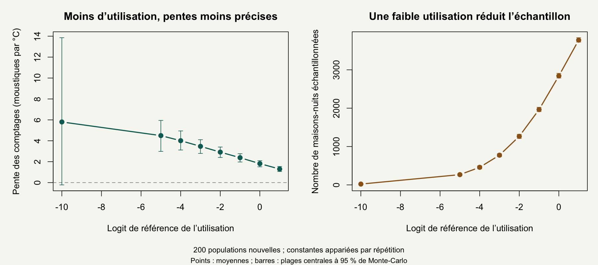
:::

::: interpretation
**À −10 : environ 22 maisons ; pente moyenne +5,801, plage à 95 % [−0,219 ; 13,857].**

6 pentes sur 200 sont négatives ; toutes restent estimables. La moyenne ne s’inverse pas sur la plage testée.
:::

note:
Les huit constantes partagent une population dans chaque répétition. La référence est −1 ; la grille comprend −10, puis les entiers de −5 à +1. Les barres sont les plages centrales à 95 % de Monte-Carlo, pas des intervalles de confiance. À −10 : 14–32 maisons (moyenne 21,88), environ 181 attaquants par maison sélectionnée et 6 pentes négatives sur 200. La couverture moyenne est 0,365 %, contre 0,00454 % aux prédicteurs moyens. À −5, le plus petit échantillon contient 235 maisons ; les 200 pentes sont estimables à chaque constante. La forte pression favorise encore l’utilisation. La pente moyenne reste monotone sur les valeurs testées, sans garantie générale. Aucun point entre −10 et −5 n’a été simulé. Ces résultats sont régénérés après le passage de la référence à −1 ; la graine dédiée à Q4 implique de petites différences entre sa référence et celle des autres questions.

--

<!-- .slide: class="compact-code" -->

## 4. Reproduire et examiner la réponse

```r
source("R/04_discussion.R")
d <- generate_discussion_population()
observe_discussion(baseline_logit = -10, population = d)
```

| Constante | n moyen | Attaquants moyens | Pente moyenne |
|---|---:|---:|---:|
| -10 | 22 | 181,1 | +5,801 |
| -5 | 268 | 94,6 | +4,495 |
| -4 | 459 | 80,8 | +4,010 |
| -3 | 774 | 69,4 | +3,469 |
| -2 | 1 266 | 59,7 | +2,918 |
| -1 | 1 964 | 52,0 | +2,384 |
| 0 | 2 842 | 45,9 | +1,816 |
| 1 | 3 774 | 41,6 | +1,299 |

200 populations nouvelles ; scénarios appariés par répétition. <!-- element class="caption" -->

note:
Le tableau provient de data/intercept_summary.csv ; data/intercept_replicates.csv conserve les 1 600 résultats, y compris les éventuelles pentes manquantes. Les colonnes valid_slopes et empty_samples rendent explicites les problèmes d’estimabilité. Les huit valeurs utilisent une graine distincte : les autres questions restent inchangées. La référence à −1 diffère donc légèrement des autres tables par l’aléa de simulation. Le code montre une réalisation supplémentaire ; elle ne doit pas reproduire les moyennes.

---

## 5. Et si davantage de moustiques entraient ?

1. Comparer `bed_net_entry_rate` pour **0,1 ; 0,3 ; 0,7 ; 0,9**.
2. Dans chaque répétition, garder les mêmes maisons pour tous les taux d’entrée.
3. Renouveler population et sélection à la répétition suivante.

> [!question]
> Une pente plus forte signifie-t-elle un effet écologique accru de la température ?

note:
La pente attendue des comptages vaut p fois celle des attaquants sélectionnés, conditionnellement à chaque échantillon. Augmenter p change l’échelle et la variabilité des comptages ; une pente brute n’est pas une mesure standardisée d’association. L’exercice complémentaire des notes conserve une population fixe ; la figure utilise des populations renouvelées. Chaque répétition génère une nouvelle population de 6 000 maisons-nuits, puis applique tous les scénarios à cette même population. Les variantes d’entrée conservent les maisons sélectionnées par le scénario de référence de cette répétition. Les points sont les moyennes ; les barres sont les plages centrales à 95 % de Monte-Carlo sur 200 répétitions, et non des intervalles de confiance.

--

<!-- slide template="[[assets/fieldnote-academic/templates/fieldnote-figure-focus]]" -->

::: title
## 5. Réponse : davantage d’entrées, une pente accrue
:::

::: figure
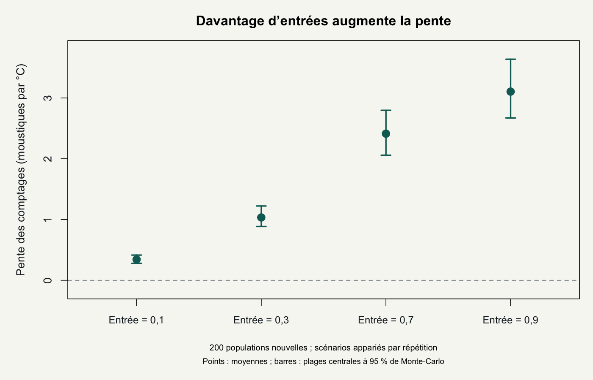
:::

::: interpretation
**Mêmes maisons dans chaque répétition.**

Population renouvelée entre répétitions.

Pente attendue des comptages = probabilité d’entrée × pente des attaquants sélectionnés.

**L’effet écologique reste nul.**
:::

::: source
Lorsque `bed_net_entry_rate` tend vers zéro, la pente attendue des comptages tend vers zéro. À exactement zéro, tous les comptages — et leur pente ajustée — valent zéro : les captures n’apportent plus aucune information sur la relation entre moustiques attaquants et température.
:::

note:
La pente attendue vaut p fois celle des attaquants sélectionnés dans chaque répétition. La référence et le scénario d’entrée à 0,7 partagent les maisons mais ont des captures indépendantes ; leurs moyennes sont donc proches, sans être identiques. Chaque répétition génère une nouvelle population de 6 000 maisons-nuits, puis applique tous les scénarios à cette même population. Les variantes d’entrée conservent les maisons sélectionnées par le scénario de référence de cette répétition. Les points sont les moyennes ; les barres sont les plages centrales à 95 % de Monte-Carlo sur 200 répétitions, et non des intervalles de confiance.

--

<!-- .slide: class="compact-code" -->

## 5. Reproduire et examiner la réponse

```r
source("R/04_discussion.R")
d <- generate_discussion_population()
observe_discussion(entry_rate = 0.9, fixed_sample = TRUE, population = d)
```

| Scénario | n moyen | Pente moyenne |
|---|---:|---:|
| 0,1 | 1 964 | +0,343 |
| 0,3 | 1 964 | +1,034 |
| 0,7 | 1 964 | +2,413 |
| 0,9 | 1 964 | +3,106 |

200 populations nouvelles ; scénarios appariés par répétition. <!-- element class="caption" -->

note:
Le tableau provient de l’exécution reproductible de R/04_discussion.R ; les commandes suivantes illustrent une réalisation supplémentaire, dont les valeurs peuvent différer. generate_discussion_population() renouvelle températures, attaquants, variables standardisées tz et mz, et sélection de référence, sans réinitialiser la graine. Réutiliser d pour comparer les scénarios au sein d’une répétition. Les résultats exportés portent les colonnes design et replicate. Chaque répétition génère une nouvelle population de 6 000 maisons-nuits, puis applique tous les scénarios à cette même population. Les variantes d’entrée conservent les maisons sélectionnées par le scénario de référence de cette répétition. Les points sont les moyennes ; les barres sont les plages centrales à 95 % de Monte-Carlo sur 200 répétitions, et non des intervalles de confiance.

---

## 6. Et si la température affectait la pression ?

Ajouter un **effet causal direct** de la température sur les moustiques attaquants, en conservant les deux influences sur l’utilisation des moustiquaires.

> [!question]
> La sélection des utilisateurs restitue-t-elle, amplifie-t-elle ou atténue-t-elle la relation écologique ?

Explorer un effet **négatif, nul, puis positif**.

note:
Cette question change le modèle causal. Une dépendance pourrait aussi résulter de causes environnementales communes ; ici, nous choisissons explicitement T → M. Les questions précédentes conservent leur hypothèse d’indépendance. L’utilisation ne modifie ni l’abondance des attaquants ni la probabilité d’entrée dans ce modèle simplifié ; elle détermine la disponibilité des comptages.

--

<!-- .slide: class="compact-code" -->

## Effet de la température sur la pression

```r
temperature_effect <- 0.3  # beta
n <- 6000L
air_temperature_c <- rnorm(n, mean = 27, sd = 2.8)
log_pressure <- rnorm(n, mean = log(28), sd = 0.65) +
  temperature_effect * (air_temperature_c - 27) / 2.8
true_attacking_mosquitoes <- rpois(n, lambda = exp(log_pressure))
```

$N\mid T,Z \sim \operatorname{Poisson}(\lambda)$, donc $E[N\mid T,Z]=\lambda$.

$\log(\lambda)=\log(28)+\beta(T-27)/2.8+Z$, $Z\sim N(0,0.65^2)$, $Z\perp T$.

Ici, $T$ est la température en °C ; 27 et 2,8 sont la moyenne et l’écart-type **générateurs**.

$e^\beta$ multiplie l’abondance attendue par hausse de 2,8 °C ; pour $\beta=0{,}3$, cela donne **×1,35**.

note:
N désigne le nombre de moustiques attaquants et lambda sa moyenne conditionnelle. C’est N | T,Z qui suit une loi de Poisson ; E[N | T,Z] = lambda est une espérance, pas une variable tirée selon une loi de Poisson. Le code génère indépendamment la température et un terme normal de moyenne log(28) et d’écart-type 0.65, équivalent à log(28) + Z. Z représente l’hétérogénéité résiduelle entre maisons-nuits et est indépendant de T. Le coefficient temperature_effect correspond à beta. Le centrage et la division utilisent les paramètres fixes 27 et 2.8, pas la moyenne et l’écart-type réalisés dans cet échantillon. Le multiplicateur exp(beta) est valable à Z fixé et après intégration sur sa distribution indépendante. La moyenne marginale conditionnelle à T vaut 28 * exp(beta * (T - 27) / 2.8 + 0.65^2 / 2) ; 28 n’est donc pas la moyenne des attaquants à 27 °C. Le code reproduit la partie écologique de generate_ecological_population() dans R/lib/ecological_effect_compute.R. L’exemple ne réinitialise pas la graine ; ses valeurs ne doivent pas nécessairement reproduire les figures à graine fixée. Après avoir régénéré les attaquants, recalculer tz et mz à partir des nouveaux vecteurs avant d’appliquer le modèle comportemental. Le générateur complet le fait automatiquement. Dans le modèle causal supposé, beta décrit un effet sur le logarithme de l’abondance attendue, pas la pente linéaire des comptages.

--

<!-- slide template="[[assets/fieldnote-academic/templates/fieldnote-figure-causal]]" -->

::: title
## 6. Réponse : deux chemins contribuent
:::

::: figure
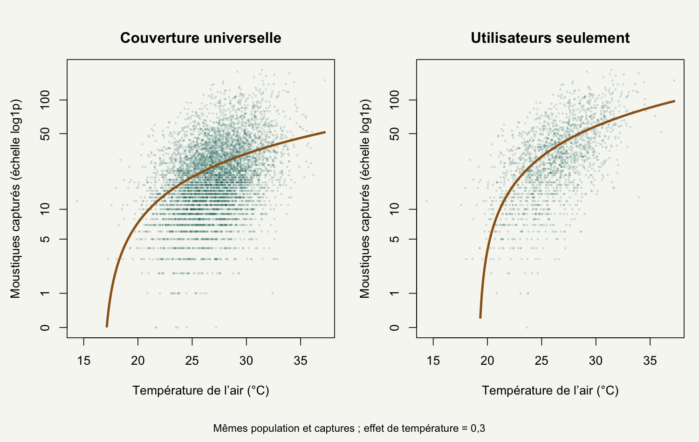
:::

::: causal
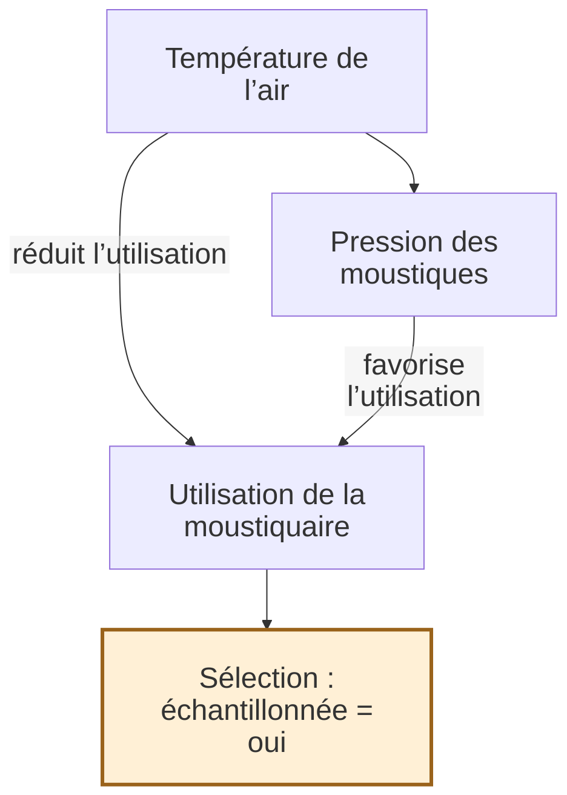
:::

::: interpretation
**Un chemin écologique existe désormais : T → M.**

La sélection ouvre aussi le chemin par le collisionneur T → U ← M. La relation observée reflète les deux processus.
:::

note:
Un exemple avec temperature_effect = 0.3 : chaque hausse de 2,8 °C multiplie l’abondance attendue par exp(0.3), soit environ 1,35. Les deux panneaux partagent population, captures et limites des axes. La sélection révèle un sous-ensemble des mêmes comptages potentiels. L’axe vertical affiche log(1 + comptage), avec les comptages originaux comme graduations, zéros inclus. Les courbes représentent les régressions linéaires sur les comptages bruts, transformées uniquement pour l’affichage ; les prédictions négatives sont omises. Les courbes sont descriptives, pas le modèle générateur exponentiel. Le graphe montre la sélection ; le modèle de capture inchangé est omis.

--

<!-- slide template="[[assets/fieldnote-academic/templates/fieldnote-figure-focus]]" -->

::: title
## 6. Faire varier l’effet écologique
:::

::: figure
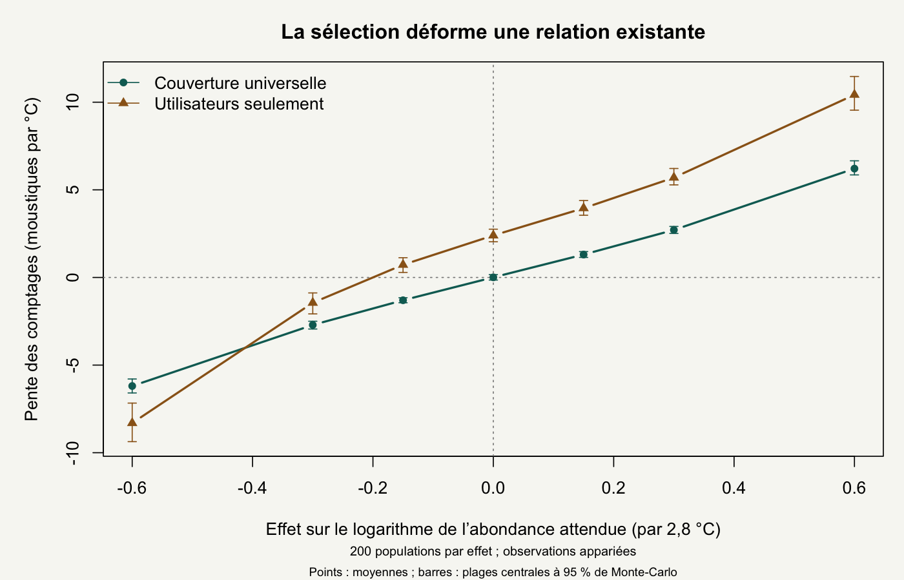
:::

::: interpretation
**Comparer à la couverture universelle au même effet écologique.**

À −0,15, le signe est inversé ; à +0,30, la pente positive est amplifiée.

Le coefficient générateur et la pente des comptages ont des unités différentes.
:::

note:
À chaque valeur de l’effet, 200 populations indépendantes de 6 000 maisons-nuits sont générées. Dans chaque répétition, couverture universelle et utilisateurs partagent les mêmes captures, avec une probabilité d’entrée de 0,7. Les barres sont des plages centrales à 95 % de Monte-Carlo, pas des intervalles de confiance. La ligne verticale à zéro correspond au modèle écologique initial. Les points entre valeurs sont reliés pour guider la lecture. L’effet écologique agit sur le logarithme de l’abondance attendue par 2,8 °C ; la pente ajustée décrit des moustiques par °C. Leur différence numérique n’est donc pas une mesure de biais. Comparer plutôt les deux pentes de comptages. La standardisation mz est recalculée dans chaque population : la sensibilité à la nuisance reste constante par écart-type, pas par moustique. Modifier l’effet change aussi la distribution marginale de pression ; l’interception écologique maintient l’abondance attendue à 27 °C, pas sa moyenne marginale.

--

<!-- .slide: class="compact-code" -->

## 6. Reproduire et comparer les pentes

```r
source("R/04_discussion.R")
d <- generate_ecological_population(temperature_effect = 0.3)
ecological_slopes(d)
subset(ecological_summary, temperature_effect %in% c(-0.15, 0, 0.3))
```

| Effet | Universelle | Utilisateurs | Écart |
|---|---:|---:|---:|
| -0,15 | -1,300 | +0,724 | +2,024 |
| +0,00 | +0,008 | +2,398 | +2,390 |
| +0,30 | +2,711 | +5,697 | +2,987 |

200 populations par effet ; pentes en moustiques par °C. <!-- element class="caption" -->

note:
R/04_discussion.R génère tous les résultats sans données pré-calculées. generate_ecological_population() utilise log_pressure = rnorm(n, log(28), 0.65) + temperature_effect * (air_temperature_c - 27) / 2.8, puis une loi de Poisson et le modèle habituel d’utilisation. tz et mz gardent leurs noms et sont recalculées. La première sortie illustre une réalisation supplémentaire ; le tableau résume les 200 répétitions à graine fixée. Écart = pente des utilisateurs − pente universelle dans la même répétition. Les résultats sont exportés dans data/ecological_replicates.csv et data/ecological_summary.csv. Une pente universelle négative et une pente sélectionnée positive illustrent une inversion ; aucune nouvelle causalité ne peut être déduite de la seule régression sélectionnée.

---

<!-- slide bg="#132927" -->
<!-- .slide: class="questions-slide" -->

# CONCLUSIONS

note:
Message final à retenir, plan d’étude et améliorations du modèle.

---

<!-- slide bg="#e2f0ed" -->
<!-- .slide: class="takeaway-slide" -->

MESSAGE À RETENIR <!-- element class="eyebrow" -->
## Distinguer les processus écologique et observationnel

1. Préciser la question écologique et ses hypothèses causales.
2. Décrire le processus qui détermine les observations disponibles.
3. Vérifier si la sélection dépend de l’exposition et de causes du résultat.

> [!danger]
> Un échantillon d’utilisateurs de moustiquaires ne représente pas automatiquement toutes les maisons.

note:
Relier ces messages aux exemples de terrain des participants. Les collisionneurs sont des propriétés des chemins d’un graphe causal ; une association seule n’identifie pas le mécanisme de sélection.

---

<!-- slide bg="#e2f0ed" -->
<!-- .slide: class="takeaway-slide" -->

Concevoir une étude plus informative <!-- element class="eyebrow" -->
## Comment mesurer la pression des moustiques indépendamment du choix d’utiliser une moustiquaire ?

1. Envisager d’échantillonner les maisons-nuits quel que soit l’usage de la moustiquaire, avec une méthode de mesure applicable aux deux groupes.
2. Consigner l’utilisation des moustiquaires et les raisons des observations manquantes.

> [!evidence] Preuves
> Observer l’utilisation aide à diagnostiquer la sélection, mais ne permet pas à elle seule de retrouver les comptages manquants ni de garantir une estimation causale sans biais.

note:
L’objectif est de rompre la dépendance de l’observation au collisionneur comportemental. Faire proposer et évaluer une méthode de mesure entomologique adaptée ; le diaporama ne valide aucun dispositif particulier.

---

<!-- slide template="[[assets/fieldnote-academic/templates/fieldnote-figure-focus]]" -->
<!-- .slide: class="disclaimer-dag-slide" -->

::: title
## Modèles simplifiés : confusion saisonnière
:::

::: figure
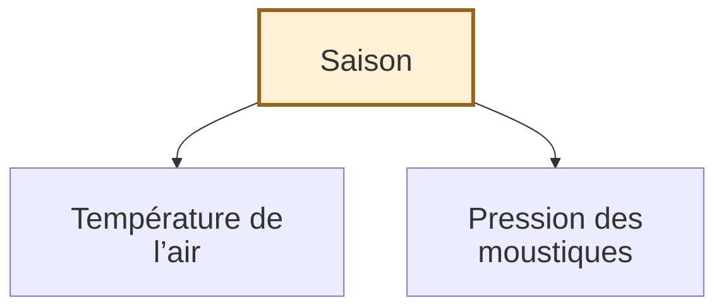
:::

::: interpretation
**Une cause commune peut créer une association.**

La saison peut agir sur la température et la pression, même sans effet direct de la température.

Nos modèles omettent ce chemin.
:::

::: source
Une étude réaliste doit examiner les chemins saisonniers en plus de la sélection.
:::

note:
Ces modèles pédagogiques isolent certains mécanismes ; ils ne décrivent pas intégralement l’écologie des moustiques ni leur observation. La saison représente des processus saisonniers susceptibles d’influencer à la fois la température et la pression des moustiques. Ce chemin par une cause commune peut produire une association dans la population sans effet direct de la température sur la pression. La température peut aussi modifier le comportement des moustiques et leur probabilité d’entrée dans une moustiquaire. Si cette probabilité varie avec la température, les comptages peuvent dépendre de celle-ci même sous couverture universelle et sans effet sur l’abondance des attaquants. Dans le modèle simplifié, la couverture universelle supprime la sélection liée à l’utilisation ; elle ne supprime ni la confusion saisonnière ni la capture dépendante de la température. Une analyse réaliste doit préciser les processus saisonniers et les échelles temporelles, étudier l’efficacité de capture selon la température et examiner ces chemins à l’aide des connaissances de terrain, de données de calibration et d’analyses de sensibilité. La question 6 ajoute un effet écologique direct, mais omet encore ces deux chemins. Les simulations n’établissent ni leur présence ni leur ampleur sur le terrain.

---

<!-- slide template="[[assets/fieldnote-academic/templates/fieldnote-figure-focus]]" -->
<!-- .slide: class="disclaimer-dag-slide" -->

::: title
## Modèles simplifiés : capture et température
:::

::: figure
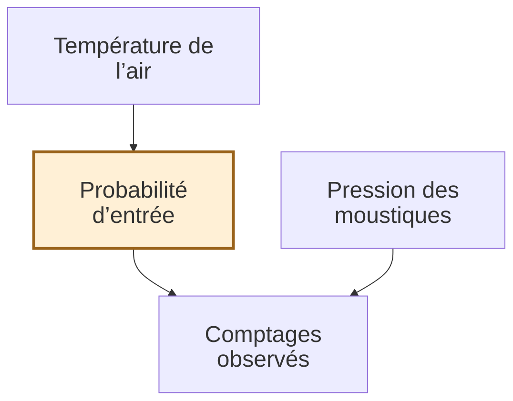
:::

::: interpretation
**Les comptages reflètent abondance et capture.**

La température peut modifier `bed_net_entry_rate`, même si l’abondance des attaquants reste constante.

La couverture universelle ne supprime pas ce chemin.
:::

::: source
Une association dans les comptages n’est pas nécessairement un effet écologique de la température.
:::

note:
La probabilité d’entrée surlignée représente un mécanisme de mesure. La pression détermine aussi les comptages : ces deux causes sont donc représentées. Ce schéma isole le chemin de capture omis ; il ne remplace pas le graphe de sélection et ne suppose pas l’absence de tous les autres chemins. Tous les scénarios, y compris la question 6, fixent la probabilité d’entrée au sein d’un scénario. Une étude réaliste doit examiner la capture dépendante de la température, la confusion saisonnière et la sélection. La couverture universelle seule ne résout aucun de ces deux chemins omis.

---

<!-- slide template="[[assets/fieldnote-academic/templates/fieldnote-figure-wide]]" -->

::: title
## Un modèle causal élargi à examiner
:::

::: figure
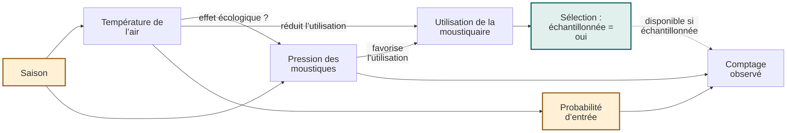
:::

::: interpretation
**Écologie, confusion saisonnière, sélection et capture interviennent ensemble.**

Le lien pointillé indique la disponibilité du comptage ; les effets causaux proposés restent à étudier.
:::

note:
Ce schéma réunit les mécanismes examinés séparément dans la présentation. La saison est une cause commune de la température et de la pression. La flèche T → M représente l’effet écologique direct à étudier ; sa présence et son ampleur ne sont pas établies ici, et le modèle sans effet l’omet. T → U ← M reste le collisionneur comportemental, l’échantillonnage étant déterminé par l’utilisation. La température agit aussi sur la probabilité d’entrée ; pression et entrée déterminent les captures potentielles. Le lien pointillé entre sélection et comptage indique si le comptage est enregistré : c’est un lien de disponibilité, pas un effet écologique sur l’abondance ni une assimilation des comptages manquants à zéro. Le nœud de sélection surligné indique la restriction définissant les données disponibles. Ce modèle causal et d’observation élargi n’inclut pas nécessairement tous les chemins pertinents : rétroactions, autres causes environnementales et hétérogénéité de mesure restent notamment à examiner. Les chemins saisonnier et d’entrée sont des extensions proposées, qui ne sont pas déjà ajustées ou simulées par les scripts actuels. Discuter des flèches soutenues par les connaissances de terrain et des données nécessaires pour identifier leurs effets. Un échantillonnage universel ne résoudrait à lui seul ni la confusion saisonnière ni la capture dépendante de la température.

---

# Avertissement

> [!warning] _Nota Bene_
> - Cette étude fictive et ses résultats simulés illustrent un biais de sélection.
> - Ils n’établissent ni la présence ni l’absence d’effets réels de la température ou du changement climatique sur la transmission vectorielle.
> - Les institutions citées apparaissent dans des dessins illustratifs. Les politiques, déclarations et financements représentés sont fictifs et n’impliquent aucune approbation.

note:
L’hypothèse d’indépendance écologique sert uniquement à isoler le mécanisme d’observation. Cette présentation n’évalue pas les preuves scientifiques qui fondent les politiques ou financements réels de l’OMS. Les questions climatiques et environnementales nécessitent des données adaptées aux processus écologiques et populations étudiés.

---

<!-- slide bg="#132927" -->
<!-- .slide: class="questions-slide" -->

# Travail personnel

Quelle étape de votre propre travail entomologique pourrait sélectionner les observations selon l’exposition et la pression des moustiques ? <!-- element class="subtitle" -->

note:
Demander aux participants d’apporter leurs propres exemples à la prochaine réunion.

---

<!-- .slide: class="references-slide" -->
<!-- slide template="[[assets/fieldnote-academic/templates/fieldnote-references]]" -->

::: title
## Références choisies
:::

::: references
1. Pulford J, Hetzel MW, Bryant M, Siba PM, Mueller I. Reported reasons for not using a mosquito net when one is available: a review of the published literature. _Malaria Journal_ **10**, 83 (2011). <a href="https://doi.org/10.1186/1475-2875-10-83" target="_blank" rel="noopener noreferrer">10.1186/1475-2875-10-83</a>
2. Moiroux N, Boussari O, Djénontin A, Damien G, Cottrell G, Henry M-C, *et al.* Dry season determinants of malaria disease and net use in Benin, West Africa. _PLoS One_ **7**, e30558 (2012). <a href="https://doi.org/10.1371/journal.pone.0030558" target="_blank" rel="noopener noreferrer">10.1371/journal.pone.0030558</a>
3. Briët, OJT, Yukich, JO, Pfeiffer, C _et al._ The effect of small solar powered ‘Bͻkͻͻ’ net fans on mosquito net use: results from a randomized controlled cross-over trial in southern Ghana. _Malaria Journal_ **16**, 12 (2017). <a href="https://doi.org/10.1186/s12936-016-1654-2" target="_blank" rel="noopener noreferrer">10.1186/s12936-016-1654-2</a>
:::

::: note
Études examinant certaines variables influant sur l’utilisation des moustiquaires parmi celles discutées dans cette présentation.
:::
