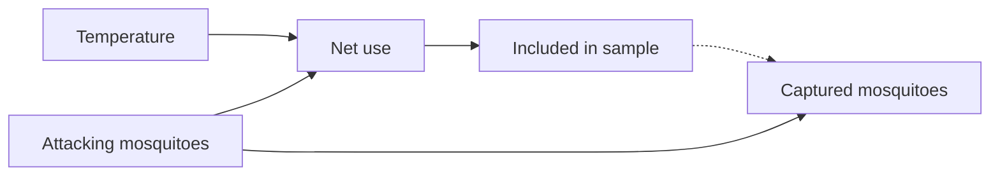

# Presenter notes: mosquito ecology, net use, and selective observation

These notes support the bilingual presentation on collider bias in medical entomology. They explain the example from the beginning, follow the six slide discussion questions, and then consider what a field analysis would need to recover an ecological relationship. No previous discussion or knowledge of causal terminology is assumed.

The central teaching point is that **a relationship in recorded mosquito counts can arise from the way houses enter the sample, even when temperature has no effect on the mosquitoes attacking those houses**. A regression can describe the recorded data accurately while answering a different question from the one the researchers intended to ask.

For presentation preparation, read Sections 1–4 in order. Sections 5–7 develop the field-inference discussion. Section 8 contains live exercises and file references. The appendices give the mathematical details behind the main text; the verbal explanations can be used without presenting those derivations.

## 1. Start with the research question and the observation rule

### The quantity of interest

Imagine that researchers want to understand whether warmer nights change the number of mosquitoes attacking people at a house. Call this number **mosquito pressure**. The word “pressure” refers to the attacking mosquitoes, whether or not they are subsequently captured.

For the tutorial, the basic observation unit is one **house-night**: one house on one night. Each unit has a temperature and a true number of attacking mosquitoes. The simulator treats these units as independent. It does not model repeated observations of the same house, shared mosquito populations between houses, or spatial and temporal autocorrelation.

The research question concerns all eligible house-nights. The measurement, however, is a count of mosquitoes collected inside a bed net. In this example, the team obtains a count only when the residents used a net that night. Houses where no net was used therefore contribute no mosquito measurement.

That observation rule creates two distinctions:

- **Pressure versus capture:** a recorded count may include only a fraction of the mosquitoes that attacked the house.
- **Population versus sample:** the houses with recorded counts may differ systematically from the houses without them.

Perfect capture would resolve the first distinction. It would leave the second one in place.

### Use one set of names throughout

| Symbol | Meaning in these notes | How to read it |
|---|---|---|
| $T$ | Nightly air temperature, in degrees Celsius | The environmental variable of interest |
| $M$ | True number of attacking mosquitoes at a house-night | The ecological quantity the researchers would like to know |
| $U$ | Whether residents used a bed net: 1 for yes, 0 for no | A behavioural decision |
| $S$ | Whether the house-night enters the mosquito sample | In the tutorial, $S=U$ exactly |
| $C$ | Number of attacking mosquitoes that enter the net and are counted | Recorded only when $S=1$ |
| $p$ | Probability that an individual attacker enters the net and is counted | A capture probability; the default is 0.7 |
| $\pi(t,m)$ | Probability of net use at temperature $t$ and pressure $m$ | A selection probability, not a capture probability |
| $q(t)$ | Proportion using nets at temperature $t$ | Coverage averaged over the different pressures at that temperature |

The notation $E[M\mid T=t]$ means “the average true mosquito pressure among all house-nights with temperature $t$.” Adding $U=1$ changes the group being averaged: $E[M\mid T=t,U=1]$ is the average among net users at that temperature. These two averages need not be equal.

In the code, $M$ is `true_attacking_mosquitoes`, $T$ is `air_temperature_c`, and $U$ is `bednet_used`. Some slide code uses `attackers` for the same quantity as $M$. Keep “attacking mosquitoes” and “captured mosquitoes” distinct when speaking.

### Why net use can connect two otherwise independent variables

Residents in this example respond to two influences. Heat makes sleeping under a net less comfortable, so higher temperature discourages use. Mosquito nuisance encourages use, so higher pressure makes a net more attractive.

Consider only the houses where a net was used. On a cool night, residents might use a net even when few mosquitoes are attacking. On a hot night, residents are less inclined to use one; heavy nuisance makes use more likely despite the heat. The selected hot-night houses therefore tend to have unusually high mosquito pressure.

Comparing net users can consequently suggest that hotter nights have more mosquitoes, although temperature and pressure were unrelated before selection. The association comes from comparing different mixtures of houses.

The causal diagram expresses that story as:



An arrow represents an assumed causal influence. A **collider** is a variable at which two arrows meet: here, temperature and mosquito pressure both point to net use. Selecting people who satisfy a common consequence of two variables can make those variables associated within the selected group. The phrase “conditioning on the collider” includes restricting the analysis to $U=1$.

The arrow from $U$ to $S$ and the dashed sampling-to-count link concern whether a count becomes available. They do not mean that net use increases the attacking population or changes the value of a potential capture. In the baseline diagram there is no ecological arrow from temperature to mosquito pressure.

Suggested opening explanation:

> We want to learn about mosquitoes at all houses, but our counts come only from houses where a net was used. Heat and mosquito nuisance both affect that decision. Before interpreting the count–temperature relationship, we need to understand how the decision selected the houses we observed.

## 2. Explain the simulated world before showing its results

The simulation creates a world whose mechanisms are known. That makes it possible to compare what the researchers would conclude from the selected sample with what actually generated the mosquitoes. The mechanisms are illustrative assumptions, not estimates from a field study.

### Ecology: pressure exists before the observation decision

The baseline simulation generates 6,000 independent house-nights. Temperature is normally distributed around 27 °C, with a standard deviation of 2.8 °C. The standard deviation describes the spread around the mean; here, most temperatures lie within a few degrees of 27 °C. Mosquito pressure varies between houses and nights but is generated independently of temperature.

More precisely, each house-night has an expected attacker count $\lambda$:

$$
T\sim\operatorname{Normal}(27,2.8^2),\qquad
\log\lambda\sim\operatorname{Normal}(\log 28,0.65^2),\qquad
M\mid\lambda\sim\operatorname{Poisson}(\lambda).
$$

The last distribution generates an integer count around its expected value. Allowing $\lambda$ to vary gives some house-nights much higher pressure than others. This is called a Poisson–lognormal mixture. The number 28 is the median of $\lambda$; it is not the overall mean attacker count.

The important assumption for the teaching example is simpler than the distributional details: **changing temperature does not change expected pressure in this baseline world**. A finite simulated dataset can nevertheless contain a small chance temperature–pressure association.

### Behaviour: both temperature and pressure affect use

The code first expresses temperature and pressure in standard-deviation units: subtract each variable's mean in the complete generated population and divide by its standard deviation. The resulting predictors are `tz` and `mz`. A value of zero denotes the population mean; a value of one denotes one standard deviation above that mean.

Net-use probability is then:

$$
\pi(T,M)
=\operatorname{logit}^{-1}(-1-1.25\,tz+1.75\,mz).
$$

The inverse-logit converts the expression into a probability between zero and one. The simulator draws a yes/no use decision from that probability for every house-night. A probability of 0.6 does not assign use to every such house: it means that use occurs with probability 0.6 when the decision is drawn.

The coefficients describe changes in **log odds of use**, holding the other predictor fixed. Odds compare the probability of use with the probability of non-use; log odds are their natural logarithm. A one-standard-deviation temperature increase multiplies use odds by $\exp(-1.25)\approx0.29$, whereas a one-standard-deviation pressure increase multiplies them by $\exp(1.75)\approx5.75$. These are not changes in mosquito counts or probability changes of 1.25 or 1.75. The negative temperature coefficient represents heat discouraging use; the positive pressure coefficient represents nuisance encouraging it.

At average temperature and average pressure, both standardised predictors are zero. The intercept of −1 then gives a use probability of about 26.9%. This is a probability for that particular combination of predictors. It is not the overall proportion of houses using nets, because the use probabilities vary across the population. The intercept is an illustrative choice, with no special biological significance.

Standardisation makes the coefficient units explicit and can help numerical fitting. It does not make the skewed pressure distribution normal, remove confounding, or prevent selection bias. A coefficient calibrated per population standard deviation also differs from one calibrated per mosquito or per degree.

### Observation: users are sampled, and only some attackers are counted

The sampling rule is deterministic: $S=U$. All users enter the tutorial sample; non-users do not. This is a deliberate simplification of a sampling protocol.

Among sampled house-nights, the recorded count follows:

$$
C\mid M,S=1\sim\operatorname{Binomial}(M,p),\qquad p=0.7.
$$

Each of the $M$ attackers independently has probability 0.7 of entering the net. Every entrant is assumed to remain inside and be counted. The expected count is $pM$, and its variance is $Mp(1-p)$. Thus two houses with the same true pressure can have different recorded counts through capture randomness alone.

In this model, $p$ is constant and net use changes the availability of a count without changing true pressure or capture efficiency. Those assumptions justify the tutorial's comparisons. A field protocol in which nets alter exposure, mosquito movement, or population size would require a different observation or ecological model.

A sampled zero is a real observation: no attackers were captured. An unsampled house has a missing count, stored as `NA`. **Missing counts must not be replaced with zeros.** Doing so would assert that no mosquitoes were captured in houses that were never measured.

### The three comparisons in the main presentation

The baseline figure separates selection from capture by comparing three regressions. Each fits an ordinary least-squares line with an intercept. Its slope describes the average linear count change per degree Celsius in the specified dataset; it does not automatically describe a causal effect.

| Comparison in the saved baseline dataset | Records | Slope, mosquitoes per °C |
|---|---:|---:|
| True pressure versus temperature in the complete population | 6,000 | +0.117 |
| True pressure versus temperature among net users | 1,987 | +3.501 |
| Captured count versus temperature among net users | 1,987 | +2.489 |

The generating ecological effect is zero. The small full-population slope is a chance result of generating a finite population. The much larger user-only pressure slope appears when houses are selected. Capture then changes the measurement scale and adds random variation.

Conditional on those selected houses, the expected capture slope is 0.7 times their pressure slope: approximately $0.7\times3.501=2.451$. The realised capture slope is +2.489 rather than exactly +2.451 because the captures are random. The derivation is in Appendix A.

Present the comparisons in this order. Otherwise the audience may attribute the association entirely to capture noise, although it is already present in the selected true pressure before any mosquitoes enter the nets.

## 3. Explain what a repeated simulation and its interval mean

One simulated study shows what can happen. Repeating the study shows which results recur and how much they vary. The discussion figures use 200 repetitions, but there are two different ways to repeat the experiment.

### Repeating observation of one fixed population

This design keeps the same 6,000 temperatures and attacker counts. It repeats the observation process: net-use decisions and capture for the baseline scenario, or capture alone when universal use is imposed.

It asks: **What would repeated observation produce for these particular house-nights?** It includes observation randomness but excludes the randomness of generating a different ecological population.

### Repeating the study with new populations

This design generates new temperatures and attackers for each repetition, recomputes the standardised predictors, and then generates use and capture. It asks: **What would independent studies produce if this generating model were repeatedly realised?**

Question 1 shows both designs. Questions 2–5 use new populations. Within each of those repetitions, all ten scenarios share the same generated population. The four entry-probability scenarios also share the baseline selected houses, so changes in capture are compared without changing which houses were sampled. Other behavioural scenarios draw their own use decisions on that population.

Sharing a population makes comparisons paired: a high-pressure population affects all its scenarios rather than only one. It does not make their counts identical. In questions 1–5, capture is drawn separately for each scenario; the baseline and the separate entry = 0.7 scenario can therefore differ slightly. Question 6 additionally shares the same realised captures between its selected and universal observation regimes.

The causal parameters remain fixed while the random realisations change. These repetitions do not introduce spatial dependence, temporal dependence, or changes in the environmental distribution between places or periods.

### Reading the points and bars

A point is the mean of the 200 fitted slopes. The bar runs from their empirical 2.5th percentile to their empirical 97.5th percentile. It describes the central 95% of slopes produced by the stated simulation design.

For a fixed population, the bar describes repeated observation of that population. For new populations, it also includes differences between generated populations. Neither bar, merely by being labelled 95%, is a confidence interval for the ecological temperature effect.

A confidence interval for the **mean simulated slope** answers another question: how precisely have 200 repetitions estimated the average result of this model? Increasing the number of repetitions makes that average more precise. It does not make individual simulated studies less variable. Appendix B gives the formula and distinguishes this use of Monte Carlo simulation from a confidence procedure for a scientific parameter.

Use the phrase **“central 95% simulation range across 200 repetitions.”** For the fixed-population figure, add **“conditional on one fixed ecological population.”** An interval excluding zero should not be presented as evidence against the ecological null imposed by the simulator.

## 4. Guide the six discussion questions in slide order

Each question changes a specified mechanism while retaining the other stated assumptions. Ask the audience to predict what changes in the sample, as well as what changes in the fitted slope. A near-zero slope does not necessarily mean the sample represents the entire population.

### Question 1. What if everyone used a net?

**Change:** impose $U=1$ for every house-night. Temperature and nuisance no longer determine who becomes observable. The ecological model and $p=0.7$ remain unchanged.

This is an intervention in the simulated world: it replaces the natural use decision. It differs from examining only people who naturally used nets, and from raising the behavioural intercept while still allowing non-use. Under the tutorial assumptions, universal use reveals counts from all houses without changing their pressure or capture probability.

The selection-induced association disappears. In repeated new populations, the universal-coverage slope is centred on zero in expectation, because the baseline ecology makes temperature and pressure independent.

The fixed-population result requires one extra explanation. This particular population already has a small pressure slope of +0.117. Repeating capture cannot erase it: the expected count slope remains $0.7\times0.117\approx0.082$. Capture adds variation around that value, with no expected additional slope.

| Universal-coverage replication design | Mean count slope | Central 95% simulation range |
|---|---:|---:|
| Same population, repeated capture | +0.081 | [0.056, 0.103] |
| New population for each repetition | +0.0063 | [−0.143, 0.164] |

The fixed-population range excludes zero because it is narrow around an inherited finite-population association. The new-population range includes the chance ecological covariance generated afresh in each study and is wider here. Neither is a confidence interval for the ecological effect.

For comparison, the selected baseline mean slope is +2.490 in the fixed design and +2.415 in the new-population design. Comparing selected and universal results within a population helps distinguish selection distortion from that population's chance association.

Suggested explanation:

> Universal observation removes this selection mechanism. One finite population can still have a chance temperature–pressure relationship. Repeating capture of that population keeps the chance relationship; generating new populations shows how it varies between studies.

### Question 2. What if heat no longer affected net use?

**Change:** set the temperature coefficient in the use model to zero. Nuisance still encourages use, and the capture process remains unchanged.

Without $T\rightarrow U$, use is no longer a shared consequence of temperature and pressure. In the independent baseline ecological model, selecting on pressure alone does not create a temperature–pressure relationship.

The sample remains enriched for mosquitoes: selected houses average about 55.8 attackers, compared with 51.9 under the baseline selection rule and about 34.6 in the full populations. Their average count–temperature slope across new populations is close to zero, about +0.026.

Emphasise the distinction between **representativeness** and **this particular association**. The sample still overrepresents high-pressure houses. What has been removed is the mechanism that connected pressure with temperature through selection in the baseline model.

### Question 3. What if nuisance no longer affected net use?

**Change:** set the pressure coefficient in the use model to zero. Heat still discourages use.

Now the sample favours cooler nights, but at a given temperature use does not depend on mosquito pressure. In the independent baseline model, this changes temperature coverage without creating a systematic pressure relationship.

The mean sampled temperature is approximately 25.13 °C, compared with 27.00 °C in the full populations. The mean count slope is close to zero, about +0.010. A restricted temperature range can affect precision even when the expected slope is zero.

Questions 2 and 3 remove one parent of the collider. They do not demonstrate that nuisance-only or temperature-only selection is harmless for every target quantity in every ecological model.

### Question 4. What if baseline willingness to use a net changed?

**Change:** vary the intercept $a$ in the behavioural expression $a-1.25\,tz+1.75\,mz$. Retain both behavioural coefficients and $p=0.7$.

Raising the intercept increases use probability for every fixed combination of temperature and pressure. It also changes the sample's composition: houses that seldom used nets at a lower intercept can now enter. Thus the exercise changes more than sample size. Both parents still influence use; the collider mechanism remains until use is universal.

The probability at average predictors is $\operatorname{logit}^{-1}(a)$. It approaches zero as $a$ becomes very negative. Setting $a=0$ instead gives 50% use at average predictors; it does not mean zero use.

The dedicated experiment uses eight intercepts: −10, −5, −4, −3, −2, −1, 0, and +1. Each of 200 new populations is used at every intercept. The following values come from that experiment; its separate random seed explains small differences from the baseline means in the other questions.

| Intercept | Use probability at average predictors | Mean sampled houses out of 6,000 | Mean attackers per selected house | Mean count slope | Central 95% simulation range |
|---|---:|---:|---:|---:|---:|
| −10 | 0.00454% | 21.88 | 181.1 | +5.801 | [−0.219, 13.857] |
| −5 | 0.67% | 267.7 | 94.6 | +4.495 | [2.987, 5.947] |
| −1 | 26.9% | 1,963.9 | 52.0 | +2.384 | [1.973, 2.762] |
| +1 | 73.1% | 3,773.7 | 41.6 | +1.299 | [1.065, 1.542] |

The very small baseline probabilities are not the overall coverage. At −5, mean coverage is 4.46%; at −10 it is 0.365%. Strong nuisance can still make particular high-pressure houses likely to use nets.

At −10, sample sizes range from 14 to 32. Six of the 200 fitted slopes, or 3%, are negative, despite the positive mean slope. This illustrates substantial variation between small studies. Every slope in the eight-intercept experiment is nevertheless estimable, and no sample is empty. At −5, even the smallest sample contains 235 houses.

Across the tested values, mean slopes increase as the intercept decreases. The experiment shows no turning point and does not establish a general monotonicity theorem. No intercepts between −10 and −5 were simulated; lines joining those points only guide the eye.

If the intercept is decreased far enough in any fixed finite population, all selection probabilities approach zero. Expected sample size then approaches zero, and an empty sample becomes overwhelmingly likely. The fitted slope need not approach zero first; eventually there are too few observations to estimate it.

An ordinary least-squares slope with an intercept needs at least two observations at different temperatures. Two observations can determine a line but leave no residual degrees of freedom for the usual uncertainty estimate. The sampler returns a missing slope for unusable samples. When exploring more extreme intercepts, report how often samples are empty or unusable. A summary of the remaining slopes is additionally conditional on obtaining a usable sample.

Appendix D explains why a mathematical approximation for rare use does not justify promising a zero-slope limit for this pressure distribution. For a general audience, the finite-study explanation above is sufficient.

### Question 5. What if more attackers entered the net?

**Change:** vary $p$ while keeping the selected houses and their true pressure fixed. This changes capture efficiency, not selection.

For a fixed selected set, the expected linear count slope is $p$ times the true-pressure slope in that set. Higher capture probability therefore makes the positive selected association larger in mosquitoes per degree, even though the ecological temperature effect remains zero.

The new-population experiment preserves each population's baseline selected houses and compares four probabilities:

| Capture probability | Mean count slope, mosquitoes per °C |
|---|---:|
| 0.1 | +0.343 |
| 0.3 | +1.034 |
| 0.7 | +2.413 |
| 0.9 | +3.106 |

These values describe a change in the count measurement scale. They do not show that better capture creates a stronger ecological temperature effect. Individual random capture repetitions need not have monotonically increasing slopes. The scaling statement concerns their conditional expectation.

The two endpoints clarify the distinction:

- At $p=1$, sampled counts equal true pressure. Selection bias remains because the same selected houses are still being compared.
- At $p=0$, all sampled counts are observed zeros. The ordinary least-squares count slope is zero when sampled temperatures vary, but captures convey no information about pressure. Correlation is undefined because count variance is zero.

Zero capture is different from zero net use. With no users, there are no recorded counts and no regression to fit. Section 8 gives a live exercise that varies capture on exactly the same selected houses.

### Question 6. What if temperature really affected mosquito pressure?

**Change:** add the ecological arrow $T\rightarrow M$. The earlier questions retain their independent ecological model; this question deliberately changes it.

For each house-night, draw temperature and an independent source of ecological variation $Z$, then generate attackers from:

$$
T\sim\operatorname{Normal}(27,2.8^2),\qquad
Z\sim\operatorname{Normal}(0,0.65^2),
$$

$$
\log\lambda=\log 28+Z+\beta(T-27)/2.8,
\qquad M\mid T,Z\sim\operatorname{Poisson}(\lambda).
$$

Here $\beta$ is the ecological coefficient. A 2.8 °C increase multiplies expected pressure by $\exp(\beta)$. At $\beta=0.3$, that multiplier is approximately 1.35: about 35% more expected attackers. This causal arrow is an assumption used to generate the data. A field association alone would not establish it.

The ecological scale of 2.8 °C is fixed. The behavioural model still uses standard deviations recalculated within each complete generated population. Consequently, its nuisance coefficient of 1.75 is held constant per realised standard deviation of pressure, not per attacking mosquito. The ecological intercept holds expected abundance at 27 °C constant as $\beta$ varies; it does not hold the overall mean across all temperatures constant.

The simulator generates potential captures for every house-night with $p=0.7$. The universal regime observes all these counts; the selected regime reveals only those from users. The two regimes share the same realised ecology and captures. Their difference therefore isolates the effect of selective revelation on these fitted slopes under the toy model. Field researchers cannot observe both regimes for the same unit merely because the simulator can construct them.

The sweep uses seven ecological coefficients and 200 new populations of 6,000 house-nights per coefficient. Regimes are paired within a repetition; different coefficients use separate fresh populations.

| Ecological coefficient $\beta$ | Mean universal count slope | Mean selected count slope | What selection does in this experiment |
|---|---:|---:|---|
| −0.60 | −6.194 | −8.307 | Makes the negative slope larger in magnitude |
| −0.30 | −2.710 | −1.444 | Makes the negative slope smaller in magnitude |
| −0.15 | −1.300 | +0.724 | Reverses its sign |
| 0 | +0.008 | +2.398 | Creates an association under ecological independence |
| +0.15 | +1.307 | +3.953 | Makes the positive slope larger |
| +0.30 | +2.711 | +5.697 | Makes the positive slope larger |
| +0.60 | +6.212 | +10.425 | Makes the positive slope larger |

All slopes in this table are in captured mosquitoes per degree Celsius. They are not estimates of $\beta$, which acts on log expected abundance per 2.8 °C. The linear slope is a summary of a relationship that is nonlinear on the original count scale.

Compare selected and universal **count slopes** to assess selection distortion. Subtracting the log-abundance coefficient from a count slope would compare different units. Likewise, the positive distortion at $\beta=0$ is not a fixed quantity that can be subtracted from every field slope: the distortion changes with the ecological relationship and the pressure distribution.

For the example figure at $\beta=0.3$, both panels use the same limits. The display uses $\log(1+C)$ to show a wide range of counts while retaining zeros, with labels in original count units. The lines are still fitted to raw counts. Negative fitted predictions are omitted from the displayed curves only; all observations contribute to the regressions.

## 5. Separate what the tutorial demonstrates from a field causal claim

The simulation demonstrates a possible mechanism with known assumptions. It does not establish which mechanisms operate, or how large they are, in any particular field study. The expanded graph at the end of the presentation adds two plausible influences that the current simulations deliberately omit.

### Season can affect both temperature and mosquitoes

Seasonal processes may change temperature and mosquito pressure together. That creates the common-cause path:

$$
T\leftarrow\text{Season}\rightarrow M.
$$

A temperature–pressure relationship in all houses could then arise even without a direct temperature effect. This is **confounding**: the comparison between warm and cool conditions also compares other causes of mosquito pressure.

Recording a season label does not automatically resolve the problem. The analysis needs measurements and assumptions adequate for the seasonal mechanisms and time scale of the proposed temperature effect. Other environmental common causes may matter as well.

### Temperature can affect capture as well as pressure

Temperature may alter mosquito behaviour and the probability of entering a net. If capture probability is $p(T)$, the tutorial's binomial assumptions imply, under universal observation:

$$
E[C\mid T]=p(T)E[M\mid T].
$$

Counts can rise because pressure rises, because capture efficiency rises, or because both do. Opposing changes can also hide an ecological relationship. The equation requires that, at a given temperature, each attacker's capture probability follows the stated model; additional heterogeneity may require another measurement model.

Universal coverage removes the net-use selection rule in the toy example. It does not remove common environmental causes or temperature-dependent measurement. Its curves are therefore useful simulation benchmarks, with a causal interpretation only under the specified assumptions.

### Define which effect is being sought

Three questions should be kept separate:

| Question | Target | What has to be addressed |
|---|---|---|
| What relationship appears in recorded user counts? | $E[C\mid T=t,U=1]$ | Adequate description of the observed sample |
| What is pressure in all houses at that temperature? | $E[M\mid T=t]$ | Measurement and selective observation |
| What would pressure be if temperature were changed? | $E[M\mid do(T=t)]$ | Measurement, selection, and the causal assumptions about temperature and other causes |

The notation $do(T=t)$ means an intervention setting temperature to $t$, rather than merely selecting nights that happened to have that temperature. Section 7 explains how to express the corresponding effect size.

There is also a difference between estimating one local mechanism and estimating an effect transmitted through a whole network. For example, a coefficient in the net-use model concerns behaviour, whereas a temperature effect on pressure concerns ecology. Neither is a universal measure of “the effect of temperature.” The response variable, intervention, and units must be stated.

## 6. Build a field analysis around ecology, behaviour, and measurement

### Why one count regression cannot estimate every network mechanism

A causal network gives each variable a model conditional on its direct causes. Ecology uses pressure as the response. Behaviour uses net use as the response. Capture uses counts as the response, conditional on pressure and capture efficiency. Combining these components is different from putting all variables and their interactions into one count regression.

| Mechanism in the tutorial | Component needed to describe it | Meaning of the programmed effect |
|---|---|---|
| Temperature $\rightarrow$ pressure | Distribution of $M$ given $T$ | Zero in the baseline; coefficient $\beta$ in question 6 |
| Temperature $\rightarrow$ use | Logistic model for $U$ given $T,M$ | −1.25 log odds per complete-population temperature SD, holding pressure fixed |
| Pressure $\rightarrow$ use | The same logistic use model | +1.75 log odds per complete-population pressure SD, holding temperature fixed |
| Pressure $\rightarrow$ captures | Capture distribution for $C$ given $M$ | Expected captures are $0.7M$ |
| Use $\rightarrow$ sampling | Observation rule | $S=U$ deterministically |
| Seasonal and temperature-dependent capture pathways | Additional ecological and measurement components | No effect sizes for these extensions are generated by the current scripts |

The simulator supplies the information needed to illustrate local estimation. On the complete baseline population, a binomial-logit regression of `bednet_used ~ tz + mz` gives coefficients approximately −0.966, −1.242, and +1.765: close to the programmed intercept and coefficients −1, −1.25, and +1.75. Dividing total selected captures by their known total attackers gives a binomial capture estimate of approximately 0.7012.

These calculations use true attacker counts that a field researcher would usually not know. They do not show that the selected capture data alone can estimate all the same parameters. Using $U$ as the response in its behavioural model is appropriate; restricting an ecological analysis to $U=1$ changes the population relationship being examined.

### Avoid using the recorded count to predict itself

Consider this proposed formula, where `mosquito_counts` denotes $C$:

```r
mosquito_counts ~ temperature + temperature * net_use + mosquito_counts * net_use
```

In R, `a * b` includes both variables and their interaction. After duplicate terms are removed, the formula contains:

```r
mosquito_counts ~ temperature + net_use + mosquito_counts +
  temperature:net_use + mosquito_counts:net_use
```

The standalone response on the right is dropped with a warning, but interactions containing the response remain. R's [formula documentation](https://stat.ethz.ch/R-manual/R-devel/library/stats/html/formula.html) and [design-matrix documentation](https://stat.ethz.ch/R-manual/R-devel/library/stats/html/model.matrix.html) explain how these terms are constructed.

In the recorded tutorial sample, rows without counts are omitted by `lm()`. Every remaining row has `net_use = 1`. Thus `temperature:net_use` equals temperature, and `mosquito_counts:net_use` equals the response itself. The model can reproduce the observed count by assigning coefficient one to this last term.

For the saved 1,987 selected records, using numeric 0/1 use gives a near-zero intercept and temperature coefficient, coefficient one for the count-by-use term, and missing coefficients for redundant use terms. Five design-matrix columns contain only three independent columns. Residuals are effectively zero because the model has been supplied with the answer it is supposed to predict.

**Its zero temperature coefficient does not recover the ecological null.** The same construction would reproduce counts from a world with a nonzero ecological effect. A log-link count model changes the exact algebra but still uses the outcome as an explanatory variable. Coding use as a factor instead makes this selected-only fit fail because only one factor level remains.

Removing self-prediction gives a conventional descriptive formula:

```r
mosquito_counts ~ temperature * net_use
```

If genuine count measurements existed in both groups, its interaction would describe how their conditional temperature slopes differ. It would not estimate the temperature-to-use or pressure-to-use mechanisms. In the actual sample, use is constant and no between-use comparison can be fitted.

Even with perfect pressure measurements in both groups, the interaction does not become an ecological effect. In the saved baseline population, pressure slopes are +1.099 among non-users and +3.501 among users, while the marginal slope is +0.117. Their difference, approximately +2.402, is a difference between selected associations under a generating ecological effect of zero.

### A coverage offset corrects the amount of sampling

An **offset** is a known contribution to a model's predictor, entered with coefficient fixed at one. For a total count with a log link, the log of the number of sampled house-nights can account for sampling effort:

```r
total_captured ~ temperature + offset(log(number_sampled))
```

This expresses a total as sampling exposure multiplied by an expected rate. R's [offset documentation](https://stat.ethz.ch/R-manual/R-devel/library/stats/html/offset.html) describes the fixed coefficient. The appropriate count variance still needs its own model; an offset does not decide between Poisson, overdispersed, or hierarchical formulations.

If $H$ is the number of eligible house-nights and $q(t)$ is their use probability, then the expected number sampled in the tutorial is $Hq(t)$. With homogeneous temperature within a group and total captured count $Y$:

$$
E[Y\mid T=t]=Hq(t)\,p\,E[M\mid T=t,U=1].
$$

Dividing out the exposure therefore gives captures per user. It does not replace the user pressure mean with the pressure mean in all houses. When modelling the realised sampled set, use the actual number sampled rather than its expectation.

The denominator must match the observation unit. If only a random subset of users is counted, use the actual sampled house-nights. A proportion of people using nets is not automatically the proportion of houses providing counts. Likewise, inserting the raw proportion as an offset is different from using the log of exposure in a log-link model.

For counts already expressed per sampled house-night, the observation has unit exposure. Adding `offset(log(q))` generally imposes another, unjustified scaling. If the same $q$ is assigned to every row, the offset only shifts the intercept.

### One example shows the difference between coverage and composition

Suppose there are 100 eligible house-nights at each of two temperatures. At each temperature, 50 have low pressure of 10 attackers and 50 have high pressure of 30. Population-average pressure is therefore 20 at both temperatures.

Assume an independent behavioural study provides these use probabilities:

| Temperature | Use probability at low pressure | Use probability at high pressure |
|---|---:|---:|
| Cool | 0.40 | 0.80 |
| Hot | 0.10 | 0.40 |

Heat discourages use in both pressure groups, and nuisance encourages it at both temperatures. Applying these probabilities gives the following expected selected composition:

| Temperature | Low-pressure users | High-pressure users | Coverage | Mean attackers among users |
|---|---:|---:|---:|---:|
| Cool | 20 | 40 | 60% | 23.33 |
| Hot | 5 | 20 | 25% | 26.00 |

A coverage offset accounts for observing 60 rather than 25 houses. The resulting per-user rates still suggest greater pressure on hot nights: 26 rather than 23.33. Constant $p$ multiplies both rates but preserves this distortion.

Coverage reports **how many** houses used nets. It does not report **which pressures** are overrepresented among those users. In particular, $q(t)$ is not the full function $\pi(t,m)$.

If independent evidence instead established that use does not depend on pressure at a given temperature, users would have the same pressure distribution as the population within that temperature. In symbols:

$$
P(U=1\mid T,M)=P(U=1\mid T).
$$

With positive selection probabilities and an adequate measurement model, this restriction would resolve the particular selection problem. It is explicitly false in the tutorial's baseline model. Assuming it merely to simplify fitting would remove the mechanism under investigation rather than demonstrate that the mechanism is absent.

### Known selection probabilities can recover population composition

Return to the example, now assuming perfect capture, so that pressure is measured accurately in selected houses. Among cool users, two-thirds have high pressure; among hot users, four-fifths do. Each group can be corrected using its own pressure-specific use probabilities.

Divide the observed proportions by their probabilities of entering the sample, then normalise so that the corrected proportions sum to one:

$$
P(M=\mathrm{high}\mid T=\mathrm{cool})
=\frac{(2/3)/0.80}{(2/3)/0.80+(1/3)/0.40}=0.50,
$$

$$
P(M=\mathrm{high}\mid T=\mathrm{hot})
=\frac{0.80/0.40}{0.80/0.40+0.20/0.10}=0.50.
$$

Both corrected populations are half low and half high, recovering mean pressure 20 at both temperatures. An observation selected with probability 0.1 receives more weight than one selected with probability 0.8 because it represents more otherwise unobserved houses. This is inverse-probability selection weighting; see [Hernán and Robins, *Causal Inference: What If*](https://miguelhernan.org/whatifbook).

The independent behavioural calibration supplied information that the coverage offset lacked. This recovery requires accurate pressure measurements, correct selection probabilities applicable to this population, and some chance of selection for every relevant pressure category. Estimated calibration probabilities also have uncertainty, which belongs in the analysis.

At $p=1$, this reasoning generalises to recovering $E[M\mid T]$ when the full function $\pi(T,M)$ is known and positive. Appendix C gives the normalised weighting identity. Very small probabilities can make finite estimates unstable; zero probabilities leave categories unrecoverable by weighting alone. For continuous temperature, a model or smoothing is needed to estimate conditional means from finite data.

### Capture calibration addresses a separate source of ambiguity

Suppose selected houses have mean captures of 10 on cool nights and 20 on hot nights. That could mean twice as many attackers at the same capture efficiency. It could also mean unchanged pressure with efficiency rising from 0.25 to 0.50.

If independent experiments establish $p(T)$, the stated binomial model gives:

$$
E[M\mid T,S=1]=\frac{E[C\mid T,S=1]}{p(T)}.
$$

With probabilities 0.25 and 0.50, the two capture means both imply average pressure 40 among selected houses. This resolves the pressure-versus-capture ambiguity under that measurement model. It still describes users; their pressure distribution may differ from the population's.

The calculation assumes capture probability at a given temperature has no additional dependence on pressure or unaccounted-for determinants that would invalidate the conditional-mean factorisation. If $p$ is constant but unknown, the count mean alone supplies its product with selected mean pressure, not their separate values. Calibrating capture and correcting selection are distinct tasks.

When $p<1$, the true $M$ is unobserved even in sampled houses. Substituting $C$ for $M$ in $\pi(T,M)$ is generally invalid: the behaviour responds to nuisance, not to the later random captured fraction. Dividing $C$ by $p$ estimates pressure in expectation under the model, but does not turn an individual noisy count into a known attacker total for a nonlinear selection function. A joint model must account for that latent pressure.

### What a hierarchical Bayesian model contributes

A Bayesian analysis can combine the three processes and represent uncertainty about their parameters. It is hierarchical because the observed counts depend on unobserved pressure, while pressure and use have their own models. Write:

- $f_\theta(M\mid T)$ for the ecological pressure distribution, with parameters $\theta$ controlling the temperature response and other ecological variation;
- $\pi_\phi(T,M)$ for the use probability, with behavioural parameters $\phi$;
- a capture model such as $C\mid M\sim\operatorname{Binomial}(M,p)$, with calibrated or estimated $p$.

A **prior** describes parameter information before these study observations are used. A **likelihood** describes how the observations arise under specified parameter values. The **posterior** combines both to describe parameter uncertainty after observing the data.

The sampling design belongs in the likelihood. If only selected records are available, their distribution must be conditioned on inclusion. With $p=1$, the pressure distribution among users is the ecological distribution multiplied by use probability and then normalised. With $p<1$, the model sums over possible unobserved attacker totals compatible with the captured count.

If temperatures and use indicators are recorded for every eligible house, non-users also contribute information. Their unmeasured pressure is integrated out; it is not set to zero. The selected-only likelihood and the likelihood for a complete sampling frame are different. Appendix C gives both forms.

### Identifiability determines what the observations can distinguish

**Identifiability** asks whether different parameter values or mechanisms can produce the same distribution of available observations. If they can, even an arbitrarily large dataset of that type cannot uniquely distinguish them without additional restrictions or information.

Even with perfect measurement of selected pressure, the observed distribution is:

$$
f(M\mid T,S=1)
=\frac{\pi(T,M)\,f(M\mid T)}{P(S=1\mid T)}.
$$

The selected distribution combines ecology with selection. Without information about their separate contributions, different population distributions and selection functions can give the same selected distribution. Imperfect capture adds another component that can be uncertain.

Thus more user-only counts can establish the observed association very precisely without establishing why it exists. A positive slope may reflect ecological change, pressure-dependent selection, or both. General graphical conditions for recovering distributions and effects under selection are developed by [Bareinboim, Tian and Pearl (2014)](https://ftp.cs.ucla.edu/pub/stat_ser/r425.pdf).

Specific parametric restrictions can sometimes identify a model. Their role must be made explicit: identification supplied by an assumed curve shape is different from identification supplied by independent observations.

### What “good priors on net use” would have to mean

Reliable independent information about the entire selection function can support population recovery. With perfect capture and correctly known positive selection probabilities, the weighting identity identifies the pressure distribution. Informative priors provide an uncertain version of that external information and can propagate its uncertainty through a joint posterior.

Knowing only that heat discourages use and nuisance encourages it is not equivalent to knowing the function. Useful calibration specifies coefficient magnitudes, uncertainty, functional form, predictor units, reference population, and the observation period to which it applies.

The scales matter. Here the behavioural coefficients are per standard deviation in the complete generated population; they are not per standard deviation among users alone. The ecological coefficient in question 6 uses a fixed 2.8 °C scale. Priors from another study require appropriate transformation and an argument that the underlying mechanism applies to the current setting.

A prior can stabilise estimation or contribute external information. It does not make the selected likelihood distinguish mechanisms that it otherwise cannot distinguish. A narrow posterior may therefore reflect strong external assumptions. Its claim is conditional: given these ecological, behavioural, capture, and prior specifications, these effect values are plausible.

## 7. State the causal target and evaluate the analysis

### Recovering a population mean is one step toward a causal effect

In the unconfounded tutorial ecology, the specified causal assumptions imply:

$$
E[M\mid T=t]=E[M\mid do(T=t)].
$$

There, recovering the population temperature–pressure curve also recovers the intervention mean. In the baseline world the curve is constant. In question 6 it varies according to the ecological response model.

An effect size still needs a specified contrast. For temperatures $t_0$ and $t_1$, an absolute effect is:

$$
\Delta(t_1,t_0)
=E[M\mid do(T=t_1)]-E[M\mid do(T=t_0)].
$$

This reports additional expected attackers per house-night. A relative effect reports a ratio of expected pressures. In question 6 that ratio is:

$$
\frac{E[M\mid do(T=t_1)]}{E[M\mid do(T=t_0)]}
=\exp\{\beta(t_1-t_0)/2.8\}.
$$

Under a seasonal common-cause model, the observed population mean at a given temperature need not equal the intervention mean. Let $A$ denote a measured set of variables sufficient to account for the relevant common causes. Under valid adjustment assumptions:

$$
E[M\mid do(T=t)]
=\int E[M\mid T=t,A=a]\,dP(a).
$$

In words, estimate the pressure response at temperature $t$ within the relevant environmental groups, then average those responses using the target population's distribution of those groups. Do not use the different environmental mixtures that happened to accompany hot and cool nights.

This requires recovering the appropriate conditional pressure means despite selection, using a selection function that accounts for the variables involved. It also requires the population distribution of $A$, adequate temperature coverage, and justified causal assumptions. Perfect capture and behavioural calibration address measurement and selection; they do not by themselves address confounding.

### Local mechanisms are not automatically whole-path effects

The pattern $T\rightarrow U\leftarrow M$ is not a directed causal route from temperature to pressure. Selection makes this pattern contribute an observed association; it does not transmit an ecological temperature effect. In this toy model, intervening on $U$ changes availability without changing $M$ or potential capture efficiency.

In a larger network, an intervention can affect a downstream outcome through several intermediate variables. Estimating such effects requires defining which variables change, which pathways are being compared, and the scale of the outcome. One generally has to average over intermediate-variable distributions. Logistic and count-model coefficients cannot simply be read as interchangeable path effects or added to a descriptive count slope.

The distinction between direct, indirect, and path-specific effects in nonlinear models is treated in [Pearl, *Direct and Indirect Effects*](https://arxiv.org/abs/1301.2300). A regression interaction describes a statistical relationship in its chosen model; it is not automatically one of these causal effects.

### Prioritise data that separate the mechanisms

| Additional information | What it contributes | What it does not establish alone |
|---|---|---|
| Temperature and use status for all eligible house-nights | Constrains use and sampling across temperatures | Selection by unmeasured pressure |
| Independent pressure measurements in a probability sample, regardless of net use | Observations outside the selected group | Accurate pressure without calibration of that measurement method |
| Independent calibration of $\pi(T,M)$ | Information about pressure-dependent selection | Capture efficiency or absence of ecological confounding |
| Capture calibration across relevant conditions | Separates pressure variation from capture variation | Representativeness of net users |
| Relevant environmental measurements chosen using a causal graph | Supports adjustment for common causes | Adequate adjustment merely because a covariate was recorded |

Independent mosquito sampling is especially informative because it directly checks the population prediction that selected data leave uncertain. Temperature and use records for everyone are also useful, but do not necessarily identify the pressure distribution among non-users.

### Assess the model before interpreting its posterior

1. **Establish the target and the identifying information.** State the population, observation unit, temperature contrast, ecological time scale, and capture protocol. Explain which observations or assumptions separate ecology, selection, and measurement. Specify where each calibration or prior came from.
2. **Check parameter recovery under the actual design.** Simulate both zero-effect and nonzero-effect studies, fit the proposed model, and examine whether ecological effects are confused with use or capture parameters. Recovery under one generating model is useful; it does not prove that all alternative mechanisms have been distinguished.
3. **Assess sensitivity to uncertain assumptions.** Vary plausible priors, behavioural functions, capture models, and ecological response shapes. Report when the ecological effect changes substantially. Additional selected counts may not remove dependence on assumptions that they constrain weakly.
4. **Check predictions using independent observations.** Posterior predictive checks among users assess fit to users. Prediction of independently sampled houses tests the reconstructed ecological distribution more directly. Good fit to the selected sample alone does not establish causal validity.
5. **Report meaningful contrasts and uncertainty.** Present absolute or relative pressure changes for stated temperatures, with uncertainty and sensitivity. Distinguish an externally informed result from a result strongly determined by the study's own observations.

An interval excluding zero is not sufficient evidence that the model has separated selection from ecology. Under an ordinary continuous prior, the posterior probability of exactly zero is itself zero by construction. Comparing a point-null model with a nonzero-effect model requires separate model and prior choices, and still does not solve a lack of identifying information.

For the closing slides, return to the scientific question: **what information would let us distinguish a temperature effect on mosquitoes from changes in which houses are observed and how efficiently mosquitoes are captured?** The answer depends on the design and the assumptions. A Bayesian model provides a way to combine and assess that information, rather than a substitute for it.

## 8. Practical guidance for presenting and reproducing the examples

### Recognise what is available only because this is a simulation

The saved `data/simulated_houses.csv` contains true pressure for all records, including non-users. Even `data/observed_bednet_sample.csv` retains true pressure, the generating `prob_bednet_used`, and capture probability. The ecological extension also contains potential captures for every house-night.

These are **oracle quantities**: values known to the simulator that would normally be unobserved in the field. A file named “observed” does not make all its columns realistic field measurements.

As an illustration, weighting selected true-pressure records by `1 / prob_bednet_used` gives a baseline pressure slope of about +0.084, compared with the unweighted +3.501. That is one finite realisation, not a confidence assessment or proof of exact unbiasedness. It illustrates the contribution of known pressure-specific selection probabilities.

The current R scripts generate mechanisms, descriptive regressions, and simulation comparisons. They do not fit a full Bayesian network or demonstrate posterior recovery of every causal effect. The seasonal and temperature-dependent capture arrows remain proposed extensions.

### Live exercise: vary capture while preserving the selected houses

Ask the audience to predict the slopes at $p=0.1,0.3,0.7,0.9$ before running the code. This exercise uses 100 capture repetitions per value, with the same selected houses throughout.

Run it from the workspace root. The first command regenerates and writes the baseline tutorial datasets; it is a rebuild operation, not a read-only inspection.

```r
source("R/01_simulate.R")
obs <- subset(houses, house_sampled == 1)
attacker_slope <- unname(coef(lm(
  true_attacking_mosquitoes ~ air_temperature_c, data = obs
))[2])

set.seed(20260924)
entry_comparison <- do.call(rbind, lapply(c(0.1, 0.3, 0.7, 0.9), function(p) {
  slopes <- replicate(100, {
    captured <- rbinom(nrow(obs), obs$true_attacking_mosquitoes, p)
    unname(coef(lm(captured ~ obs$air_temperature_c))[2])
  })
  data.frame(entry_probability = p,
             expected_slope = p * attacker_slope,
             mean_slope = mean(slopes),
             capture_sd = sd(slopes))
}))
print(entry_comparison)
```

Compare the average slopes with their conditional expectations. Counts must remain between zero and the known number of attackers. If correlations are also displayed, explain that they use a different, standardised association scale; they do not turn the comparison into a causal analysis.

### Live exercise: compare scenarios on one new population

The following commands rebuild the discussion outputs before generating one additional population. They illustrate a paired comparison; one additional realisation will not reproduce the means of 200 repetitions.

```r
source("R/04_discussion.R")
d <- generate_discussion_population()
observe_discussion(fixed_sample = TRUE, population = d)
observe_discussion(universal = TRUE, population = d)
observe_discussion(entry_rate = 0.9, fixed_sample = TRUE, population = d)
```

When repeating this comparison in a loop, generate a new `d` for each repetition and use it for every scenario in that repetition. Do not reset the random seed inside the loop: doing so can repeat the same random realisation instead of producing independent repetitions.

Other useful demonstrations are to impose universal use, remove one parent from the behavioural model, or change coefficient magnitudes. Equal magnitudes do not remove the collider mechanism. For example, `-1 - 1.25 * tz + 1.25 * mz` still makes greater nuisance compensate for heat that discourages use. If both influences have the same sign, selection can instead make them substitute for each other, inducing a negative association. These changes concern the selected association, not a new ecological effect.

### Locate the outputs used in the slides

| File | Contents and interpretation |
|---|---|
| `data/expected_results.csv` | The three descriptive slopes for the saved baseline population and selected sample |
| `data/discussion_replicates.csv` | 2,400 results: two scenarios × 200 fixed-population repetitions, plus ten scenarios × 200 new-population repetitions |
| `data/discussion_summary.csv` | Summaries for questions 1–5; question 4's displayed expanded sweep uses its dedicated files below |
| `data/intercept_replicates.csv` | All 1,600 results from eight intercepts × 200 paired new populations, retaining missing slopes if any occur |
| `data/intercept_summary.csv` | The question 4 summaries, including `valid_slopes`, `empty_samples`, and `min_sample_n` |
| `data/ecological_replicates.csv` | 1,400 paired results from seven ecological coefficients × 200 new populations |
| `data/ecological_summary.csv` | Universal and selected count-slope summaries, plus their paired differences |

For `discussion_replicates.csv`, group by both `design` and `scenario`. Within the new-population design, use `replicate` to pair scenarios. `population_slope` is the realised full-population pressure slope; `expected_slope` is capture probability times the selected pressure slope, before capture noise.

The expanded intercept experiment uses a dedicated seed. Its −10 case uses the same 200 populations with a separate random stream, so adding that extreme case does not change the other intercept draws. The three narrower intercept scenarios retained in `discussion_summary.csv` are not the source of the expanded question 4 figure.

Question 6 is generated by `R/lib/ecological_effect_compute.R` and rendered by `R/lib/ecological_effect_figures.R`. `R/04_discussion.R` runs it with separate seeds after the earlier questions. Its zero-effect mean therefore differs slightly from the other baseline means through Monte Carlo variation. The standalone French build also generates this experiment without precomputed input data.

### Keep the bilingual presentation consistent

The current decks are [the English presentation](../docs_EN/current/colliders_entomology_EN.md) and [the French presentation](../docs_FR/current/colliders_entomology_FR.md). After a model change, rebuild from the workspace root with:

```sh
Rscript R/run_all.R
```

This regenerates data and figures. Update authored numerical tables in both languages to match the outputs. The slides use the saved 200-repetition results; the 100-capture exercise is an additional teaching demonstration.

## Appendix A. Why constant capture probability scales a fixed pressure slope

This derivation concerns a fixed set of observed house-nights. It applies to the selected houses or, under universal coverage, to the complete population. It does not by itself correct selection.

For house-night $h$, write the capture count as its conditional mean plus an error:

$$
C_h=pM_h+\varepsilon_h,
\qquad E[\varepsilon_h\mid T_h,M_h]=0,
\qquad\operatorname{Var}(\varepsilon_h\mid T_h,M_h)=M_hp(1-p).
$$

The error represents the random difference between actual captures and expected captures. Its variance changes with pressure, but its conditional mean is zero.

With an intercept, the ordinary least-squares count slope is:

$$
\widehat b_C
=p\widehat b_M
+\frac{\sum_h(T_h-\overline T)\varepsilon_h}
       {\sum_h(T_h-\overline T)^2}.
$$

Here $\widehat b_M$ is the pressure slope on exactly the same fixed houses. Because the second term has conditional expectation zero:

$$
E[\widehat b_C\mid\mathbf T,\mathbf M]=p\widehat b_M.
$$

This explains both the selected-slope scaling in question 5 and the fixed universal slope in question 1. Zero expected capture error does not cancel a chance pressure–temperature covariance already present in a finite population.

Under universal coverage, generating new populations introduces another source of variability. The law of total variance separates it from repeated capture:

$$
\operatorname{Var}(\widehat b_C)
=E[\operatorname{Var}(\widehat b_C\mid\mathbf T,\mathbf M)]
+\operatorname{Var}(p\widehat b_M).
$$

The first term concerns capture variability within populations. The second concerns differences in realised pressure slopes between populations. Repeated capture of one fixed population omits that second source of variation.

## Appendix B. Simulation ranges and uncertainty about the simulation mean

Let $\widehat b_r$ be the fitted slope in repetition $r$, and let $B=200$. The plotted simulation range is:

$$
[Q_{0.025}(\widehat b_r),Q_{0.975}(\widehat b_r)].
$$

It estimates the central part of the distribution of results from the stated experiment. With only 200 repetitions, its estimated endpoints also have Monte Carlo uncertainty.

An approximate confidence interval for the **mean of that simulation distribution** is instead:

$$
\overline{\widehat b}
\;\pm\;t_{0.975,199}\frac{s_{\widehat b}}{\sqrt{200}},
$$

where $s_{\widehat b}$ is the standard deviation of the replicate slopes. This is a large-sample approximation for independent repetitions with finite variance. The t interval is exact when replicate slopes are normally distributed.

| Interval | What it describes | Effect of increasing $B$ |
|---|---|---|
| Central 95% simulation range | Variation in fitted slopes between repeated experiments | Endpoints become more precise; width approaches the underlying between-experiment spread |
| Confidence interval for the mean simulated slope | Precision of the estimated average result under this model | Width decreases approximately as $1/\sqrt B$ |

Monte Carlo methods can also be used to construct valid confidence procedures for scientific parameters. A suitable bootstrap is one example. However, taking percentiles alone does not establish coverage for a parameter; the procedure and its target need that justification. The bars in this presentation are distributions of simulated study results, not such a construction for the ecological effect.

## Appendix C. Weighting identities and likelihoods for selective observation

### Recovering pressure when capture is perfect

Let $f_1(m\mid t)$ be the pressure distribution among users, and let $\pi(t,m)=P(U=1\mid T=t,M=m)$ be known. At $p=1$, selected captures reveal $M$ exactly. If selection probability is positive throughout the relevant population support:

$$
f(m\mid t)
=\frac{f_1(m\mid t)/\pi(t,m)}
       {\sum_{r=0}^{\infty}f_1(r\mid t)/\pi(t,r)}.
$$

The numerator reverses preferential selection. The denominator makes the resulting probabilities sum to one. If the population mean is finite:

$$
E[M\mid T=t]
=\frac{E[M/\pi(t,M)\mid T=t,U=1]}
       {E[1/\pi(t,M)\mid T=t,U=1]}.
$$

These are population identities. A finite estimate need not recover the population mean exactly. Estimation at continuous temperatures needs smoothing or a model. The normalisation does not require knowing marginal coverage $q(t)$ separately when the full $\pi(t,m)$ is correctly known.

### Conditioning the likelihood on selection

Let $f_\theta(m\mid t)$ denote an ecological model and $\pi_\phi(t,m)$ a behavioural model. Define the model-implied use probability:

$$
q_{\theta,\phi}(t)
=\sum_{m=0}^{\infty}f_\theta(m\mid t)\pi_\phi(t,m).
$$

If pressure is measured perfectly and only user records are available, their conditional likelihood contribution is:

$$
P(M=m\mid T=t,U=1,\theta,\phi)
=\frac{f_\theta(m\mid t)\pi_\phi(t,m)}
       {q_{\theta,\phi}(t)}.
$$

Without the denominator, the expression describes pressure **and inclusion**, not pressure conditional on inclusion. That distinction changes inference when only selected records form the dataset.

With imperfect capture, let $B_p(c\mid m)$ denote the binomial probability of recording $c$ captures from $m$ attackers. The selected-only contribution becomes:

$$
P(C=c\mid T=t,U=1,\theta,\phi,p)
=\frac{\sum_{m=c}^{\infty}
 f_\theta(m\mid t)\pi_\phi(t,m)B_p(c\mid m)}
 {q_{\theta,\phi}(t)}.
$$

The sum accounts for the attacker totals that could have produced the observed capture. This is where uncertain ecological pressure, behaviour, and capture are combined. It remains necessary to establish what information identifies the parameters; writing the likelihood alone does not do so.

### Using records from the complete sampling frame

Suppose temperature and use are recorded for every eligible house-night, and captures are recorded whenever $U=1$, as in the tutorial rule. Conditional on temperature, a user with capture $c$ contributes the joint probability:

$$
P(U=1,C=c\mid T=t)
=\sum_{m=c}^{\infty}
 f_\theta(m\mid t)\pi_\phi(t,m)B_p(c\mid m).
$$

A non-user contributes:

$$
P(U=0\mid T=t)
=\sum_{m=0}^{\infty}
 f_\theta(m\mid t)[1-\pi_\phi(t,m)].
$$

Here the use indicators are part of the observed outcomes, so these are joint contributions rather than the selected-only conditional contributions. The non-user sum integrates missing pressure; it does not assert that pressure or potential capture was zero.

A protocol that samples only some users, or samples through additional criteria, must represent those inclusion probabilities too. The equations above describe the tutorial's specific rule, not every possible entomological sampling design.

## Appendix D. Why rare net use does not justify a general zero-slope limit

This is an optional technical explanation for an audience asking whether selection bias must disappear when the baseline probability becomes extremely small. The finite-study answer remains that the sample eventually disappears.

Let $t$ and $m$ denote standardised predictors and write:

$$
P(S=1\mid t,m)=\operatorname{logit}^{-1}(a+bt+cm).
$$

For fixed $t,m$, as $a$ tends to negative infinity:

$$
P(S=1\mid t,m)\approx e^a e^{bt}e^{cm}.
$$

The approximate weight factorises into a temperature part and a pressure part. If the original predictors are independent, these weights have finite normalising constants, and the limiting argument is justified, the resulting weighted population also factorises. Under those additional conditions, rare selection can preserve independence in the limit.

Those conditions are important. The tutorial has an unbounded Poisson–lognormal pressure distribution and a positive nuisance coefficient. With a fixed population-standardisation scale, its positive exponential pressure moments are infinite. Thus the proposed pressure weight cannot be normalised over that population distribution.

The logistic probability is still bounded between zero and one. The problem is the exponential approximation in the pressure tail: however negative a finite intercept is, sufficiently high pressure can make use probable. A pointwise approximation for each fixed pressure does not justify interchanging the limit with averaging over all pressures. The scripts also recompute standardisation within each finite population, which a formal limit for their exact design must respect.

For one fixed finite population, the approximation eventually holds for every record. But those normalised weights act on its realised empirical joint distribution, which need not factorise exactly. Independence in the generating model does not force an independent empirical distribution in a finite sample. Actual selected samples meanwhile become empty with probability approaching one.

Neither argument supports promising that the fitted slope will approach zero as baseline use declines. The practical conclusion is to report shrinking sample size, changing composition, variability, and loss of estimability. Missing or unusable fits must remain visible in any extreme-intercept analysis.
